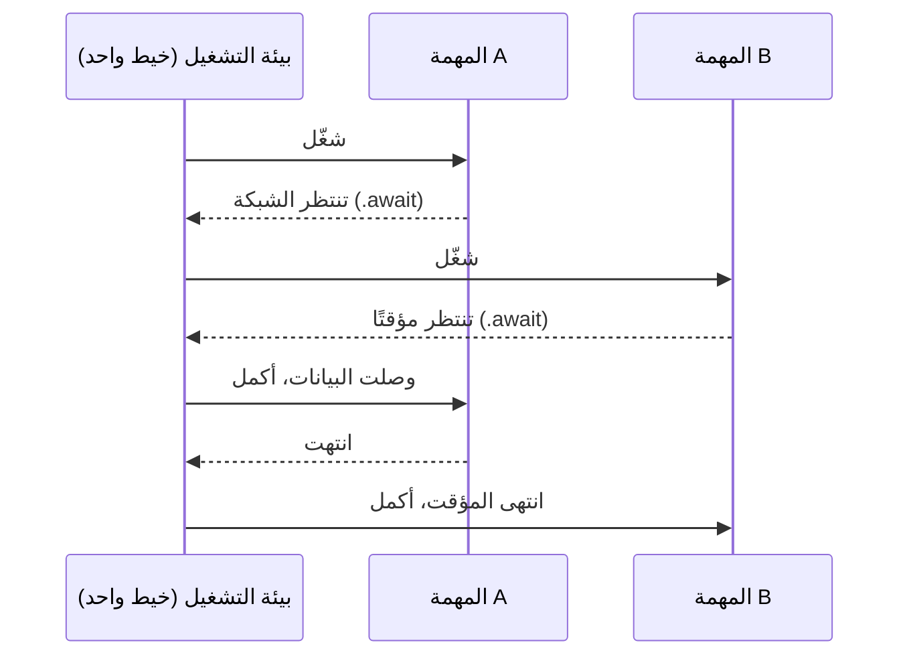

# الـ async programming في Rust مع tokio

الـ threads ممتازة للشغل الذي يستهلك المعالج. لكن خادمًا يتعامل مع 10,000 اتصال شبكي سيهدر الذاكرة بـ 10,000 thread أغلبها ينتظر. والكود **غير المتزامن (async)** يسمح لـ thread واحد بالتنقل بين مهام كثيرة تنتظر.

## الفكرة

function `async fn` لا تعمل عندما تستدعيها. بل ترجع **future**: مهمة تستطيع التقدم، والتوقف أثناء الانتظار (للشبكة، أو مؤقت، أو ملف)، والاستئناف لاحقًا. و**المنفّذ (executor)** أو runtime يشغّل futures كثيرة، وينتقل إلى أيها جاهز.



الـ standard library في Rust تعرّف الـ futures لكن ليس فيها runtime. و**tokio** هي الأكثر استخدامًا.

## التجهيز

في `Cargo.toml`:

```toml
[dependencies]
tokio = { version = "1", features = ["full"] }
```

## أول برنامج غير متزامن

<!-- skip -->
```rust
use std::time::Duration;
use tokio::time::sleep;

async fn brew(drink: &str, secs: u64) -> String {
    sleep(Duration::from_secs(secs)).await;      // pauses this task, not the thread
    format!("{drink} ready after {secs}s")
}

#[tokio::main]
async fn main() {
    // one after another: about 3 seconds
    println!("{}", brew("tea", 1).await);
    println!("{}", brew("coffee", 2).await);

    // at the same time: about 2 seconds
    let (a, b) = tokio::join!(brew("tea", 1), brew("coffee", 2));
    println!("{a} / {b}");
}
```

```text
tea ready after 1s
coffee ready after 2s
tea ready after 1s / coffee ready after 2s
```

- `.await` تنتظر future **بدون حجز الـ thread**: runtime تشغّل مهامًا أخرى في هذه الأثناء.
- `#[tokio::main]` تبدأ runtime وتشغّل `main` غير المتزامنة.
- `tokio::join!` تشغّل عدة futures في نفس الوقت وتنتظرها كلها.

## تشغيل المهام

‏`tokio::spawn` هي النسخة غير المتزامنة من `thread::spawn`، لكن المهام صغيرة جدًا: تستطيع تشغيل مئات الآلاف منها.

<!-- skip -->
```rust
use std::time::Duration;

#[tokio::main]
async fn main() {
    let mut handles = Vec::new();
    for id in 1..=5u64 {
        handles.push(tokio::spawn(async move {
            tokio::time::sleep(Duration::from_millis(100 * (6 - id))).await;
            id * 10
        }));
    }
    let mut total = 0;
    for h in handles {
        total += h.await.unwrap();
    }
    println!("total {total}");
}
```

```text
total 150
```

## خادم صدى TCP صغير

لهذا وُجدت الـ async programming: عملاء بطيئون كثيرون، وبرنامج صغير واحد.

<!-- skip -->
```rust
use tokio::io::{AsyncReadExt, AsyncWriteExt};
use tokio::net::TcpListener;

#[tokio::main]
async fn main() -> std::io::Result<()> {
    let listener = TcpListener::bind("127.0.0.1:8080").await?;
    println!("listening on 8080");
    loop {
        let (mut socket, addr) = listener.accept().await?;
        tokio::spawn(async move {
            let mut buf = [0u8; 1024];
            loop {
                let n = match socket.read(&mut buf).await {
                    Ok(0) | Err(_) => return,          // client closed or error
                    Ok(n) => n,
                };
                if socket.write_all(&buf[..n]).await.is_err() {
                    return;
                }
            }
        });
        println!("client {addr} connected");
    }
}
```

شغّله، ثم في نافذة طرفية أخرى `nc 127.0.0.1 8080` (أو `telnet`)، اكتب شيئًا فيرجع إليك. كل عميل مهمة، لا thread.

## قواعد للـ async code

1. **لا تحجز الـ thread أبدًا** داخل كود async: لا `std::thread::sleep`، ولا loops طويلة تستهلك المعالج، ولا استدعاءات ملفات أو شبكة حاجزة. استخدم نسخ tokio ‏(`tokio::time::sleep` و`tokio::fs` و`tokio::net`)، أو انقل الشغل الثقيل إلى `tokio::task::spawn_blocking`.
2. استخدم `tokio::sync::Mutex` فقط لو كنت تمسك الـ lock عبر `.await`؛ وإلا فإن `std::sync::Mutex` مناسبة وأسرع.
3. الـ async programming ليست أسرع لشغل المعالج. استخدمها **للانتظار**: خوادم الشبكة، وطلبات HTTP كثيرة، وقواعد البيانات. ولحسابات الأرقام استخدم الـ threads (أو الـ crate المسمى `rayon`).

‏crates غير متزامنة مشهورة: ‏`reqwest` (عميل HTTP)، و`axum` (إطار ويب)، و`sqlx` (قواعد بيانات)، وكلها مبنية على tokio.

## الخلاصة

- `async fn` ترجع future؛ و`.await` توقف المهمة لا الـ thread؛ وtokio تشغّل المهام.
- `tokio::join!` تشغّل futures معًا؛ و`tokio::spawn` تبدأ مهامًا مستقلة رخيصة.
- لا تحجز الـ thread في الـ async code؛ واستخدمه للانتظار، والـ threads للحساب.

## فيديوهات اختيارية

الدرس أعلاه كامل وحده. هذه الفيديوهات للتعمق إن كنت تحب التعلم بالمشاهدة. الفيديوهات المكتوب بجانبها (بالإنجليزية) يمكنك تشغيل الترجمة لها (**CC**)، ثم **الإعدادات ← الترجمة ← ترجمة تلقائية ← العربية**.

**Crust of Rust: async/await (Jon Gjengset) (بالإنجليزية)**

https://www.youtube.com/watch?v=ThjvMReOXYM

**Decrusting the tokio crate (Jon Gjengset) (بالإنجليزية)**

https://www.youtube.com/watch?v=o2ob8zkeq2s
