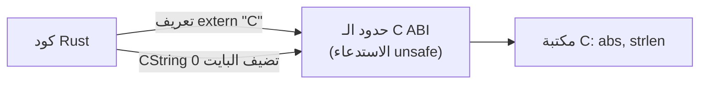

# الماكرو والكود غير الآمن واستدعاء C

## الماكرو التصريحية: macro_rules!

استخدمت الماكرو من اليوم الأول: ‏`println!` و`vec!` و`format!`. والماكرو تكتب كودًا بدلًا منك compile time. واكتب ماكرو خاصة بك بـ `macro_rules!`:

```rust
macro_rules! square {
    ($x:expr) => {
        $x * $x
    };
}

macro_rules! hashmap {
    ($($key:expr => $value:expr),* $(,)?) => {{
        let mut m = std::collections::BTreeMap::new();
        $( m.insert($key, $value); )*
        m
    }};
}

macro_rules! check_all {
    ($($cond:expr),+) => {
        $( if !$cond { println!("failed: {}", stringify!($cond)); } )+
    };
}

fn main() {
    println!("{}", square!(7));
    let prices = hashmap! { "tea" => 15, "coffee" => 30, };
    println!("{:?}", prices);
    let x = 5;
    check_all!(x > 0, x < 3, x % 5 == 0);
}
```

```output
49
{"coffee": 30, "tea": 15}
failed: x < 3
```

كيف تقرأ قاعدة ماكرو:

- `$x:expr` تلتقط تعبيرًا وتسميه `$x`. وأنواع أخرى: ‏`ident` (اسم)، و`ty` (نوع)، و`tt` (أي رمز)، و`literal`، و`block`.
- `$( ... ),*` تتكرر صفرًا أو أكثر، مفصولة بفواصل؛ و`+` معناها مرة أو أكثر. و`$(,)?` تسمح بفاصلة في الآخر.
- `stringify!` تحوّل الكود إلى نص: ممتازة للرسائل.

استخدم الماكرو عندما لا تستطيع الـ functions أداء المهمة: عدد variable من المعاملات، أو توليد كود متكرر، أو الحاجة إلى نص المصدر. وفي غير ذلك فضّل الـ functions: أسهل في القراءة وأخطاؤها أوضح.

و**الـ procedural macros** (مثل `#[derive(Debug)]` أو `#[tokio::main]`) نوع أقوى، تُكتب كـ crates منفصلة. وستستخدمها أكثر بكثير مما تكتبها.

## ‏Rust غير الآمنة (unsafe)

الـ compiler لا يستطيع التحقق من كل شيء. و`unsafe` تفتح خمس قدرات إضافية، أهمها:

- فك الإشارة عن الـ pointers الخام (`*const T` و`*mut T`)
- استدعاء functions `unsafe`، ومنها functions C

‏`unsafe` لا تطفئ borrow checker؛ بل تسمح فقط بهذه العمليات، و**أنت** تتعهد بأنها صحيحة.

```rust
fn main() {
    let mut nums = [10, 20, 30];
    let p = nums.as_mut_ptr();          // a raw pointer: creating it is safe
    unsafe {
        *p.add(1) += 5;                 // dereferencing it is not checked by the compiler
    }
    println!("{:?}", nums);

    // The safe way to get two mutable parts of one slice: split_at_mut
    let (left, right) = nums.split_at_mut(1);
    left[0] += right[0];
    println!("{:?}", nums);
}
```

```output
[10, 25, 30]
[35, 25, 30]
```

‏`split_at_mut` نفسها مكتوبة بـ `unsafe` من الداخل، ومغلّفة في **واجهة آمنة** تتحقق من الفهرس أولًا. وهذا هو النمط: اجعل كتل `unsafe` صغيرة جدًا، وتحقق من كل ما حولها، وقدّم function آمنة، واكتب تعليق `// SAFETY:` يشرح لماذا هي صحيحة.

## استدعاء C: ‏FFI

تستطيع Rust استدعاء functions C مباشرة (وأن تُستدعى من C). وهذا استدعاء لمكتبة C القياسية:

<!-- diagram -->


```rust
use std::ffi::{CStr, CString};
use std::os::raw::{c_char, c_int};

extern "C" {
    fn abs(x: c_int) -> c_int;
    fn strlen(s: *const c_char) -> usize;
    fn getenv(name: *const c_char) -> *const c_char;
}

fn main() {
    let text = CString::new("hello from C").unwrap();   // adds the 0 byte C expects
    let name = CString::new("NO_SUCH_VARIABLE_HERE").unwrap();
    // SAFETY: the pointers come from valid CStrings that live until the end of main.
    unsafe {
        println!("{}", abs(-42));
        println!("{}", strlen(text.as_ptr()));
        let v = getenv(name.as_ptr());
        if v.is_null() {
            println!("not set");
        } else {
            println!("{}", CStr::from_ptr(v).to_string_lossy());
        }
    }
}
```

```output
42
12
not set
```

- `extern "C"` تعلن عن functions تتبع اتفاقية استدعاء C، وهي نفس الاتفاقية التي قابلتها في كورس Assembly.
- `CString` تصنع نصًا منتهيًا بـ 0 لـ C؛ و`CStr` تقرأ نصًا راجعًا منها.
- المشاريع الحقيقية تستخدم `bindgen` لتوليد هذه الإعلانات من ملفات رأس C تلقائيًا، والـ crate المسمى `cc` لترجمة ملفات C كجزء من `cargo build`.

## الخلاصة

- `macro_rules!` تطابق أنماطًا مثل `$x:expr` و`$(...),*` لتوليد الكود؛ وفضّل الـ functions عندما تكفي.
- `unsafe` تسمح بالـ pointers الخام واستدعاءات FFI؛ اجعلها صغيرة وموثّقة وخلف واجهة آمنة.
- `extern "C"` و`CString` و`CStr` تسمح لـ Rust باستدعاء C وتمرير النصوص بأمان.

## فيديوهات اختيارية

الدرس أعلاه كامل وحده. هذه الفيديوهات للتعمق إن كنت تحب التعلم بالمشاهدة. الفيديوهات المكتوب بجانبها (بالإنجليزية) يمكنك تشغيل الترجمة لها (**CC**)، ثم **الإعدادات ← الترجمة ← ترجمة تلقائية ← العربية**.

**Crust of Rust: Declarative macros (Jon Gjengset) (بالإنجليزية)**

https://www.youtube.com/watch?v=q6paRBbLgNw
