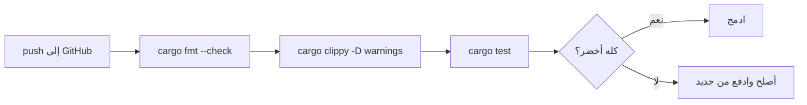

# الاختبار والتوثيق وصندوق أدوات Cargo

## ثلاثة أنواع من الاختبارات

```text
my_crate/
  src/lib.rs        unit tests live next to the code, in #[cfg(test)] mod tests
  tests/api.rs      integration tests: use the crate like an outside user would
  examples/demo.rs  runnable examples: cargo run --example demo
```

unit tests تستطيع اختبار الـ functions الخاصة؛ وintegration tests ترى فقط الواجهة `pub`، فتتحقق من أن مكتبتك مريحة الاستخدام من الخارج.

```rust
/// Splits a bill between people, giving the leftover piasters to the first people.
///
/// ```
/// let parts = bills::split(1000, 3);
/// assert_eq!(parts, vec![334, 333, 333]);
/// ```
pub fn split(total: u64, people: u64) -> Vec<u64> {
    assert!(people > 0, "need at least one person");
    let base = total / people;
    let extra = total % people;
    (0..people).map(|i| base + u64::from(i < extra)).collect()
}

#[cfg(test)]
mod tests {
    use super::*;

    #[test]
    fn splits_evenly() {
        assert_eq!(split(900, 3), vec![300, 300, 300]);
    }

    #[test]
    fn total_is_kept() {
        for people in 1..20 {
            assert_eq!(split(12_345, people).iter().sum::<u64>(), 12_345);
        }
    }

    #[test]
    #[should_panic(expected = "at least one")]
    fn zero_people_panics() {
        split(100, 0);
    }
}
```

- `#[should_panic]` ينجح فقط لو أصاب الكود panic (بهذه الرسالة).
- `total_is_kept` تتحقق من **خاصية** لمدخلات كثيرة، لا مثال واحد. والـ crate المسمى `proptest` يذهب أبعد بتوليد مدخلات عشوائية وتصغير حالات الفشل إلى أصغر حالة.
- الكود داخل تعليقات `///` **اختبار توثيق (doc test)**: يشغّله `cargo test` أيضًا، فلا تصبح الأمثلة في توثيقك قديمة أبدًا.

## التوثيق

تعليقات `///` مكتوبة بـ Markdown. و`cargo doc --open` يبني موقعًا لـ crate الخاص بك وكل اعتمادياته، بنفس أسلوب docs.rs حيث يُستضاف توثيق كل crate عام تلقائيًا. اكتب توثيقًا لكل عنصر `pub`: ماذا يفعل، ومثال، ومتى يُصاب بـ panic أو يرجع خطأ.

## صندوق أدوات Cargo

| الأمر | لماذا |
|---|---|
| `cargo fmt` | التنسيق القياسي؛ شغّله قبل كل commit |
| `cargo clippy` | مئات الفحوص: أخطاء، وكود بطيء، وكود غير مألوف في Rust |
| `cargo test` | unit tests والتكامل والتوثيق |
| `cargo doc --open` | توثيقك |
| `cargo bench` | قياسات الأداء (مع الـ crate المسمى `criterion`) |
| `cargo tree` | أي اعتماديات تسحبها |
| `cargo audit` | مشاكل أمنية معروفة في الاعتماديات (ثبّته بـ `cargo install cargo-audit`) |
| `cargo build --release` | البناء المحسّن الذي تسلّمه |

‏Clippy مفيد جدًا للتعلم: يشرح **لماذا** قد يكون شيء ما أفضل ويضع روابط للتفاصيل.

## workspaces: عدة crates في مستودع واحد

المشاريع الأكبر تُقسم إلى crates في **workspace** واحدة، تتشارك ملف `Cargo.lock` واحدًا ومجلد `target/` واحدًا:

```toml
# Cargo.toml at the top
[workspace]
members = ["core", "cli", "server"]
resolver = "2"
```

‏`core` فيه المنطق، و`cli` و`server` برامج رفيعة تستخدمه. وهي نفس فكرة تنظيم مكتبة مع برنامج في C++.

## الـ features: أجزاء اختيارية

```toml
[features]
default = []
json = ["dep:serde_json"]

[dependencies]
serde_json = { version = "1", optional = true }
```

الكود المعلّم بـ `#[cfg(feature = "json")]` لا يُترجم إلا عندما يطلبه أحد: `cargo build --features json`. والمكتبات تستخدم الـ features لكي لا يدفع المستخدمون ثمن أجزاء لا يحتاجونها.

## التكامل المستمر (CI)

مهمة GitHub Actions بسيطة لمشروع Rust:

```yaml
name: ci
on: [push, pull_request]
jobs:
  test:
    runs-on: ubuntu-latest
    steps:
      - uses: actions/checkout@v4
      - uses: dtolnay/rust-toolchain@stable
        with:
          components: clippy, rustfmt
      - run: cargo fmt --check
      - run: cargo clippy -- -D warnings
      - run: cargo test
```



## الخلاصة

- unit tests بجوار الكود، وintegration tests في `tests/`، وdoc tests داخل تعليقات `///`.
- ‏fmt وclippy وtest وdoc وaudit: شغّلها كلها، ويُفضّل في CI مع كل push.
- workspaces تقسم المشاريع الكبيرة إلى crates؛ والـ features تجعل الأجزاء اختيارية.

## فيديوهات اختيارية

الدرس أعلاه كامل وحده. هذه الفيديوهات للتعمق إن كنت تحب التعلم بالمشاهدة. الفيديوهات المكتوب بجانبها (بالإنجليزية) يمكنك تشغيل الترجمة لها (**CC**)، ثم **الإعدادات ← الترجمة ← ترجمة تلقائية ← العربية**.

**Testing in Rust (Let's Get Rusty) (بالإنجليزية)**

https://www.youtube.com/watch?v=18-7NoNPO30
