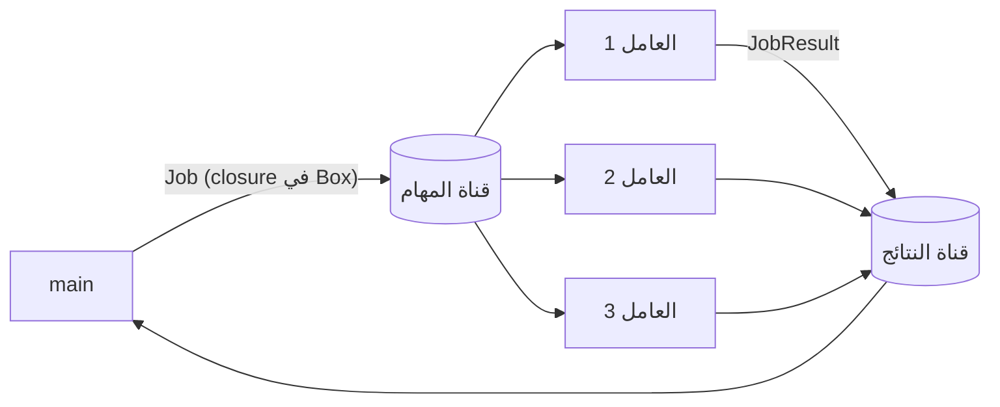

# مشروع: منفّذ مهام متعدد الـ threads

لننهِ بقطعة صغيرة لكنها حقيقية من برمجيات الأنظمة: **thread pool** يشغّل المهام بالتوازي، ويجمع نتائجها عبر channel، ويتعامل مع المهام الفاشلة بدون أن يتوقف، ويعرض إحصائيات. ومجمّعات threads مثل هذا موجودة داخل خوادم الويب وأدوات البناء وقواعد البيانات.

## التصميم



- المهام closures، داخل Box بالنوع `Box<dyn FnOnce() -> Result<u64, String> + Send>`.
- العمال يتشاركون مستقبِلًا **واحدًا** للمهام، محميًا بـ `Arc<Mutex<..>>`.
- النتائج ترجع عبر channel ثانية، فلا شيء آخر مشترك.
- إسقاط المجمّع يغلق channel المهام؛ فيلاحظ العمال وينتهون؛ و`Drop` تنتظرهم.

## الكود

```rust
use std::sync::mpsc::{self, Receiver, Sender};
use std::sync::{Arc, Mutex};
use std::thread::{self, JoinHandle};

type Job = Box<dyn FnOnce() -> Result<u64, String> + Send + 'static>;

#[derive(Debug)]
struct JobResult {
    id: usize,
    worker: usize,
    outcome: Result<u64, String>,
}

struct Pool {
    jobs: Option<Sender<(usize, Job)>>,
    workers: Vec<JoinHandle<()>>,
}

impl Pool {
    fn new(size: usize, results: Sender<JobResult>) -> Pool {
        let (tx, rx) = mpsc::channel::<(usize, Job)>();
        let rx: Arc<Mutex<Receiver<(usize, Job)>>> = Arc::new(Mutex::new(rx));
        let workers = (0..size)
            .map(|w| {
                let rx = Arc::clone(&rx);
                let results = results.clone();
                thread::spawn(move || loop {
                    let next = rx.lock().unwrap().recv();     // the lock is released right after recv
                    let Ok((id, job)) = next else { break };  // channel closed: no more jobs
                    let outcome = job();
                    results.send(JobResult { id, worker: w, outcome }).unwrap();
                })
            })
            .collect();
        Pool { jobs: Some(tx), workers }
    }

    fn submit<F>(&self, id: usize, f: F)
    where
        F: FnOnce() -> Result<u64, String> + Send + 'static,
    {
        self.jobs.as_ref().unwrap().send((id, Box::new(f))).unwrap();
    }
}

impl Drop for Pool {
    fn drop(&mut self) {
        drop(self.jobs.take());                // close the job channel
        for w in self.workers.drain(..) {
            w.join().unwrap();                 // wait for every worker to finish
        }
    }
}

fn count_primes(limit: u64) -> u64 {
    (2..=limit).filter(|&n| (2..).take_while(|d| d * d <= n).all(|d| n % d != 0)).count() as u64
}

fn main() {
    let (result_tx, result_rx) = mpsc::channel();
    {
        let pool = Pool::new(3, result_tx);
        for (id, limit) in [10_000u64, 50_000, 0, 20_000, 5].into_iter().enumerate() {
            pool.submit(id, move || {
                if limit == 0 {
                    Err("limit can't be zero".to_string())
                } else {
                    Ok(count_primes(limit))
                }
            });
        }
    }   // the pool is dropped here: all jobs finish, all workers are joined

    let mut results: Vec<JobResult> = result_rx.iter().collect();
    results.sort_by_key(|r| r.id);
    let mut ok = 0;
    for r in &results {
        match &r.outcome {
            Ok(n) => {
                ok += 1;
                println!("job {}: {} primes", r.id, n);
            }
            Err(e) => println!("job {}: failed ({e})", r.id),
        }
    }
    let mut used: Vec<usize> = results.iter().map(|r| r.worker).collect();
    used.sort();
    used.dedup();
    println!("{ok} of {} jobs succeeded", results.len());
    eprintln!("workers used: {:?}", used);     // varies from run to run, so it goes to stderr
}
```

```output
job 0: 1229 primes
job 1: 5133 primes
job 2: failed (limit can't be zero)
job 3: 2262 primes
job 4: 3 primes
4 of 5 jobs succeeded
```

قائمة العمال المستخدمين تذهب إلى تيار الأخطاء لأنها تتغير من تشغيل لآخر: أي عامل يلتقط أي مهمة يعتمد على التوقيت. وعادة يحصل الثلاثة على شغل.

## أشياء لاحظها

- `Box<dyn FnOnce() -> ... + Send + 'static>`: أي closure يمكن تشغيلها مرة واحدة، و**إرسالها** إلى thread آخر، ولا تستعير بيانات قصيرة العمر. والـ compiler يتحقق من الثلاثة.
- `rx.lock().unwrap().recv()` تمسك الـ lock فقط أثناء انتظار المهمة التالية. وتشغيل المهمة يحدث بعد إسقاط الحارس، فيعمل العمال فعلًا بالتوازي.
- `let Ok(..) = next else { break }` تنهي العامل بنظافة عندما تُغلق الـ channel.
- `Drop` تعطي إيقافًا نظيفًا مجانًا: الخروج من الكتلة ينتظر كل الشغل. ‏RAII مرة أخرى.
- المهمة الفاشلة ترجع `Err` والمجمّع يستمر. أما المهمة التي تُصاب بـ panic فستقتل عاملها فقط؛ وجعل المجمّع يصمد أمام ذلك أحد التمارين.

## دورك

1. أضف اختبارات لـ `count_primes` ‏(0 و1 و2 و10 و100) ولمجمّع لا يأخذ أي مهام إطلاقًا.
2. اجعل المجمّع يصمد أمام المهام التي تُصاب بـ panic باستخدام `std::panic::catch_unwind` وأبلغ عنها كأخطاء.
3. أضف التوقيت: كل `JobResult` يسجّل المدة التي أخذتها المهمة (`std::time::Instant`)؛ واطبع أبطأ مهمة.
4. قارن بالـ crate المسمى `rayon`: ‏`limits.par_iter().map(|&l| count_primes(l)).collect()`. كم سطرًا أخذ المجمّع، وكيف تقارن السرعات؟
5. أعد كتابة المنفّذ بمهام tokio و`spawn_blocking`، واشرح متى تختار كل تصميم.

## إلى أين بعد ذلك

غطيت Rust التي يستخدمها أغلب المحترفين يوميًا. خطوات جيدة تالية: *Rust for Rustaceans* لـ Jon Gjengset، و*Rustonomicon* (للكود غير الآمن)، و*Rust Atomics and Locks* لـ Mara Bos (مجاني على الإنترنت)، والمساهمة في crate مفتوح المصدر. وابنِ شيئًا ستستخدمه: أداة سطر أوامر، أو خدمة ويب صغيرة بـ axum، أو لعبة بـ Bevy.

## الخلاصة

- thread pool = channel مهام مشتركة خلف `Arc<Mutex<..>>` + channel نتائج + `Drop` للإيقاف.
- قيود `Send + 'static` تسمح للـ compiler بالتحقق من أن المهام آمنة للنقل بين الـ threads.
- أرجع الأخطاء كقيم، واجمع النتائج في مكان واحد، واختبر الأرقام التي تعرضها.

## فيديوهات اختيارية

الدرس أعلاه كامل وحده. هذه الفيديوهات للتعمق إن كنت تحب التعلم بالمشاهدة. الفيديوهات المكتوب بجانبها (بالإنجليزية) يمكنك تشغيل الترجمة لها (**CC**)، ثم **الإعدادات ← الترجمة ← ترجمة تلقائية ← العربية**.

**Crust of Rust: Channels (Jon Gjengset) (بالإنجليزية)**

https://www.youtube.com/watch?v=b4mS5UPHh20
