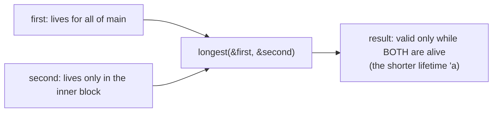

# Lifetimes

This course continues from *Rust for beginners*. You should be comfortable with ownership, borrowing, structs, enums, `Result` and traits.

A **lifetime** is the stretch of code during which a reference is valid. The borrow checker has been tracking lifetimes all along; most of the time it works them out silently. This lesson covers the cases where you have to write them down.

## The problem lifetimes solve

<!-- diagram -->


```rust
fn longest(a: &str, b: &str) -> &str {      // error: missing lifetime specifier
    if a.len() >= b.len() { a } else { b }
}
```

The returned reference points into either `a` or `b`. The compiler needs to know how long the result stays valid, so it can check every caller. You tell it with a lifetime parameter:

```rust
fn longest<'a>(a: &'a str, b: &'a str) -> &'a str {
    if a.len() >= b.len() { a } else { b }
}

fn main() {
    let first = String::from("pyramids");
    let result;
    {
        let second = String::from("nile");
        result = longest(&first, &second);
        println!("{result}");
    }
    // println!("{result}");   // error: `second` does not live long enough
}
```

```output
pyramids
```

`'a` (read "tick a") is a name for "some region of code". The signature says: **the result lives at most as long as the shorter of a and b**. Using `result` after `second` is gone would be unsafe, even though this time it happens to point at `first`, so the compiler refuses.

Lifetimes never change how long anything lives. They only **describe** relationships so the compiler can check them.

## Elision: when you don't write them

You've written many functions returning references without lifetimes. The compiler fills them in using three rules ("elision"):

1. Each reference parameter gets its own lifetime.
2. If there's exactly one reference parameter, the output gets its lifetime.
3. If one parameter is `&self` or `&mut self`, the output gets self's lifetime.

So `fn first_word(s: &str) -> &str` is really `fn first_word<'a>(s: &'a str) -> &'a str`. You only write lifetimes when these rules can't decide, as with `longest`.

## Structs that hold references

A struct holding a reference needs a lifetime, so it can't outlive the data:

```rust
struct Highlight<'a> {
    text: &'a str,
    start: usize,
}

impl<'a> Highlight<'a> {
    fn word(&self) -> &'a str {
        let rest = &self.text[self.start..];
        rest.split_whitespace().next().unwrap_or("")
    }
}

fn main() {
    let article = String::from("Rust makes systems programming safer");
    let h = Highlight { text: &article, start: 11 };
    println!("highlighted: {}", h.word());
}
```

```output
highlighted: systems
```

`Highlight<'a>` reads: "a Highlight can't outlive the text it points into". Parsers and tokenizers often look like this: they hold slices of the input instead of copying it, which makes them very fast.

## 'static

`'static` means "valid for the whole program". String literals are `&'static str`: they're baked into the program file.

```rust
fn level_name(n: u8) -> &'static str {
    match n {
        0 => "beginner",
        1 => "intermediate",
        _ => "advanced",
    }
}

fn main() {
    println!("{}", level_name(1));
}
```

```output
intermediate
```

When the compiler suggests adding `'static` to fix an error, think twice. It's usually right for literals and for data moved into threads, and usually wrong as a quick fix for a borrow problem. Often the real fix is to return an owned `String` instead of a reference.

## When fighting lifetimes, own the data

If a struct with lifetimes becomes painful (you want to store it, return it, send it to a thread), make it own its data: `String` instead of `&str`, `Vec<T>` instead of `&[T]`. Cloning a little data is cheap; lifetimes are worth it mostly in hot paths like parsers.

## Summary

- Lifetimes name how long references are valid; they describe, they don't change anything.
- Elision rules fill them in for most functions; write `<'a>` when a result could borrow from several inputs.
- Structs holding references need lifetime parameters; owning the data is often simpler.

## Optional videos

The lesson above is complete on its own. These videos go deeper, if you like learning by watching.

**Crust of Rust: Lifetime annotations (Jon Gjengset)**

https://www.youtube.com/watch?v=rAl-9HwD858
