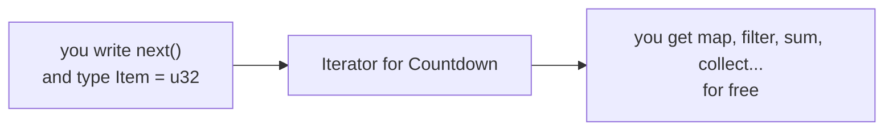

# Traits in depth

## Associated types

Some traits have a type "slot" the implementer fills in. `Iterator` is the famous one:

<!-- diagram -->


```rust
trait Iterator {
    type Item;                                // filled in by each implementation
    fn next(&mut self) -> Option<Self::Item>;
    // ...and over 70 provided methods: map, filter, sum, collect...
}
```

Implement `next` and you get all the other methods for free:

```rust
struct Countdown {
    n: u32,
}

impl Iterator for Countdown {
    type Item = u32;
    fn next(&mut self) -> Option<u32> {
        if self.n == 0 {
            None
        } else {
            self.n -= 1;
            Some(self.n + 1)
        }
    }
}

fn main() {
    let launch: Vec<u32> = Countdown { n: 5 }.collect();
    println!("{:?}", launch);
    let even_sum: u32 = Countdown { n: 10 }.filter(|x| x % 2 == 0).sum();
    println!("{even_sum}");
}
```

```output
[5, 4, 3, 2, 1]
30
```

Associated types vs generic parameters: a type can implement `Iterator` only **once** (it has one Item type), while it could implement `From<T>` for many different T.

## Operator overloading with std::ops

`+`, `-`, `*`, `==`, `[]` and others are traits too:

```rust
use std::ops::{Add, Mul};

#[derive(Debug, Clone, Copy, PartialEq)]
struct Vec2 {
    x: f64,
    y: f64,
}

impl Add for Vec2 {
    type Output = Vec2;
    fn add(self, o: Vec2) -> Vec2 {
        Vec2 { x: self.x + o.x, y: self.y + o.y }
    }
}

impl Mul<f64> for Vec2 {
    type Output = Vec2;
    fn mul(self, k: f64) -> Vec2 {
        Vec2 { x: self.x * k, y: self.y * k }
    }
}

fn main() {
    let pos = Vec2 { x: 1.0, y: 2.0 };
    let vel = Vec2 { x: 0.5, y: -1.0 };
    let next = pos + vel * 2.0;
    println!("{:?}", next);
}
```

```output
Vec2 { x: 2.0, y: 0.0 }
```

## Conversions: From and Into

Implement `From` and you get `Into` for free. They're the standard way to convert between types:

```rust
struct Celsius(f64);
struct Fahrenheit(f64);

impl From<Celsius> for Fahrenheit {
    fn from(c: Celsius) -> Self {
        Fahrenheit(c.0 * 9.0 / 5.0 + 32.0)
    }
}

fn main() {
    let f = Fahrenheit::from(Celsius(37.0));
    let g: Fahrenheit = Celsius(100.0).into();
    println!("{:.1} {:.1}", f.0, g.0);
}
```

```output
98.6 212.0
```

You'll see `From` again with errors: the `?` operator uses it to convert one error type into another automatically.

## Generic structs and blanket implementations

```rust
use std::fmt::Display;

struct Labeled<T> {
    label: String,
    value: T,
}

impl<T: Display> Labeled<T> {
    fn show(&self) -> String {
        format!("{}: {}", self.label, self.value)
    }
}

trait Shout {
    fn shout(&self) -> String;
}

impl<T: Display> Shout for T {            // every printable type gets shout()
    fn shout(&self) -> String {
        self.to_string().to_uppercase() + "!"
    }
}

fn main() {
    let a = Labeled { label: "temp".to_string(), value: 31.5 };
    let b = Labeled { label: "city".to_string(), value: "Aswan" };
    println!("{} / {}", a.show(), b.show());
    println!("{} {}", "hello".shout(), 42.shout());
}
```

```output
temp: 31.5 / city: Aswan
HELLO! 42!
```

`impl<T: Display> Shout for T` is a **blanket implementation**: one impl for every type meeting the bound. The standard library does this a lot, for example every `Display` type gets `.to_string()` this way.

## Static vs dynamic dispatch

| | `fn f(x: impl Trait)` or `<T: Trait>` | `fn f(x: &dyn Trait)` |
|---|---|---|
| Decided | at compile time | at run time |
| Code | one copy per type (fast, larger program) | one copy (a small cost per call) |
| Mixed types in one Vec | no | yes, `Vec<Box<dyn Trait>>` |

Default to generics; use `dyn` when you need mixed collections or want smaller compiled code.

## Summary

- Associated types (`type Item`) are filled in by each implementation; implement `next` to get the whole iterator toolbox.
- Operators are traits in `std::ops`; `From` gives you `Into` and powers `?` conversions.
- Blanket impls give a trait to every type meeting a bound; choose generics or `dyn` by need.

## Optional videos

The lesson above is complete on its own. These videos go deeper, if you like learning by watching.

**Traits in Rust (Let's Get Rusty)**

https://www.youtube.com/watch?v=T0Xfltu4h3A

**Generic types in Rust (Let's Get Rusty)**

https://www.youtube.com/watch?v=6rcTSxPJ6Bw
