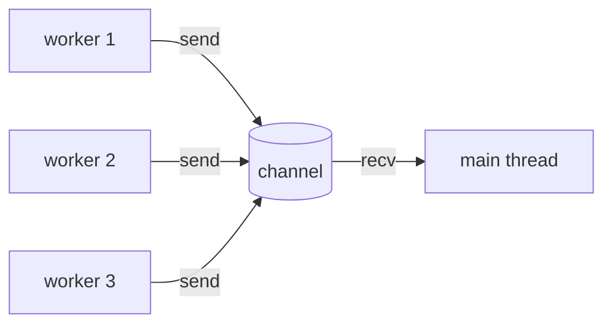

# Threads, channels and shared state

Rust's slogan here is **fearless concurrency**: the same ownership and borrowing rules that prevent memory bugs also prevent data races. If your threaded program compiles, it has no data races.

## Spawning threads

```rust
use std::thread;

fn main() {
    let handles: Vec<_> = (1..=3)
        .map(|id| {
            thread::spawn(move || {
                let sum: u64 = (1..=id * 1000).sum();
                (id, sum)
            })
        })
        .collect();

    for h in handles {
        let (id, sum) = h.join().unwrap();      // wait and take the thread's result
        println!("thread {id}: {sum}");
    }
}
```

```output
thread 1: 500500
thread 2: 2001000
thread 3: 4501500
```

- `thread::spawn` runs a closure on a new thread and returns a handle.
- `move` is required: the thread may outlive the current function, so it must own what it uses.
- `join()` waits for the thread and returns its result (an `Err` if it panicked).

## Scoped threads: borrow instead of move

When threads only need to **borrow** local data, `thread::scope` guarantees they finish before the scope ends, so borrowing is safe:

```rust
use std::thread;

fn main() {
    let data: Vec<u32> = (1..=100).collect();
    let (left, right) = data.split_at(50);

    let (a, b) = thread::scope(|s| {
        let h1 = s.spawn(|| left.iter().sum::<u32>());
        let h2 = s.spawn(|| right.iter().sum::<u32>());
        (h1.join().unwrap(), h2.join().unwrap())
    });
    println!("{a} + {b} = {}", a + b);
}
```

```output
1275 + 3775 = 5050
```

No `move`, no `Arc`, no copying: the compiler knows the threads end before `data` does.

## Channels: send messages between threads

A channel is a queue: producers send, a consumer receives. Ownership of each message moves through the channel, so nothing is shared at all.



```rust
use std::sync::mpsc;
use std::thread;

fn main() {
    let (tx, rx) = mpsc::channel();
    for id in 1..=3 {
        let tx = tx.clone();                    // each worker gets its own sender
        thread::spawn(move || {
            let result = id * id;
            tx.send((id, result)).unwrap();
        });
    }
    drop(tx);                                    // close our copy so the loop below can end

    let mut results: Vec<(i32, i32)> = rx.iter().collect();   // ends when all senders are gone
    results.sort();
    println!("{:?}", results);
}
```

```output
[(1, 1), (2, 4), (3, 9)]
```

`mpsc` means "multiple producer, single consumer". The receiving loop ends when every sender has been dropped. Results arrive in whatever order the threads finish, so sort if order matters.

## Shared state: Arc<Mutex<T>>

When threads really must change the same data, combine:

- `Arc<T>`: like `Rc`, but its counter is safe across threads ("atomic reference counted")
- `Mutex<T>`: one thread at a time may access the data inside

```rust
use std::collections::HashMap;
use std::sync::{Arc, Mutex};
use std::thread;

fn main() {
    let counts = Arc::new(Mutex::new(HashMap::new()));
    let texts = ["red green red", "green blue", "red blue blue"];

    let handles: Vec<_> = texts
        .iter()
        .map(|&text| {
            let counts = Arc::clone(&counts);
            thread::spawn(move || {
                for w in text.split_whitespace() {
                    let mut map = counts.lock().unwrap();   // locked until `map` is dropped
                    *map.entry(w.to_string()).or_insert(0) += 1;
                }
            })
        })
        .collect();
    for h in handles {
        h.join().unwrap();
    }

    let map = counts.lock().unwrap();
    let mut pairs: Vec<_> = map.iter().collect();
    pairs.sort();
    println!("{:?}", pairs);
}
```

```output
[("blue", 3), ("green", 2), ("red", 3)]
```

Notice there's no way to reach the HashMap **without** locking: the data lives inside the Mutex. In C++ you can forget to lock; in Rust you can't. The lock is released automatically when the guard goes out of scope.

For a single counter or flag, `std::sync::atomic::AtomicUsize` (and friends) is lighter than a mutex. For data read often and written rarely, `RwLock` allows many readers at once.

## Send and Sync: how the compiler knows

Two marker traits make this safe:

- `Send`: a value can be **moved** to another thread.
- `Sync`: a value can be **shared by reference** between threads.

The compiler works them out automatically. `Rc` is neither (its counter isn't thread-safe), so this doesn't compile:

```rust
let data = std::rc::Rc::new(5);
std::thread::spawn(move || println!("{data}"));
// error: `Rc<i32>` cannot be sent between threads safely
```

Swap `Rc` for `Arc` and it works. You rarely write these traits yourself; you just read the error and pick the thread-safe type.

## Summary

- `thread::spawn(move || ...)` and `join()`; `thread::scope` lets threads borrow local data.
- Channels move messages between threads: no sharing, no locks.
- `Arc<Mutex<T>>` for shared changeable data; `Send` and `Sync` let the compiler rule out data races.

## Optional videos

The lesson above is complete on its own. These videos go deeper, if you like learning by watching.

**Concurrency in Rust: creating threads (Let's Get Rusty)**

https://www.youtube.com/watch?v=06WcsNPUNC8

**Crust of Rust: Channels (Jon Gjengset)**

https://www.youtube.com/watch?v=b4mS5UPHh20

**Crust of Rust: Send, Sync, and their implementors (Jon Gjengset)**

https://www.youtube.com/watch?v=yOezcP-XaIw
