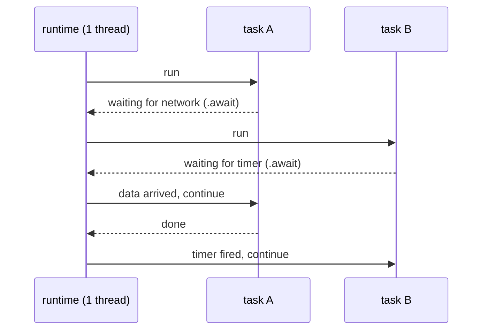

# Async Rust with tokio

Threads are great for CPU-heavy work. But a server handling 10,000 network connections would waste memory with 10,000 threads that mostly sit waiting. **Async** code lets one thread juggle many waiting tasks.

## The idea

An `async fn` doesn't run when you call it. It returns a **future**: a task that can make progress, pause while waiting (for the network, a timer, a file), and resume later. An **executor** (a runtime) runs many futures, switching to whichever is ready.



Rust's standard library defines futures but has no runtime. **tokio** is the most widely used one.

## Setting up

In `Cargo.toml`:

```toml
[dependencies]
tokio = { version = "1", features = ["full"] }
```

## Your first async program

<!-- skip -->
```rust
use std::time::Duration;
use tokio::time::sleep;

async fn brew(drink: &str, secs: u64) -> String {
    sleep(Duration::from_secs(secs)).await;      // pauses this task, not the thread
    format!("{drink} ready after {secs}s")
}

#[tokio::main]
async fn main() {
    // one after another: about 3 seconds
    println!("{}", brew("tea", 1).await);
    println!("{}", brew("coffee", 2).await);

    // at the same time: about 2 seconds
    let (a, b) = tokio::join!(brew("tea", 1), brew("coffee", 2));
    println!("{a} / {b}");
}
```

```text
tea ready after 1s
coffee ready after 2s
tea ready after 1s / coffee ready after 2s
```

- `.await` waits for a future **without blocking the thread**: the runtime runs other tasks meanwhile.
- `#[tokio::main]` starts the runtime and runs your async `main`.
- `tokio::join!` runs several futures at the same time and waits for all of them.

## Spawning tasks

`tokio::spawn` is the async version of `thread::spawn`, but tasks are tiny: you can have hundreds of thousands.

<!-- skip -->
```rust
use std::time::Duration;

#[tokio::main]
async fn main() {
    let mut handles = Vec::new();
    for id in 1..=5u64 {
        handles.push(tokio::spawn(async move {
            tokio::time::sleep(Duration::from_millis(100 * (6 - id))).await;
            id * 10
        }));
    }
    let mut total = 0;
    for h in handles {
        total += h.await.unwrap();
    }
    println!("total {total}");
}
```

```text
total 150
```

## A tiny TCP echo server

This is what async is for: many slow clients, one small program.

<!-- skip -->
```rust
use tokio::io::{AsyncReadExt, AsyncWriteExt};
use tokio::net::TcpListener;

#[tokio::main]
async fn main() -> std::io::Result<()> {
    let listener = TcpListener::bind("127.0.0.1:8080").await?;
    println!("listening on 8080");
    loop {
        let (mut socket, addr) = listener.accept().await?;
        tokio::spawn(async move {
            let mut buf = [0u8; 1024];
            loop {
                let n = match socket.read(&mut buf).await {
                    Ok(0) | Err(_) => return,          // client closed or error
                    Ok(n) => n,
                };
                if socket.write_all(&buf[..n]).await.is_err() {
                    return;
                }
            }
        });
        println!("client {addr} connected");
    }
}
```

Run it, then in another terminal `nc 127.0.0.1 8080` (or `telnet`), type something and it comes back. Each client is a task, not a thread.

## Rules for async code

1. **Never block** inside async code: no `std::thread::sleep`, no long CPU loops, no blocking file or network calls. Use tokio's versions (`tokio::time::sleep`, `tokio::fs`, `tokio::net`), or move heavy work to `tokio::task::spawn_blocking`.
2. Use `tokio::sync::Mutex` only if you hold the lock across an `.await`; otherwise `std::sync::Mutex` is fine and faster.
3. Async isn't faster for CPU work. Use it for **waiting**: network servers, many HTTP requests, databases. For number crunching, use threads (or the `rayon` crate).

Popular async crates: `reqwest` (HTTP client), `axum` (web framework), `sqlx` (databases), all built on tokio.

## Summary

- `async fn` returns a future; `.await` pauses the task, not the thread; tokio runs the tasks.
- `tokio::join!` runs futures together; `tokio::spawn` starts cheap independent tasks.
- Don't block in async code; use async for waiting, threads for computing.

## Optional videos

The lesson above is complete on its own. These videos go deeper, if you like learning by watching.

**Crust of Rust: async/await (Jon Gjengset)**

https://www.youtube.com/watch?v=ThjvMReOXYM

**Decrusting the tokio crate (Jon Gjengset)**

https://www.youtube.com/watch?v=o2ob8zkeq2s
