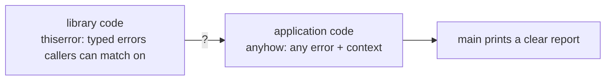

# Error handling in real programs

In the beginner course you returned `Result`, used `?`, and wrote error enums. Real programs combine errors from many sources: files, parsing, the network, your own rules. This lesson shows the patterns professionals use.

## Converting errors with From

`?` doesn't just return the error. It first calls `From::from` on it, so it can **convert** one error type into another. Implement `From` for your error type and `?` does the rest:

```rust
use std::fmt;
use std::num::ParseIntError;

#[derive(Debug)]
enum ConfigError {
    Missing(String),
    BadNumber(ParseIntError),
}

impl fmt::Display for ConfigError {
    fn fmt(&self, f: &mut fmt::Formatter) -> fmt::Result {
        match self {
            ConfigError::Missing(key) => write!(f, "missing setting '{key}'"),
            ConfigError::BadNumber(e) => write!(f, "bad number: {e}"),
        }
    }
}

impl std::error::Error for ConfigError {}

impl From<ParseIntError> for ConfigError {
    fn from(e: ParseIntError) -> Self {
        ConfigError::BadNumber(e)
    }
}

fn read_port(settings: &[(&str, &str)]) -> Result<u16, ConfigError> {
    let (_, value) = settings
        .iter()
        .find(|(k, _)| *k == "port")
        .ok_or_else(|| ConfigError::Missing("port".to_string()))?;
    let port: u16 = value.parse()?;          // ParseIntError becomes ConfigError automatically
    Ok(port)
}

fn main() {
    println!("{:?}", read_port(&[("port", "8080")]).map_err(|e| e.to_string()));
    println!("{:?}", read_port(&[("host", "x")]).map_err(|e| e.to_string()));
    println!("{:?}", read_port(&[("port", "80a")]).map_err(|e| e.to_string()));
}
```

```output
Ok(8080)
Err("missing setting 'port'")
Err("bad number: invalid digit found in string")
```

A proper error type implements `Debug`, `Display` and `std::error::Error`. That's a lot of boilerplate, which is why two crates are used almost everywhere.

## thiserror: for libraries

`thiserror` writes the `Display`, `Error` and `From` code for you from attributes:

<!-- skip -->
```rust
use thiserror::Error;

#[derive(Debug, Error)]
pub enum ConfigError {
    #[error("missing setting '{0}'")]
    Missing(String),
    #[error("bad number: {0}")]
    BadNumber(#[from] std::num::ParseIntError),
    #[error("can't read the config file")]
    Io(#[from] std::io::Error),
}
```

Same behaviour as the hand-written version, in a quarter of the lines. Use it in **libraries** and modules where callers need to tell errors apart and react (retry on `Io`, show a form error on `BadNumber`).

## anyhow: for applications

In the application's top level (main, command handlers), you usually just want to report the error well. `anyhow::Result` accepts **any** error, and `.context()` adds a human explanation:

<!-- skip -->
```rust
use anyhow::{bail, Context, Result};
use std::fs;

fn load_limit(path: &str) -> Result<u32> {
    let text = fs::read_to_string(path)
        .with_context(|| format!("reading {path}"))?;
    let limit: u32 = text.trim().parse()
        .context("the limit must be a whole number")?;
    if limit == 0 {
        bail!("the limit can't be zero");
    }
    Ok(limit)
}

fn main() -> Result<()> {
    std::fs::write("limit.txt", "abc")?;
    let limit = load_limit("limit.txt")?;
    println!("limit {limit}");
    Ok(())
}
```

```text
Error: the limit must be a whole number

Caused by:
    invalid digit found in string
```

The error report shows your explanation **and** the original cause. That's what users and log files need.

The common split:



## Panics, again

Panics are still for bugs. Two extra tools:

- `debug_assert!(cond)` checks only in debug builds: free in release builds.
- `std::panic::catch_unwind` exists for edge cases (like keeping a server alive when a plugin panics), but don't use it as exception handling.

## A checklist for errors

1. Library code returns typed errors (`thiserror`); applications collect them (`anyhow`).
2. Add context where it helps the reader: which file, which user, which step.
3. Never `unwrap()` on input from outside (files, users, network).
4. Log or show an error **once**, at the top, rather than at every level.

## Summary

- `?` converts errors through `From`; implement it, or let `#[from]` do it.
- `thiserror` for typed library errors; `anyhow` with `.context()` for applications.
- Keep panics for bugs; report errors once, with context.

## Optional videos

The lesson above is complete on its own. These videos go deeper, if you like learning by watching.

**Error handling in Rust (Let's Get Rusty)**

https://www.youtube.com/watch?v=wM6o70NAWUI
