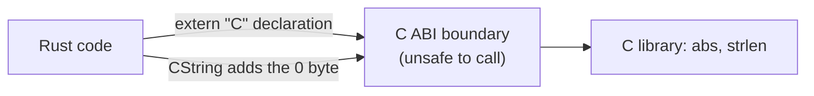

# Macros, unsafe code and calling C

## Declarative macros: macro_rules!

You've used macros since day one: `println!`, `vec!`, `format!`. A macro writes code for you at compile time. Write your own with `macro_rules!`:

```rust
macro_rules! square {
    ($x:expr) => {
        $x * $x
    };
}

macro_rules! hashmap {
    ($($key:expr => $value:expr),* $(,)?) => {{
        let mut m = std::collections::BTreeMap::new();
        $( m.insert($key, $value); )*
        m
    }};
}

macro_rules! check_all {
    ($($cond:expr),+) => {
        $( if !$cond { println!("failed: {}", stringify!($cond)); } )+
    };
}

fn main() {
    println!("{}", square!(7));
    let prices = hashmap! { "tea" => 15, "coffee" => 30, };
    println!("{:?}", prices);
    let x = 5;
    check_all!(x > 0, x < 3, x % 5 == 0);
}
```

```output
49
{"coffee": 30, "tea": 15}
failed: x < 3
```

How to read a macro rule:

- `$x:expr` captures an expression and calls it `$x`. Other kinds: `ident` (a name), `ty` (a type), `tt` (any token), `literal`, `block`.
- `$( ... ),*` repeats zero or more times, separated by commas; `+` means one or more. `$(,)?` allows a trailing comma.
- `stringify!` turns code into text: great for messages.

Use macros when functions can't do the job: a varying number of arguments, generating repeated code, or needing the source text. Otherwise prefer functions: they're easier to read and give clearer errors.

**Procedural macros** (like `#[derive(Debug)]` or `#[tokio::main]`) are a more powerful kind, written as separate crates. You'll use them far more than write them.

## unsafe Rust

The compiler can't verify everything. `unsafe` unlocks five extra abilities, the main ones being:

- dereferencing raw pointers (`*const T`, `*mut T`)
- calling `unsafe` functions, including C functions

`unsafe` doesn't turn off the borrow checker; it only allows those operations, and **you** promise they're correct.

```rust
fn main() {
    let mut nums = [10, 20, 30];
    let p = nums.as_mut_ptr();          // a raw pointer: creating it is safe
    unsafe {
        *p.add(1) += 5;                 // dereferencing it is not checked by the compiler
    }
    println!("{:?}", nums);

    // The safe way to get two mutable parts of one slice: split_at_mut
    let (left, right) = nums.split_at_mut(1);
    left[0] += right[0];
    println!("{:?}", nums);
}
```

```output
[10, 25, 30]
[35, 25, 30]
```

`split_at_mut` is itself written with `unsafe` inside, wrapped in a **safe API** that checks the index first. That's the pattern: keep `unsafe` blocks tiny, check everything around them, expose a safe function, and write a `// SAFETY:` comment explaining why it's correct.

## Calling C: FFI

Rust can call C functions directly (and be called from C). Here's a call into the C standard library:

<!-- diagram -->


```rust
use std::ffi::{CStr, CString};
use std::os::raw::{c_char, c_int};

extern "C" {
    fn abs(x: c_int) -> c_int;
    fn strlen(s: *const c_char) -> usize;
    fn getenv(name: *const c_char) -> *const c_char;
}

fn main() {
    let text = CString::new("hello from C").unwrap();   // adds the 0 byte C expects
    let name = CString::new("NO_SUCH_VARIABLE_HERE").unwrap();
    // SAFETY: the pointers come from valid CStrings that live until the end of main.
    unsafe {
        println!("{}", abs(-42));
        println!("{}", strlen(text.as_ptr()));
        let v = getenv(name.as_ptr());
        if v.is_null() {
            println!("not set");
        } else {
            println!("{}", CStr::from_ptr(v).to_string_lossy());
        }
    }
}
```

```output
42
12
not set
```

- `extern "C"` declares functions that follow C's calling convention, the one you met in the assembly course.
- `CString` makes a 0-terminated string for C; `CStr` reads one coming back.
- Real projects use `bindgen` to generate these declarations from C headers automatically, and the `cc` crate to compile C files as part of `cargo build`.

## Summary

- `macro_rules!` matches patterns like `$x:expr` and `$(...),*` to generate code; prefer functions when they suffice.
- `unsafe` allows raw pointers and FFI calls; keep it small, documented and behind a safe API.
- `extern "C"`, `CString` and `CStr` let Rust call C and pass strings safely.

## Optional videos

The lesson above is complete on its own. These videos go deeper, if you like learning by watching.

**Crust of Rust: Declarative macros (Jon Gjengset)**

https://www.youtube.com/watch?v=q6paRBbLgNw
