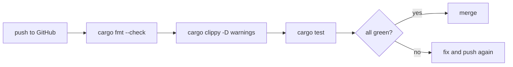

# Testing, docs and the Cargo toolbox

## Three kinds of tests

```text
my_crate/
  src/lib.rs        unit tests live next to the code, in #[cfg(test)] mod tests
  tests/api.rs      integration tests: use the crate like an outside user would
  examples/demo.rs  runnable examples: cargo run --example demo
```

Unit tests can test private functions; integration tests only see the `pub` API, which checks that your library is pleasant to use from outside.

```rust
/// Splits a bill between people, giving the leftover piasters to the first people.
///
/// ```
/// let parts = bills::split(1000, 3);
/// assert_eq!(parts, vec![334, 333, 333]);
/// ```
pub fn split(total: u64, people: u64) -> Vec<u64> {
    assert!(people > 0, "need at least one person");
    let base = total / people;
    let extra = total % people;
    (0..people).map(|i| base + u64::from(i < extra)).collect()
}

#[cfg(test)]
mod tests {
    use super::*;

    #[test]
    fn splits_evenly() {
        assert_eq!(split(900, 3), vec![300, 300, 300]);
    }

    #[test]
    fn total_is_kept() {
        for people in 1..20 {
            assert_eq!(split(12_345, people).iter().sum::<u64>(), 12_345);
        }
    }

    #[test]
    #[should_panic(expected = "at least one")]
    fn zero_people_panics() {
        split(100, 0);
    }
}
```

- `#[should_panic]` passes only if the code panics (with that message).
- `total_is_kept` checks a **property** for many inputs, not one example. The `proptest` crate takes this further by generating random inputs and shrinking failures to the smallest case.
- The code inside `///` comments is a **doc test**: `cargo test` runs it too, so examples in your documentation can never go stale.

## Documentation

`///` comments are Markdown. `cargo doc --open` builds a website for your crate and all its dependencies, in the same style as docs.rs, where every public crate's docs are hosted automatically. Write docs for every `pub` item: what it does, an example, and when it panics or errors.

## The Cargo toolbox

| Command | Why |
|---|---|
| `cargo fmt` | standard formatting; run it before every commit |
| `cargo clippy` | hundreds of lints: bugs, slow code, non-idiomatic code |
| `cargo test` | unit, integration and doc tests |
| `cargo doc --open` | your documentation |
| `cargo bench` | benchmarks (with the `criterion` crate) |
| `cargo tree` | which dependencies you pull in |
| `cargo audit` | known security problems in dependencies (install with `cargo install cargo-audit`) |
| `cargo build --release` | the optimized build to ship |

Clippy is especially good for learning: it explains **why** something could be better and links to details.

## Workspaces: several crates, one repo

Bigger projects split into crates in one **workspace**, sharing one `Cargo.lock` and one `target/` folder:

```toml
# Cargo.toml at the top
[workspace]
members = ["core", "cli", "server"]
resolver = "2"
```

`core` holds the logic, `cli` and `server` are thin programs that use it. The same idea as the C++ library-plus-app layout.

## Features: optional parts

```toml
[features]
default = []
json = ["dep:serde_json"]

[dependencies]
serde_json = { version = "1", optional = true }
```

Code marked `#[cfg(feature = "json")]` is compiled only when someone asks for it: `cargo build --features json`. Libraries use features so users don't pay for parts they don't need.

## Continuous integration

A minimal GitHub Actions job for a Rust project:

```yaml
name: ci
on: [push, pull_request]
jobs:
  test:
    runs-on: ubuntu-latest
    steps:
      - uses: actions/checkout@v4
      - uses: dtolnay/rust-toolchain@stable
        with:
          components: clippy, rustfmt
      - run: cargo fmt --check
      - run: cargo clippy -- -D warnings
      - run: cargo test
```



## Summary

- Unit tests next to the code, integration tests in `tests/`, doc tests inside `///` comments.
- fmt, clippy, test, doc, audit: run them all, ideally in CI on every push.
- Workspaces split big projects into crates; features make parts optional.

## Optional videos

The lesson above is complete on its own. These videos go deeper, if you like learning by watching.

**Testing in Rust (Let's Get Rusty)**

https://www.youtube.com/watch?v=18-7NoNPO30
