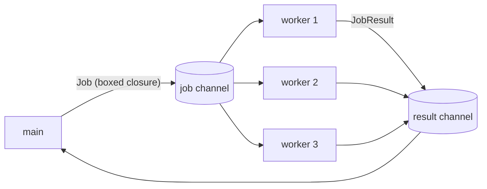

# Project: a multi-threaded job runner

Let's finish with a small but real piece of systems software: a **thread pool** that runs jobs in parallel, collects their results over a channel, handles failing jobs without crashing, and reports statistics. Thread pools like this sit inside web servers, build tools and databases.

## The design



- Jobs are closures, boxed as `Box<dyn FnOnce() -> Result<u64, String> + Send>`.
- Workers share **one** receiver for jobs, protected by `Arc<Mutex<..>>`.
- Results come back through a second channel, so nothing else is shared.
- Dropping the pool closes the job channel; workers notice and finish; `Drop` joins them.

## The code

```rust
use std::sync::mpsc::{self, Receiver, Sender};
use std::sync::{Arc, Mutex};
use std::thread::{self, JoinHandle};

type Job = Box<dyn FnOnce() -> Result<u64, String> + Send + 'static>;

#[derive(Debug)]
struct JobResult {
    id: usize,
    worker: usize,
    outcome: Result<u64, String>,
}

struct Pool {
    jobs: Option<Sender<(usize, Job)>>,
    workers: Vec<JoinHandle<()>>,
}

impl Pool {
    fn new(size: usize, results: Sender<JobResult>) -> Pool {
        let (tx, rx) = mpsc::channel::<(usize, Job)>();
        let rx: Arc<Mutex<Receiver<(usize, Job)>>> = Arc::new(Mutex::new(rx));
        let workers = (0..size)
            .map(|w| {
                let rx = Arc::clone(&rx);
                let results = results.clone();
                thread::spawn(move || loop {
                    let next = rx.lock().unwrap().recv();     // the lock is released right after recv
                    let Ok((id, job)) = next else { break };  // channel closed: no more jobs
                    let outcome = job();
                    results.send(JobResult { id, worker: w, outcome }).unwrap();
                })
            })
            .collect();
        Pool { jobs: Some(tx), workers }
    }

    fn submit<F>(&self, id: usize, f: F)
    where
        F: FnOnce() -> Result<u64, String> + Send + 'static,
    {
        self.jobs.as_ref().unwrap().send((id, Box::new(f))).unwrap();
    }
}

impl Drop for Pool {
    fn drop(&mut self) {
        drop(self.jobs.take());                // close the job channel
        for w in self.workers.drain(..) {
            w.join().unwrap();                 // wait for every worker to finish
        }
    }
}

fn count_primes(limit: u64) -> u64 {
    (2..=limit).filter(|&n| (2..).take_while(|d| d * d <= n).all(|d| n % d != 0)).count() as u64
}

fn main() {
    let (result_tx, result_rx) = mpsc::channel();
    {
        let pool = Pool::new(3, result_tx);
        for (id, limit) in [10_000u64, 50_000, 0, 20_000, 5].into_iter().enumerate() {
            pool.submit(id, move || {
                if limit == 0 {
                    Err("limit can't be zero".to_string())
                } else {
                    Ok(count_primes(limit))
                }
            });
        }
    }   // the pool is dropped here: all jobs finish, all workers are joined

    let mut results: Vec<JobResult> = result_rx.iter().collect();
    results.sort_by_key(|r| r.id);
    let mut ok = 0;
    for r in &results {
        match &r.outcome {
            Ok(n) => {
                ok += 1;
                println!("job {}: {} primes", r.id, n);
            }
            Err(e) => println!("job {}: failed ({e})", r.id),
        }
    }
    let mut used: Vec<usize> = results.iter().map(|r| r.worker).collect();
    used.sort();
    used.dedup();
    println!("{ok} of {} jobs succeeded", results.len());
    eprintln!("workers used: {:?}", used);     // varies from run to run, so it goes to stderr
}
```

```output
job 0: 1229 primes
job 1: 5133 primes
job 2: failed (limit can't be zero)
job 3: 2262 primes
job 4: 3 primes
4 of 5 jobs succeeded
```

The list of workers used goes to the error stream because it changes from run to run: which worker picks which job depends on timing. Usually all three get work.

## Things to notice

- `Box<dyn FnOnce() -> ... + Send + 'static>`: any closure that can run once, be **sent** to another thread, and doesn't borrow short-lived data. The compiler checks all three.
- `rx.lock().unwrap().recv()` holds the lock only while waiting for the next job. Running the job happens after the guard is dropped, so workers really run in parallel.
- `let Ok(..) = next else { break }` ends the worker cleanly when the channel closes.
- `Drop` gives a clean shutdown for free: leaving the block waits for all work. RAII again.
- A failing job returns `Err` and the pool keeps going. A panicking job would kill only its worker; making the pool survive that is one of the exercises.

## Your turn

1. Add tests for `count_primes` (0, 1, 2, 10, 100) and for a pool that gets no jobs at all.
2. Make the pool survive panicking jobs with `std::panic::catch_unwind` and report them as errors.
3. Add timing: each `JobResult` records how long the job took (`std::time::Instant`); print the slowest job.
4. Compare with the `rayon` crate: `limits.par_iter().map(|&l| count_primes(l)).collect()`. How much code did the pool take, and how do the speeds compare?
5. Rewrite the runner with tokio tasks and `spawn_blocking`, and explain when you'd choose each design.

## Where to go next

You've covered the Rust most professionals use daily. Good next steps: *Rust for Rustaceans* by Jon Gjengset, the *Rustonomicon* (for unsafe code), *Rust Atomics and Locks* by Mara Bos (free online), and contributing to an open-source crate. Build something you'll use: a CLI tool, a small web service with axum, or a game with Bevy.

## Summary

- A thread pool = a job channel shared behind `Arc<Mutex<..>>` + a result channel + `Drop` to shut down.
- `Send + 'static` bounds let the compiler check that jobs are safe to move between threads.
- Return errors as values, collect results in one place, and test the numbers you report.

## Optional videos

The lesson above is complete on its own. These videos go deeper, if you like learning by watching.

**Crust of Rust: Channels (Jon Gjengset)**

https://www.youtube.com/watch?v=b4mS5UPHh20
