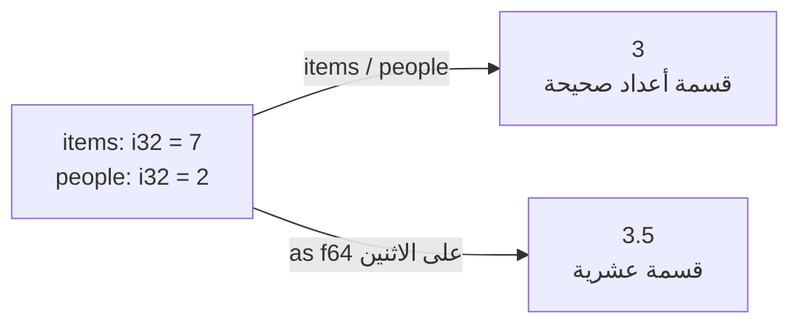

# الـ variables والأنواع والإدخال

## الـ variables ثابتة افتراضيًا

```rust
fn main() {
    let speed = 60;
    // speed = 80;        // error: cannot assign twice to immutable variable
    let mut distance = 0;
    distance += speed;
    distance += speed;
    println!("speed {speed}, distance {distance}");
}
```

```output
speed 60, distance 120
```

‏`let` تصنع variable لا يتغير. وأضف `mut` لتسمح بالتغيير. جعل الأشياء غير قابلة للتغيير افتراضيًا يعني أنك تستطيع الثقة بأن القيمة التي تقرؤها لم يغيّرها شيء في مكان آخر.

## الأنواع

‏Rust تستنتج الأنواع بنفسها، لكن لكل قيمة نوع واحد بالضبط:

| النوع | يحمل |
|---|---|
| `i32` و`i64` | أعداد صحيحة (بإشارة)؛ و`i32` هو الافتراضي |
| `u8` و`u32` و`u64` و`usize` | أعداد صحيحة لا تكون سالبة؛ و`usize` للأحجام والفهارس |
| `f64` | أعداد عشرية (الافتراضي للعشري) |
| `bool` | `true` أو `false` |
| `char` | حرف Unicode واحد بين علامتي تنصيص مفردتين: `'a'` و`'ع'` و`'😀'` |
| `&str` و`String` | نصوص (الدروس القادمة تشرح الفرق) |

تستطيع كتابة النوع عندما تريد الوضوح:

```rust
let year: u32 = 2026;
let ratio: f64 = 0.75;
let big = 1_000_000;     // underscores make long numbers readable
```

## لا تحويلات صامتة

<!-- diagram -->


```rust
fn main() {
    let items: i32 = 7;
    let people: i32 = 2;
    println!("{}", items / people);                     // whole-number division
    println!("{}", items as f64 / people as f64);       // decimal division
    let small: u8 = 250;
    println!("{}", small.checked_add(10).is_none());    // 260 doesn't fit in a u8
}
```

```output
3
3.5
true
```

في بناءات التصحيح، فيضان الرقم (مثل 250 + 10 في `u8`) يوقف البرنامج برسالة خطأ بدل أن يلتف بصمت. وfunctions مثل `checked_add` تسمح لك بالتعامل معه بنفسك.

## الـ shadowing

تستطيع إعلان variable جديد بنفس الاسم. فيحل محل القديم، ويمكن حتى أن يكون من نوع مختلف:

```rust
fn main() {
    let input = "42";
    let input: i32 = input.parse().unwrap();   // a new `input`, now a number
    println!("{}", input * 2);
}
```

```output
84
```

هذا شائع عند تحويل قيمة خطوة بخطوة.

## الـ constants

```rust
const TAX_RATE: f64 = 0.14;
const MAX_USERS: usize = 500;
```

الـ constants تُكتب بحروف كبيرة، وتحتاج نوعًا دائمًا، ويمكن إعلانها خارج الـ functions.

## قراءة المدخلات

<!-- stdin: Omar\n29\n -->
```rust
use std::io;

fn main() {
    println!("What's your name?");
    let mut name = String::new();
    io::stdin().read_line(&mut name).expect("could not read");
    let name = name.trim();          // remove the Enter at the end

    println!("How old are you?");
    let mut age = String::new();
    io::stdin().read_line(&mut age).expect("could not read");
    let age: u32 = age.trim().parse().expect("please type a number");

    println!("Hi {name}, next year you'll be {}.", age + 1);
}
```

```output
What's your name?
How old are you?
Hi Omar, next year you'll be 30.
```

(هذه المخرجات للمدخلات "Omar" و"29". وعندما تشغّله، يظهر ما تكتبه تحت كل سؤال.)

- `use std::io;` تُحضر وحدة الإدخال والإخراج.
- `String::new()` تصنع نصًا فارغًا قابلًا للكبر. و`&mut name` تسمح لـ `read_line` بالكتابة فيه. ستفهم `&mut` جيدًا في الوحدة 3.
- `.trim()` تحذف المسافات والسطر الجديد.
- `.parse()` تحوّل النص إلى رقم. وقد تفشل (المستخدم يكتب "abc")، لذلك ترجع نتيجة يجب أن تتعامل معها. و`.expect("...")` معناها "لو فشلت، أوقف البرنامج بهذه الرسالة". والوحدة 5 تبيّن طرقًا أفضل لمعالجة الأخطاء.

## الخلاصة

- `let` ثابتة و`let mut` قابلة للتغيير؛ والـ constants بحروف كبيرة مع نوع.
- i32 وu32 وusize وf64 وbool وchar؛ وحوّل صراحة بـ `as`.
- اقرأ المدخلات بـ `stdin().read_line` ثم `trim()` و`parse()`.

## فيديوهات اختيارية

الدرس أعلاه كامل وحده. هذه الفيديوهات للتعمق إن كنت تحب التعلم بالمشاهدة. الفيديوهات المكتوب بجانبها (بالإنجليزية) يمكنك تشغيل الترجمة لها (**CC**)، ثم **الإعدادات ← الترجمة ← ترجمة تلقائية ← العربية**.

**Learn Rust Programming, complete course (freeCodeCamp.org) (بالإنجليزية)**

https://www.youtube.com/watch?v=BpPEoZW5IiY
