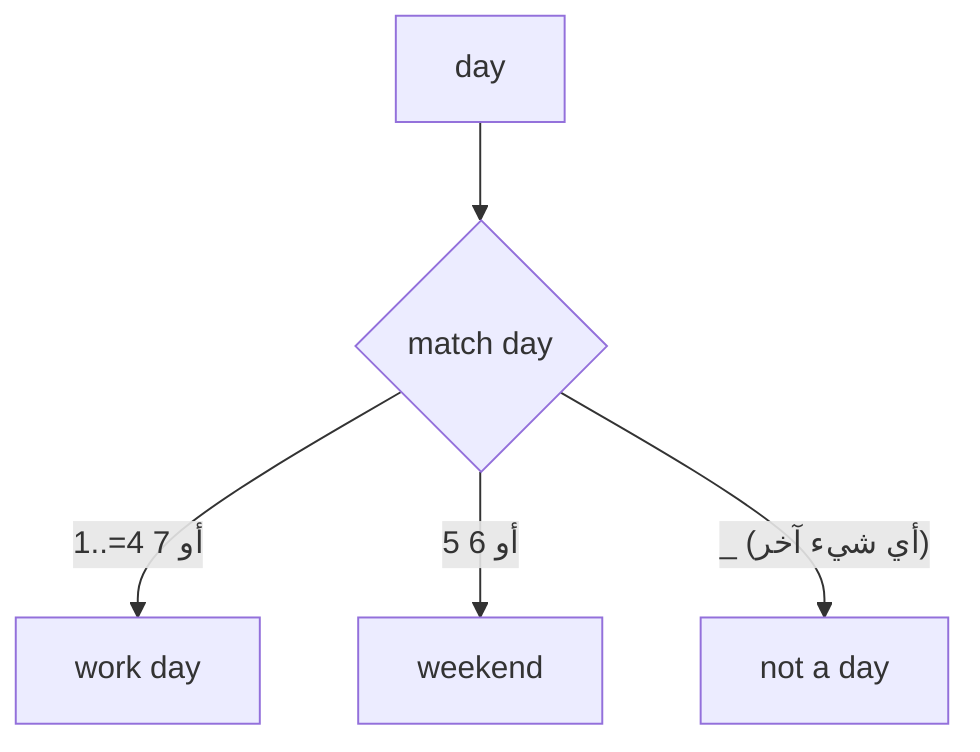

# القرارات والـ loops

## ‏if تعبير

```rust
fn main() {
    let score = 73;
    if score >= 85 {
        println!("Excellent");
    } else if score >= 65 {
        println!("Pass");
    } else {
        println!("Try again");
    }

    let label = if score >= 65 { "pass" } else { "fail" };   // if gives back a value
    println!("{label}");
}
```

```output
Pass
pass
```

- لا أقواس حول الشرط، لكن الأقواس المعقوصة `{ }` إجبارية.
- الشرط يجب أن يكون `bool` حقيقيًا. و`if count { }` مع رقم لا تُترجم؛ اكتب `if count > 0`.
- ‏`if` يمكن أن تنتج قيمة. ويجب أن يعطي الفرعان نفس النوع. وهذا يحل محل `? :` في C.

## ‏loop وwhile وfor

```rust
fn main() {
    // for: the most common loop
    for i in 1..=5 {
        print!("{} ", i * i);
    }
    println!();

    // while: repeat while a condition holds
    let mut balance = 1000;
    let mut months = 0;
    while balance > 0 {
        balance -= 300;
        months += 1;
    }
    println!("money lasts {months} months");

    // loop: repeat forever until break; break can return a value
    let mut n = 1;
    let first_big_power = loop {
        n *= 3;
        if n > 500 {
            break n;
        }
    };
    println!("first power of 3 above 500: {first_big_power}");
}
```

```output
1 4 9 16 25 
money lasts 4 months
first power of 3 above 500: 729
```

- `1..=5` هو **مدى (range)** من 1 إلى 5 شاملًا؛ و`1..5` يتوقف قبل 5.
- `print!` تطبع بدون سطر جديد؛ و`println!()` وحدها تنهي السطر.
- ‏`for` تمشي أيضًا على المجموعات: `for name in &names { ... }`.
- لا توجد `for (i = 0; i < n; i++)` بأسلوب C. المدى والـ iterators تحل محلها ولا يمكن أن تخرج عن الحدود.

## مساعدات الـ loops

```rust
fn main() {
    for (i, fruit) in ["apple", "fig", "mango"].iter().enumerate() {
        println!("{}. {}", i + 1, fruit);
    }
    for x in (1..=10).rev().step_by(3) {
        print!("{x} ");
    }
    println!();
}
```

```output
1. apple
2. fig
3. mango
10 7 4 1 
```

‏`enumerate()` تعطي الموضع مع كل عنصر؛ و`rev()` تمشي بالعكس؛ و`step_by(3)` تقفز.

## ‏match: ‏switch أفضل

‏`match` تقارن قيمة بأنماط. ويجب أن تغطي **كل** قيمة ممكنة، فلا يمكن أن تنسى حالة:

<!-- diagram -->


```rust
fn main() {
    for day in [1, 5, 6, 9] {
        let kind = match day {
            1..=4 | 7 => "work day",
            5 | 6 => "weekend",
            _ => "not a day",
        };
        println!("{day}: {kind}");
    }

    let temp = 34;
    match temp {
        t if t >= 40 => println!("very hot: {t}"),
        30..=39 => println!("hot"),
        _ => println!("fine"),
    }
}
```

```output
1: work day
5: weekend
6: weekend
9: not a day
hot
```

- `|` معناها "أو"؛ و`1..=4` تطابق مدى.
- `_` تطابق أي شيء آخر. احذفها فيخبرك الـ compiler بالقيم التي نسيتها.
- `t if t >= 40` **حارس (guard)**: شرط إضافي.
- مثل `if`، تنتج `match` قيمة.

‏`match` تصبح أقوى بكثير مع الـ enums في الوحدة 4.

## الخلاصة

- `if` تحتاج bool ويمكن أن ترجع قيمة: `let x = if c { a } else { b };`.
- `for x in 1..=5` و`while` و`loop` (التي تستطيع `break value`).
- `match` تتحقق من كل الحالات؛ استخدم `|` والمدى و`_` والحراس.

## فيديوهات اختيارية

الدرس أعلاه كامل وحده. هذه الفيديوهات للتعمق إن كنت تحب التعلم بالمشاهدة. الفيديوهات المكتوب بجانبها (بالإنجليزية) يمكنك تشغيل الترجمة لها (**CC**)، ثم **الإعدادات ← الترجمة ← ترجمة تلقائية ← العربية**.

**Learn Rust Programming, complete course (freeCodeCamp.org) (بالإنجليزية)**

https://www.youtube.com/watch?v=BpPEoZW5IiY
