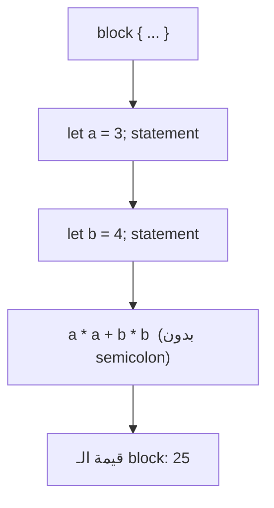

# الـ functions والتعبيرات

## الـ functions

```rust
fn with_tax(price: f64, rate: f64) -> f64 {
    price * (1.0 + rate)
}

fn grade(score: u32) -> char {
    if score >= 85 {
        'A'
    } else if score >= 65 {
        'B'
    } else {
        'C'
    }
}

fn greet(name: &str) {
    println!("Hi, {name}!");
}

fn main() {
    println!("{}", with_tax(100.0, 0.14));
    println!("{}{}{}", grade(91), grade(70), grade(12));
    greet("Laila");
}
```

```output
114.00000000000001
ABC
Hi, Laila!
```

- أنواع المعاملات تُكتب **دائمًا**. ‏Rust تستنتج الأنواع داخل الـ functions فقط، لا عبرها، فالسطر الأول من الـ function يخبرك بكل شيء عن طريقة استدعائها.
- `-> f64` نوع الإرجاع. وبدون سهم لا ترجع الـ function شيئًا (في الحقيقة ترجع `()`، القيمة الفارغة "unit").
- يمكن تعريف الـ functions بأي ترتيب؛ كان يمكن أن تأتي `greet` بعد `main`.

(‏`114.00000000000001` أثر عادي لتقريب الأعداد العشرية، وهو نفسه في كل اللغات. اطبع بـ `{:.2}` لتعرض 114.00.)

## آخر تعبير هو النتيجة

لاحظ أن `with_tax` ليس فيها `return` ولا فاصلة منقوطة في آخر سطر. في Rust، قيمة الكتلة هي **آخر تعبير فيها بدون فاصلة منقوطة**:

<!-- diagram -->


```rust
fn main() {
    let x = {
        let a = 3;
        let b = 4;
        a * a + b * b       // no semicolon: this is the block's value
    };
    println!("{x}");
}
```

```output
25
```

إضافة فاصلة منقوطة تحوّل التعبير إلى جملة لا تنتج شيئًا. وهذا خطأ شائع في البداية:

```rust
fn double(n: i32) -> i32 {
    n * 2;      // error: expected `i32`, found `()`
}
```

والـ compiler يقترح حتى حذف الفاصلة المنقوطة. و`return value;` موجودة أيضًا للخروج المبكر من الـ function:

```rust
fn first_negative(nums: &[i32]) -> i32 {
    for &n in nums {
        if n < 0 {
            return n;
        }
    }
    0
}

fn main() {
    println!("{}", first_negative(&[4, 8, -3, 5, -9]));
    println!("{}", first_negative(&[1, 2]));
}
```

```output
-3
0
```

(‏`&[i32]` **slice**، نافذة على قائمة أرقام. ستقابلها في الوحدة 3.)

## إرجاع عدة قيم: الـ tuples

الـ tuple تجمع قيمًا قليلة من أنواع مختلفة:

```rust
fn min_max(nums: &[i32]) -> (i32, i32) {
    let mut lo = nums[0];
    let mut hi = nums[0];
    for &n in nums {
        lo = lo.min(n);
        hi = hi.max(n);
    }
    (lo, hi)
}

fn main() {
    let temps = [31, 27, 35, 29, 33];
    let (lo, hi) = min_max(&temps);
    println!("min {lo}, max {hi}");

    let point = (3, 4.5, 'x');
    println!("{} {} {}", point.0, point.1, point.2);
}
```

```output
min 27, max 35
3 4.5 x
```

‏`let (lo, hi) = ...` **تفك** الـ tuple إلى متغيرين.

## الـ arrays

قائمة ثابتة الحجم من نوع واحد:

```rust
let days = ["Sat", "Sun", "Mon"];      // type [&str; 3]
let zeros = [0; 10];                   // ten zeros
println!("{}", days.len());
```

الفهرسة بعد النهاية (`days[5]`) **توقف البرنامج** برسالة واضحة بدل قراءة ذاكرة عشوائية. وللقوائم التي تكبر ستستخدم `Vec` في الوحدة 5.

## لا تحميل زائد ولا معاملات افتراضية

‏Rust ليس فيها أي منهما. استخدم أسماء مختلفة (`area_square` و`area_rect`)، أو أنماطًا ستتعلمها لاحقًا (traits، وstructs بناء، ومعاملات `Option`). وهذا يجعل كل استدعاء سهل الفهم.

## الخلاصة

- `fn name(param: Type) -> Return { ... }`؛ وأنواع المعاملات تُكتب دائمًا.
- آخر تعبير بدون `;` هو القيمة؛ و`return` تخرج مبكرًا.
- الـ tuples تجمع القيم وتُفك بـ `let (a, b) = ...`؛ والـ arrays حجمها ثابت وفهارسها مُتحقق منها.

## فيديوهات اختيارية

الدرس أعلاه كامل وحده. هذه الفيديوهات للتعمق إن كنت تحب التعلم بالمشاهدة. الفيديوهات المكتوب بجانبها (بالإنجليزية) يمكنك تشغيل الترجمة لها (**CC**)، ثم **الإعدادات ← الترجمة ← ترجمة تلقائية ← العربية**.

**Rust for the impatient (No Boilerplate) (بالإنجليزية)**

https://www.youtube.com/watch?v=br3GIIQeefY
