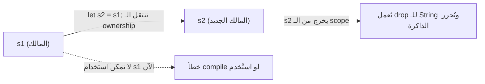

# الـ ownership: الفكرة الكبرى في Rust

هذا هو الدرس الذي يجعل Rust مختلفة عن كل لغة قد تعرفها. خذه ببطء؛ فكل ما بعده مبني عليه.

## القواعد الثلاث

1. لكل قيمة **مالك واحد** بالضبط: variable.
2. عندما يخرج المالك من نطاقه، تُ**سقَط (drop)** القيمة (تُحرر ذاكرتها).
3. الـ ownership يمكن أن **تنتقل** إلى variable آخر؛ وحينها لا يمكن استخدام القديم.

<!-- diagram -->


لا جامع قمامة، ولا `free` يدوية. الـ compiler يضع التنظيف في المكان الصحيح، ويرفض البرامج التي تكسر القواعد.

## النطاق والإسقاط

```rust
fn main() {
    let a = String::from("outer");
    {
        let b = String::from("inner");
        println!("{a} and {b}");
    }   // b is dropped here: its memory is freed
    println!("{a}");
}   // a is dropped here
```

```output
outer and inner
outer
```

هذه هي RAII في C++، لكن لكل شيء، ويتحقق منها الـ compiler.

## النقل

```rust
fn main() {
    let s1 = String::from("hello");
    let s2 = s1;                 // ownership moves from s1 to s2
    // println!("{s1}");         // error: borrow of moved value: `s1`
    println!("{s2}");
}
```

```output
hello
```

لماذا؟ الـ `String` تملك ذاكرة في الـ heap. لو نسخت `let s2 = s1;` الـ pointer فقط، فسيحرر الاثنان نفس الذاكرة في النهاية: double free. ونسخ كل النص بصمت سيكون بطيئًا. لذلك **تنقل** Rust: أصبح s2 يملك النص، ولم يعد s1 صالحًا. والـ compiler يمنعك من استخدامه.

```text
after let s2 = s1;

 s1 (invalid)        s2
                   +-----+          heap
                   | ptr | ------> h e l l o
                   | len |
                   +-----+
```

## النقل إلى الـ functions

تمرير قيمة إلى function ينقلها أيضًا:

```rust
fn shout(text: String) {
    println!("{}!", text.to_uppercase());
}   // text is dropped here

fn main() {
    let msg = String::from("rust");
    shout(msg);
    // shout(msg);              // error: use of moved value: `msg`
}
```

```output
RUST!
```

وإرجاع قيمة ينقلها للخارج:

```rust
fn make_greeting(name: &str) -> String {
    let g = format!("Welcome, {name}");   // format! builds a String like println! prints one
    g                                      // ownership moves to the caller
}

fn main() {
    let w = make_greeting("Dina");
    println!("{w}");
}
```

```output
Welcome, Dina
```

## أنواع Copy

القيم البسيطة التي تعيش كاملة على الـ stack (الأعداد الصحيحة والعشرية وbool وchar، والـ tuples والـ arrays المكونة منها) **تُنسخ** بدل أن تُنقل، لأن نسخها رخيص مثل نقلها:

```rust
fn main() {
    let x = 5;
    let y = x;                 // a copy: both are usable
    println!("{x} {y}");
}
```

```output
5 5
```

هذه الأنواع تنفّذ الـ trait المسمى `Copy`. أما `String` و`Vec` وأي شيء يملك ذاكرة في الـ heap فلا.

## ‏clone: نسخ عميق صريح

عندما تريد فعلًا نسختين مستقلتين، قل ذلك:

```rust
fn main() {
    let a = String::from("data");
    let b = a.clone();         // copies the text into new memory
    println!("{a} {b}");
}
```

```output
data data
```

‏`clone()` ظاهرة في كودك، فلا يحدث نسخ مكلف بالصدفة أبدًا.

## لماذا يستحق هذا العناء

نقل الـ ownership هنا وهناك سيكون مزعجًا لو كان الخيار الوحيد: ستضطر لتمرير القيم إلى الـ functions واستعادتها كل مرة. والدرس القادم يقدّم **الـ borrowing** التي تسمح للـ functions باستخدام قيمة بدون أخذها. والـ ownership والـ borrowing معًا تعطيانك سرعة C بدون استخدام بعد التحرير، وبدون double free، وبدون تسريبات، وكل ذلك يُتحقق منه قبل أن يعمل البرنامج.

## الخلاصة

- مالك واحد لكل قيمة؛ وتُسقط عندما يخرج المالك من نطاقه.
- إسناد أو تمرير String/Vec **ينقلها**؛ ويصبح الـ variable القديم غير قابل للاستخدام.
- الأعداد الصحيحة والعشرية وbool وchar **تُنسخ**؛ واستخدم `.clone()` لنسخ عميق صريح.

## فيديوهات اختيارية

الدرس أعلاه كامل وحده. هذه الفيديوهات للتعمق إن كنت تحب التعلم بالمشاهدة. الفيديوهات المكتوب بجانبها (بالإنجليزية) يمكنك تشغيل الترجمة لها (**CC**)، ثم **الإعدادات ← الترجمة ← ترجمة تلقائية ← العربية**.

**Understanding ownership in Rust (Let's Get Rusty) (بالإنجليزية)**

https://www.youtube.com/watch?v=VFIOSWy93H0
