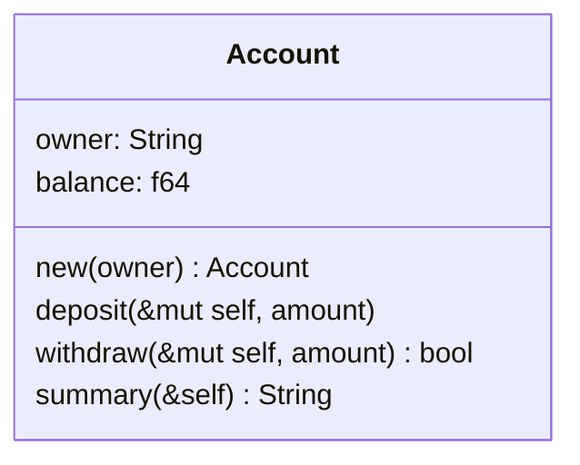

# الـ Structs والـ functions المرتبطة بها (methods)

الـ **struct** يجمع بيانات مترابطة تحت اسم واحد، مثل صف في جدول.

## تعريف struct واستخدامه

```rust
struct Product {
    name: String,
    price: f64,
    stock: u32,
}

fn main() {
    let mut pen = Product {
        name: String::from("pen"),
        price: 7.5,
        stock: 120,
    };
    pen.stock -= 20;
    println!("{}: {} left at {} each", pen.name, pen.stock, pen.price);
}
```

```output
pen: 100 left at 7.5 each
```

الـ variable كله يجب أن يكون `mut` لتغيير أي حقل.

## الـ functions المرتبطة بـ impl

الـ functions التي تنتمي لنوع توضع في كتلة `impl`:

<!-- diagram -->


```rust
struct Account {
    owner: String,
    balance: f64,
}

impl Account {
    fn new(owner: &str) -> Account {             // an "associated function": no self
        Account { owner: owner.to_string(), balance: 0.0 }
    }

    fn deposit(&mut self, amount: f64) {          // changes the account
        if amount > 0.0 {
            self.balance += amount;
        }
    }

    fn withdraw(&mut self, amount: f64) -> bool {
        if amount <= 0.0 || amount > self.balance {
            return false;
        }
        self.balance -= amount;
        true
    }

    fn summary(&self) -> String {                 // only reads
        format!("{} has {:.2}", self.owner, self.balance)
    }
}

fn main() {
    let mut acc = Account::new("Salma");
    acc.deposit(500.0);
    if !acc.withdraw(1000.0) {
        println!("not enough money");
    }
    acc.withdraw(120.0);
    println!("{}", acc.summary());
}
```

```output
not enough money
Salma has 380.00
```

المعامل الأول يقول كيف تستخدم الـ function الـ object:

| المعامل الأول | المعنى |
|---|---|
| `&self` | تقرأ الـ object (مثل function const في C++) |
| `&mut self` | تغيّر الـ object |
| `self` | تأخذ الـ ownership (الـ object يُستهلك) |
| لا شيء | function مرتبطة بالنوع، تُستدعى `Type::name()`، مثل الـ constructor |

‏`new` مجرد عرف في التسمية للـ constructors؛ ‏Rust ليس فيها صياغة خاصة للـ constructor.

## طباعة الـ structs بـ derive

‏`println!("{:?}", x)` تحتاج أن ينفّذ النوع `Debug`. ولا تكتبه بيدك؛ اطلب من الـ compiler **اشتقاقه (derive)**:

```rust
#[derive(Debug, Clone, PartialEq)]
struct Point {
    x: i32,
    y: i32,
}

fn main() {
    let a = Point { x: 3, y: 4 };
    let b = a.clone();
    println!("{:?}", a);
    println!("{:#?}", b);          // pretty, one field per line
    println!("equal? {}", a == b);
}
```

```output
Point { x: 3, y: 4 }
Point {
    x: 3,
    y: 4,
}
equal? true
```

‏`#[derive(...)]` تكتب السلوك القياسي بدلًا منك: `Debug` (الطباعة)، و`Clone` ‏(`.clone()`)، و`PartialEq` ‏(`==`)، وغيرها مثل `Copy` و`Default` و`Hash` و`PartialOrd`.

## اختصارات

```rust
struct User {
    name: String,
    email: String,
    active: bool,
}

fn make_user(name: String, email: String) -> User {
    User { name, email, active: true }          // field init shorthand: name means name: name
}

fn main() {
    let u1 = make_user("Ali".to_string(), "ali@example.com".to_string());
    let u2 = User { name: "Ola".to_string(), ..u1 };   // the rest copied/moved from u1
    println!("{} {} {}", u2.name, u2.email, u2.active);
}
```

```output
Ola ali@example.com true
```

‏`..u1` تملأ الحقول الباقية من u1. وهنا `email` نص String، فإنه **ينتقل** من u1؛ ولا يمكن استخدام u1 ككل بعد ذلك.

## الـ Tuple structs والخصوصية

```rust
struct Celsius(f64);          // a tuple struct: a named wrapper
let t = Celsius(36.6);
println!("{}", t.0);
```

encapsulation رقم عادي في نوع خاص به يمنعك من الخلط بين Celsius وFahrenheit بالصدفة.

الحقول خاصة بـ **الوحدة (module)** التي هي فيها افتراضيًا (الوحدة 6 تشرح الوحدات). وفي ملف واحد يرى كل شيء كل شيء؛ أما في مكتبة فستضيف `pub` لما يستطيع الآخرون استخدامه.

## الخلاصة

- `struct` يجمع حقولًا لها أسماء؛ والـ variable يجب أن يكون `mut` لتغييرها.
- `impl` فيها الـ functions: `&self` تقرأ، و`&mut self` تغيّر، و`self` تستهلك؛ و`Type::new()` هو عرف الـ constructor.
- `#[derive(Debug, Clone, PartialEq)]` تعطي الطباعة والنسخ والمقارنة مجانًا.

## فيديوهات اختيارية

الدرس أعلاه كامل وحده. هذه الفيديوهات للتعمق إن كنت تحب التعلم بالمشاهدة. الفيديوهات المكتوب بجانبها (بالإنجليزية) يمكنك تشغيل الترجمة لها (**CC**)، ثم **الإعدادات ← الترجمة ← ترجمة تلقائية ← العربية**.

**Structs in Rust (Let's Get Rusty) (بالإنجليزية)**

https://www.youtube.com/watch?v=n3bPhdiJm9I
