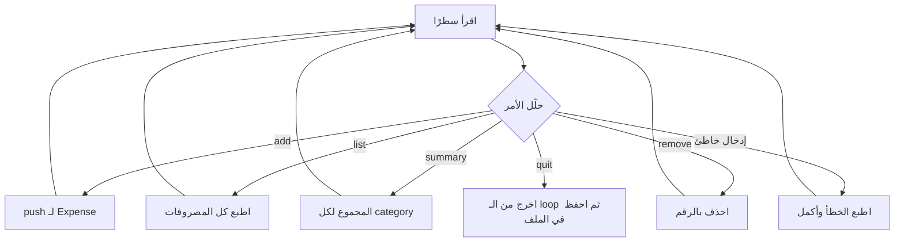

# مشروع: متتبّع مصروفات

لنبنِ برنامج سطر أوامر كاملًا يستخدم كل ما في هذا الكورس: الـ structs والـ enums و`match` و`Option` و`Result` مع `?` و`Vec` والخرائط والـ iterators والـ traits والملفات.

## ماذا يفعل

تكتب أوامر؛ فيحتفظ بقائمة مصروفات ويحفظها في ملف:

<!-- diagram -->


```text
add 45.5 food lunch with Sara
add 120 transport monthly card
list
summary
remove 1
quit
```

## الكود

أنشئ المشروع بـ `cargo new expenses` وضع هذا في `src/main.rs`:

<!-- stdin: add 45.5 food lunch with Sara\nadd 120 transport monthly card\nadd 30 food coffee beans\nadd abc food oops\nadd 15 fun\nlist\nremove 1\nremove 9\nsummary\nquit\n -->
```rust
use std::collections::BTreeMap;
use std::fmt;
use std::fs;
use std::io::{self, BufRead};

#[derive(Debug, Clone, PartialEq)]
struct Expense {
    amount: f64,
    category: String,
    note: String,
}

impl fmt::Display for Expense {
    fn fmt(&self, f: &mut fmt::Formatter) -> fmt::Result {
        write!(f, "{:>8.2}  {:<10} {}", self.amount, self.category, self.note)
    }
}

enum Command {
    Add(Expense),
    List,
    Remove(usize),
    Summary,
    Quit,
}

#[derive(Debug)]
enum ParseError {
    Unknown(String),
    Missing(&'static str),
    BadNumber(String),
}

impl fmt::Display for ParseError {
    fn fmt(&self, f: &mut fmt::Formatter) -> fmt::Result {
        match self {
            ParseError::Unknown(c) => write!(f, "unknown command '{c}'"),
            ParseError::Missing(what) => write!(f, "missing {what}"),
            ParseError::BadNumber(s) => write!(f, "'{s}' is not a number"),
        }
    }
}

fn parse_command(line: &str) -> Result<Command, ParseError> {
    let mut parts = line.split_whitespace();
    let word = parts.next().ok_or(ParseError::Missing("a command"))?;
    match word {
        "add" => {
            let amount_text = parts.next().ok_or(ParseError::Missing("an amount"))?;
            let amount: f64 = amount_text
                .parse()
                .map_err(|_| ParseError::BadNumber(amount_text.to_string()))?;
            let category = parts.next().ok_or(ParseError::Missing("a category"))?.to_string();
            let note = parts.collect::<Vec<_>>().join(" ");
            Ok(Command::Add(Expense { amount, category, note }))
        }
        "list" => Ok(Command::List),
        "summary" => Ok(Command::Summary),
        "quit" => Ok(Command::Quit),
        "remove" => {
            let n = parts.next().ok_or(ParseError::Missing("a number"))?;
            let index = n.parse().map_err(|_| ParseError::BadNumber(n.to_string()))?;
            Ok(Command::Remove(index))
        }
        other => Err(ParseError::Unknown(other.to_string())),
    }
}

struct Tracker {
    items: Vec<Expense>,
}

impl Tracker {
    fn load(path: &str) -> Tracker {
        let items = fs::read_to_string(path)
            .unwrap_or_default()                    // no file yet: start empty
            .lines()
            .filter_map(|line| {
                let mut f = line.splitn(3, '|');
                Some(Expense {
                    amount: f.next()?.parse().ok()?,
                    category: f.next()?.to_string(),
                    note: f.next().unwrap_or("").to_string(),
                })
            })
            .collect();
        Tracker { items }
    }

    fn save(&self, path: &str) -> io::Result<()> {
        let text: String = self
            .items
            .iter()
            .map(|e| format!("{}|{}|{}\n", e.amount, e.category, e.note))
            .collect();
        fs::write(path, text)
    }

    fn remove(&mut self, number: usize) -> Option<Expense> {
        if number == 0 || number > self.items.len() {
            return None;
        }
        Some(self.items.remove(number - 1))
    }

    fn by_category(&self) -> BTreeMap<&str, f64> {
        let mut totals = BTreeMap::new();
        for e in &self.items {
            *totals.entry(e.category.as_str()).or_insert(0.0) += e.amount;
        }
        totals
    }
}

fn main() -> Result<(), Box<dyn std::error::Error>> {
    let path = "expenses.txt";
    let _ = fs::remove_file(path);                 // start fresh for this demo
    let mut tracker = Tracker::load(path);

    for line in io::stdin().lock().lines() {
        let line = line?;
        match parse_command(&line) {
            Ok(Command::Add(e)) => {
                println!("added: {}", e.note);
                tracker.items.push(e);
            }
            Ok(Command::List) => {
                for (i, e) in tracker.items.iter().enumerate() {
                    println!("{:>2}. {e}", i + 1);
                }
            }
            Ok(Command::Remove(n)) => match tracker.remove(n) {
                Some(e) => println!("removed: {}", e.note),
                None => println!("there is no expense number {n}"),
            },
            Ok(Command::Summary) => {
                for (cat, total) in tracker.by_category() {
                    println!("{cat:<10} {total:>8.2}");
                }
                let all: f64 = tracker.items.iter().map(|e| e.amount).sum();
                println!("{:<10} {:>8.2}", "TOTAL", all);
            }
            Ok(Command::Quit) => break,
            Err(e) => println!("error: {e}"),
        }
    }

    tracker.save(path)?;
    let again = Tracker::load(path);
    println!("saved {} expenses; loaded {} back", tracker.items.len(), again.items.len());
    Ok(())
}
```

```output
added: lunch with Sara
added: monthly card
added: coffee beans
error: 'abc' is not a number
added: 
 1.    45.50  food       lunch with Sara
 2.   120.00  transport  monthly card
 3.    30.00  food       coffee beans
 4.    15.00  fun        
removed: lunch with Sara
there is no expense number 9
food          30.00
fun           15.00
transport    120.00
TOTAL        165.00
saved 3 expenses; loaded 3 back
```

(احذف سطر `fs::remove_file` عندما تستخدمه فعلًا، لكي تبقى مصروفاتك بين مرات التشغيل.)

## أشياء لاحظها

- **القراءة منفصلة عن التنفيذ.** ‏`parse_command` تحوّل النص إلى enum اسمه `Command` أو إلى `ParseError`؛ و`main` لا تطابق إلا قيمًا نظيفة. سهل الاختبار وسهل التوسيع.
- `ok_or(...)?` تحوّل الكلمة الناقصة (`None`) إلى خطأ وترجعه. سطر واحد لكل تحقق.
- `impl Display` لكل من `Expense` و`ParseError` تعطي طباعة مرتبة بـ `{}`. و`{:>8.2}` تحاذي لليمين في 8 خانات مع منزلتين عشريتين؛ و`{:<10}` تحاذي لليسار.
- `BTreeMap` تحافظ على ترتيب الفئات، فيكون للملخص ترتيب ثابت.
- `load` تستخدم `filter_map` مع `?` داخل closure ترجع `Option`: الأسطر التالفة تُتخطى بدل أن توقف البرنامج.
- لا `unwrap()` في أي مكان: كل فشل يُعالج أو يُمرر لأعلى بـ `?`.

## دورك

1. أضف اختبارات في `#[cfg(test)] mod tests` لـ `parse_command` (أسطر صحيحة، ومبلغ ناقص، ورقم خطأ، وأمر غير معروف) ولـ `Tracker::remove`.
2. أضف أمر `month`: أعطِ كل مصروف تاريخًا (`2026-11-21`) واعرض الإجماليات لشهر واحد.
3. أضف `budget food 500` وحذّر عندما تتجاوز فئة ميزانيتها.
4. انقل `Expense` و`Tracker` إلى `src/tracker.rs` مع `mod tracker;` و`pub` حيث يلزم.
5. استخدم الـ crates المسماة `serde` و`serde_json` للحفظ بصيغة JSON بدل النص المفصول بـ `|`.

## إلى أين بعد ذلك

كورس **Rust المتقدم** يكمل بlifetimes (lifetimes)، والـ iterators والـ closures بعمق، والـ smart pointers (`Box` و`Rc` و`RefCell` و`Arc`)، والـ threads والقنوات، والبرمجة غير المتزامنة بـ tokio، ومكتبات الأخطاء، والماكرو، والكود غير الآمن (unsafe). ومن المصادر الممتازة المجانية أيضًا: *The Rust Programming Language* ("الكتاب") على doc.rust-lang.org/book، وRustlings لتمارين صغيرة.

## الخلاصة

- حوّل المدخلات إلى enums أولًا، ثم تصرّف على قيم نظيفة.
- `Result` و`?` و`ok_or` و`map_err` تجعل معالجة الأخطاء قصيرة بدون unwrap.
- `Display` و`BTreeMap` والـ iterators تجعل المخرجات مرتبة ويمكن توقعها.

## فيديوهات اختيارية

الدرس أعلاه كامل وحده. هذه الفيديوهات للتعمق إن كنت تحب التعلم بالمشاهدة. الفيديوهات المكتوب بجانبها (بالإنجليزية) يمكنك تشغيل الترجمة لها (**CC**)، ثم **الإعدادات ← الترجمة ← ترجمة تلقائية ← العربية**.

**Error handling in Rust (Let's Get Rusty) (بالإنجليزية)**

https://www.youtube.com/watch?v=wM6o70NAWUI

**Learn Rust Programming, complete course (freeCodeCamp.org) (بالإنجليزية)**

https://www.youtube.com/watch?v=BpPEoZW5IiY
