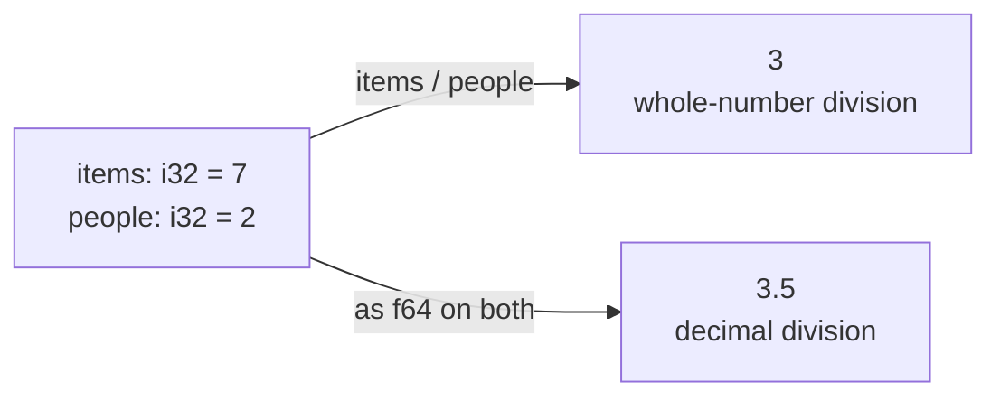

# Variables, types and input

## Variables are fixed by default

```rust
fn main() {
    let speed = 60;
    // speed = 80;        // error: cannot assign twice to immutable variable
    let mut distance = 0;
    distance += speed;
    distance += speed;
    println!("speed {speed}, distance {distance}");
}
```

```output
speed 60, distance 120
```

`let` makes a variable that can't change. Add `mut` to allow changes. Making things unchangeable by default means you can trust that a value you're reading hasn't been changed somewhere else.

## Types

Rust works out types itself, but every value has exactly one:

| Type | Holds |
|---|---|
| `i32`, `i64` | whole numbers (signed); `i32` is the default |
| `u8`, `u32`, `u64`, `usize` | whole numbers that can't be negative; `usize` for sizes and indexes |
| `f64` | decimal numbers (the default for decimals) |
| `bool` | `true` or `false` |
| `char` | one Unicode character, in single quotes: `'a'`, `'ع'`, `'😀'` |
| `&str` and `String` | text (next lessons explain the difference) |

You can write the type when you want to be explicit:

```rust
let year: u32 = 2026;
let ratio: f64 = 0.75;
let big = 1_000_000;     // underscores make long numbers readable
```

## No silent conversions

<!-- diagram -->


```rust
fn main() {
    let items: i32 = 7;
    let people: i32 = 2;
    println!("{}", items / people);                     // whole-number division
    println!("{}", items as f64 / people as f64);       // decimal division
    let small: u8 = 250;
    println!("{}", small.checked_add(10).is_none());    // 260 doesn't fit in a u8
}
```

```output
3
3.5
true
```

In debug builds, overflowing a number (like 250 + 10 in a `u8`) stops the program with an error instead of silently wrapping around. Methods like `checked_add` let you handle it yourself.

## Shadowing

You can declare a new variable with the same name. It replaces the old one, and can even have a different type:

```rust
fn main() {
    let input = "42";
    let input: i32 = input.parse().unwrap();   // a new `input`, now a number
    println!("{}", input * 2);
}
```

```output
84
```

This is common when converting a value step by step.

## Constants

```rust
const TAX_RATE: f64 = 0.14;
const MAX_USERS: usize = 500;
```

Constants are written in CAPITALS, always need a type, and can be declared outside functions.

## Reading input

<!-- stdin: Omar\n29\n -->
```rust
use std::io;

fn main() {
    println!("What's your name?");
    let mut name = String::new();
    io::stdin().read_line(&mut name).expect("could not read");
    let name = name.trim();          // remove the Enter at the end

    println!("How old are you?");
    let mut age = String::new();
    io::stdin().read_line(&mut age).expect("could not read");
    let age: u32 = age.trim().parse().expect("please type a number");

    println!("Hi {name}, next year you'll be {}.", age + 1);
}
```

```output
What's your name?
How old are you?
Hi Omar, next year you'll be 30.
```

(This output is for the input "Omar" and "29". When you run it, your typing appears under each question.)

- `use std::io;` brings the input/output module into scope.
- `String::new()` makes an empty, growable string. `&mut name` lets `read_line` write into it. You'll understand `&mut` fully in module 3.
- `.trim()` removes spaces and the newline.
- `.parse()` turns text into a number. It can fail (the user types "abc"), so it returns a result that you must deal with. `.expect("...")` means "if it failed, stop the program with this message". Module 5 shows better ways to handle errors.

## Summary

- `let` is fixed, `let mut` can change; constants are CAPITALS with a type.
- i32, u32, usize, f64, bool, char; convert explicitly with `as`.
- Read input with `stdin().read_line`, then `trim()` and `parse()`.

## Optional videos

The lesson above is complete on its own. These videos go deeper, if you like learning by watching.

**Learn Rust Programming, complete course (freeCodeCamp.org)**

https://www.youtube.com/watch?v=BpPEoZW5IiY
