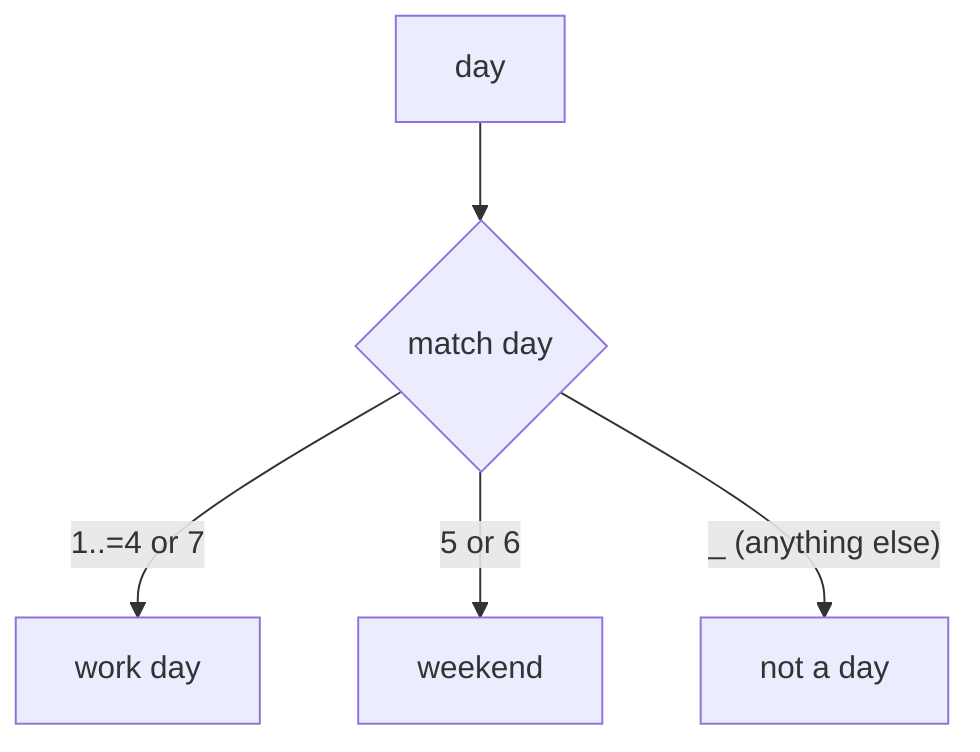

# Decisions and loops

## if is an expression

```rust
fn main() {
    let score = 73;
    if score >= 85 {
        println!("Excellent");
    } else if score >= 65 {
        println!("Pass");
    } else {
        println!("Try again");
    }

    let label = if score >= 65 { "pass" } else { "fail" };   // if gives back a value
    println!("{label}");
}
```

```output
Pass
pass
```

- No brackets around the condition, but the braces `{ }` are required.
- The condition must be a real `bool`. `if count { }` with a number doesn't compile; write `if count > 0`.
- `if` can produce a value. Both branches must give the same type. That replaces C's `? :`.

## loop, while and for

```rust
fn main() {
    // for: the most common loop
    for i in 1..=5 {
        print!("{} ", i * i);
    }
    println!();

    // while: repeat while a condition holds
    let mut balance = 1000;
    let mut months = 0;
    while balance > 0 {
        balance -= 300;
        months += 1;
    }
    println!("money lasts {months} months");

    // loop: repeat forever until break; break can return a value
    let mut n = 1;
    let first_big_power = loop {
        n *= 3;
        if n > 500 {
            break n;
        }
    };
    println!("first power of 3 above 500: {first_big_power}");
}
```

```output
1 4 9 16 25 
money lasts 4 months
first power of 3 above 500: 729
```

- `1..=5` is a **range** from 1 to 5 inclusive; `1..5` stops before 5.
- `print!` prints without a newline; `println!()` alone ends the line.
- `for` also walks through collections: `for name in &names { ... }`.
- There's no C-style `for (i = 0; i < n; i++)`. Ranges and iterators replace it and can't go out of bounds.

## Loop helpers

```rust
fn main() {
    for (i, fruit) in ["apple", "fig", "mango"].iter().enumerate() {
        println!("{}. {}", i + 1, fruit);
    }
    for x in (1..=10).rev().step_by(3) {
        print!("{x} ");
    }
    println!();
}
```

```output
1. apple
2. fig
3. mango
10 7 4 1 
```

`enumerate()` gives the position with each item; `rev()` goes backwards; `step_by(3)` skips.

## match: a better switch

`match` compares a value against patterns. It must cover **every** possible value, so you can't forget a case:

<!-- diagram -->


```rust
fn main() {
    for day in [1, 5, 6, 9] {
        let kind = match day {
            1..=4 | 7 => "work day",
            5 | 6 => "weekend",
            _ => "not a day",
        };
        println!("{day}: {kind}");
    }

    let temp = 34;
    match temp {
        t if t >= 40 => println!("very hot: {t}"),
        30..=39 => println!("hot"),
        _ => println!("fine"),
    }
}
```

```output
1: work day
5: weekend
6: weekend
9: not a day
hot
```

- `|` means "or"; `1..=4` matches a range.
- `_` matches anything else. Leave it out and the compiler tells you which values you missed.
- `t if t >= 40` is a **guard**: an extra condition.
- Like `if`, `match` produces a value.

`match` becomes much more powerful with enums in module 4.

## Summary

- `if` needs a bool and can return a value: `let x = if c { a } else { b };`.
- `for x in 1..=5`, `while`, and `loop` (which can `break value`).
- `match` checks every case; use `|`, ranges, `_` and guards.

## Optional videos

The lesson above is complete on its own. These videos go deeper, if you like learning by watching.

**Learn Rust Programming, complete course (freeCodeCamp.org)**

https://www.youtube.com/watch?v=BpPEoZW5IiY
