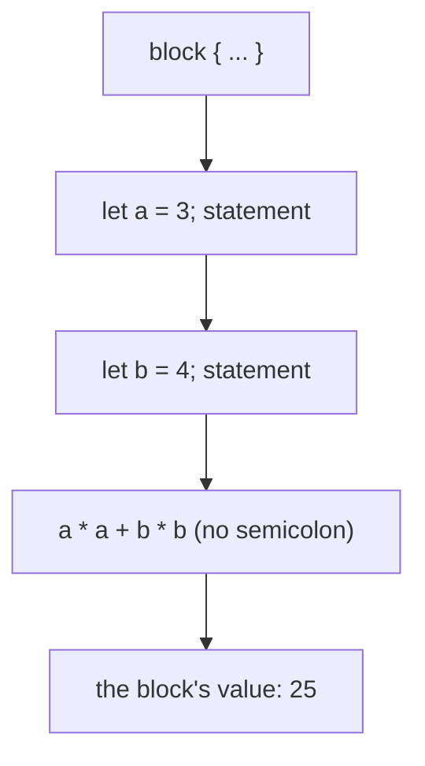

# Functions and expressions

## Functions

```rust
fn with_tax(price: f64, rate: f64) -> f64 {
    price * (1.0 + rate)
}

fn grade(score: u32) -> char {
    if score >= 85 {
        'A'
    } else if score >= 65 {
        'B'
    } else {
        'C'
    }
}

fn greet(name: &str) {
    println!("Hi, {name}!");
}

fn main() {
    println!("{}", with_tax(100.0, 0.14));
    println!("{}{}{}", grade(91), grade(70), grade(12));
    greet("Laila");
}
```

```output
114.00000000000001
ABC
Hi, Laila!
```

- Parameter types are **always** written. Rust only infers types inside functions, never across them, so a function's first line tells you everything about how to call it.
- `-> f64` is the return type. No arrow means the function returns nothing (actually `()`, the empty "unit" value).
- Functions can be defined in any order; `greet` could come after `main`.

(`114.00000000000001` is a normal floating-point rounding effect, the same in every language. Print with `{:.2}` to show 114.00.)

## The last expression is the result

Notice `with_tax` has no `return` and no semicolon on its last line. In Rust, a block's value is its **last expression without a semicolon**:

<!-- diagram -->


```rust
fn main() {
    let x = {
        let a = 3;
        let b = 4;
        a * a + b * b       // no semicolon: this is the block's value
    };
    println!("{x}");
}
```

```output
25
```

Adding a semicolon turns an expression into a statement that produces nothing. That's a common early error:

```rust
fn double(n: i32) -> i32 {
    n * 2;      // error: expected `i32`, found `()`
}
```

The compiler even suggests removing the semicolon. `return value;` exists too, for leaving a function early:

```rust
fn first_negative(nums: &[i32]) -> i32 {
    for &n in nums {
        if n < 0 {
            return n;
        }
    }
    0
}

fn main() {
    println!("{}", first_negative(&[4, 8, -3, 5, -9]));
    println!("{}", first_negative(&[1, 2]));
}
```

```output
-3
0
```

(`&[i32]` is a **slice**, a view into a list of numbers. You'll meet it in module 3.)

## Returning several values: tuples

A tuple groups a few values of different types:

```rust
fn min_max(nums: &[i32]) -> (i32, i32) {
    let mut lo = nums[0];
    let mut hi = nums[0];
    for &n in nums {
        lo = lo.min(n);
        hi = hi.max(n);
    }
    (lo, hi)
}

fn main() {
    let temps = [31, 27, 35, 29, 33];
    let (lo, hi) = min_max(&temps);
    println!("min {lo}, max {hi}");

    let point = (3, 4.5, 'x');
    println!("{} {} {}", point.0, point.1, point.2);
}
```

```output
min 27, max 35
3 4.5 x
```

`let (lo, hi) = ...` **destructures** the tuple into two variables.

## Arrays

A fixed-size list of one type:

```rust
let days = ["Sat", "Sun", "Mon"];      // type [&str; 3]
let zeros = [0; 10];                   // ten zeros
println!("{}", days.len());
```

Indexing past the end (`days[5]`) **stops the program** with a clear message instead of reading random memory. For lists that grow, you'll use `Vec` in module 5.

## No overloading, no default arguments

Rust has neither. Use different names (`area_square`, `area_rect`), or patterns you'll learn later (traits, builder structs, `Option` parameters). It keeps every call easy to understand.

## Summary

- `fn name(param: Type) -> Return { ... }`; parameter types are always written.
- The last expression without `;` is the value; `return` leaves early.
- Tuples group values and destructure with `let (a, b) = ...`; arrays have a fixed size and checked indexes.

## Optional videos

The lesson above is complete on its own. These videos go deeper, if you like learning by watching.

**Rust for the impatient (No Boilerplate)**

https://www.youtube.com/watch?v=br3GIIQeefY
