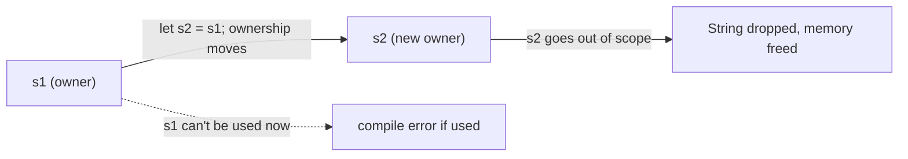

# Ownership: Rust's big idea

This is the lesson that makes Rust different from every language you may know. Take it slowly; everything else builds on it.

## The three rules

1. Every value has exactly **one owner**: a variable.
2. When the owner goes out of scope, the value is **dropped** (its memory freed).
3. Ownership can **move** to another variable; then the old one can't be used.

<!-- diagram -->


No garbage collector, no manual `free`. The compiler inserts the cleanup at the right place, and refuses programs that break the rules.

## Scope and drop

```rust
fn main() {
    let a = String::from("outer");
    {
        let b = String::from("inner");
        println!("{a} and {b}");
    }   // b is dropped here: its memory is freed
    println!("{a}");
}   // a is dropped here
```

```output
outer and inner
outer
```

This is C++'s RAII, but for everything and checked by the compiler.

## Moves

```rust
fn main() {
    let s1 = String::from("hello");
    let s2 = s1;                 // ownership moves from s1 to s2
    // println!("{s1}");         // error: borrow of moved value: `s1`
    println!("{s2}");
}
```

```output
hello
```

Why? A `String` owns memory on the heap. If `let s2 = s1;` copied only the pointer, both would free the same memory at the end: a double free. Copying all the text silently would be slow. So Rust **moves**: s2 now owns the text, and s1 is no longer valid. The compiler stops you from using it.

```text
after let s2 = s1;

 s1 (invalid)        s2
                   +-----+          heap
                   | ptr | ------> h e l l o
                   | len |
                   +-----+
```

## Moves into functions

Passing a value to a function moves it too:

```rust
fn shout(text: String) {
    println!("{}!", text.to_uppercase());
}   // text is dropped here

fn main() {
    let msg = String::from("rust");
    shout(msg);
    // shout(msg);              // error: use of moved value: `msg`
}
```

```output
RUST!
```

Returning a value moves it back out:

```rust
fn make_greeting(name: &str) -> String {
    let g = format!("Welcome, {name}");   // format! builds a String like println! prints one
    g                                      // ownership moves to the caller
}

fn main() {
    let w = make_greeting("Dina");
    println!("{w}");
}
```

```output
Welcome, Dina
```

## Copy types

Simple values that live entirely on the stack (integers, floats, bool, char, and tuples/arrays of them) are **copied** instead of moved, because copying them is as cheap as moving:

```rust
fn main() {
    let x = 5;
    let y = x;                 // a copy: both are usable
    println!("{x} {y}");
}
```

```output
5 5
```

These types implement the `Copy` trait. `String`, `Vec` and anything owning heap memory don't.

## clone: an explicit deep copy

When you really want two independent copies, say so:

```rust
fn main() {
    let a = String::from("data");
    let b = a.clone();         // copies the text into new memory
    println!("{a} {b}");
}
```

```output
data data
```

`clone()` is visible in your code, so expensive copies never happen by accident.

## Why this is worth it

Moving ownership around would be annoying if it were the only option: you'd have to pass values into functions and get them back every time. The next lesson introduces **borrowing**, which lets functions use a value without taking it. Together, ownership and borrowing give you C-level speed with no use-after-free, no double free and no leaks, all checked before the program runs.

## Summary

- One owner per value; dropped when the owner goes out of scope.
- Assigning or passing a String/Vec **moves** it; the old variable becomes unusable.
- Integers, floats, bool and char are **copied**; use `.clone()` for an explicit deep copy.

## Optional videos

The lesson above is complete on its own. These videos go deeper, if you like learning by watching.

**Understanding ownership in Rust (Let's Get Rusty)**

https://www.youtube.com/watch?v=VFIOSWy93H0
