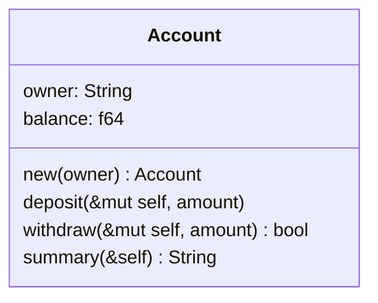

# Structs and methods

A **struct** groups related data under one name, like a row in a table.

## Defining and using a struct

```rust
struct Product {
    name: String,
    price: f64,
    stock: u32,
}

fn main() {
    let mut pen = Product {
        name: String::from("pen"),
        price: 7.5,
        stock: 120,
    };
    pen.stock -= 20;
    println!("{}: {} left at {} each", pen.name, pen.stock, pen.price);
}
```

```output
pen: 100 left at 7.5 each
```

The whole variable must be `mut` to change any field.

## Methods with impl

Functions that belong to a type go in an `impl` block:

<!-- diagram -->


```rust
struct Account {
    owner: String,
    balance: f64,
}

impl Account {
    fn new(owner: &str) -> Account {             // an "associated function": no self
        Account { owner: owner.to_string(), balance: 0.0 }
    }

    fn deposit(&mut self, amount: f64) {          // changes the account
        if amount > 0.0 {
            self.balance += amount;
        }
    }

    fn withdraw(&mut self, amount: f64) -> bool {
        if amount <= 0.0 || amount > self.balance {
            return false;
        }
        self.balance -= amount;
        true
    }

    fn summary(&self) -> String {                 // only reads
        format!("{} has {:.2}", self.owner, self.balance)
    }
}

fn main() {
    let mut acc = Account::new("Salma");
    acc.deposit(500.0);
    if !acc.withdraw(1000.0) {
        println!("not enough money");
    }
    acc.withdraw(120.0);
    println!("{}", acc.summary());
}
```

```output
not enough money
Salma has 380.00
```

The first parameter says how the method uses the object:

| First parameter | Meaning |
|---|---|
| `&self` | reads the object (like a C++ const method) |
| `&mut self` | changes the object |
| `self` | takes ownership (the object is used up) |
| none | an associated function, called as `Type::name()`, e.g. a constructor |

`new` is just a naming custom for constructors; Rust has no special constructor syntax.

## Printing structs with derive

`println!("{:?}", x)` needs the type to implement `Debug`. You don't write it by hand; ask the compiler to **derive** it:

```rust
#[derive(Debug, Clone, PartialEq)]
struct Point {
    x: i32,
    y: i32,
}

fn main() {
    let a = Point { x: 3, y: 4 };
    let b = a.clone();
    println!("{:?}", a);
    println!("{:#?}", b);          // pretty, one field per line
    println!("equal? {}", a == b);
}
```

```output
Point { x: 3, y: 4 }
Point {
    x: 3,
    y: 4,
}
equal? true
```

`#[derive(...)]` writes standard behaviour for you: `Debug` (printing), `Clone` (`.clone()`), `PartialEq` (`==`), and others like `Copy`, `Default`, `Hash`, `PartialOrd`.

## Shortcuts

```rust
struct User {
    name: String,
    email: String,
    active: bool,
}

fn make_user(name: String, email: String) -> User {
    User { name, email, active: true }          // field init shorthand: name means name: name
}

fn main() {
    let u1 = make_user("Ali".to_string(), "ali@example.com".to_string());
    let u2 = User { name: "Ola".to_string(), ..u1 };   // the rest copied/moved from u1
    println!("{} {} {}", u2.name, u2.email, u2.active);
}
```

```output
Ola ali@example.com true
```

`..u1` fills the remaining fields from u1. Here `email` is a String, so it **moves** out of u1; u1 can't be used as a whole afterwards.

## Tuple structs and privacy

```rust
struct Celsius(f64);          // a tuple struct: a named wrapper
let t = Celsius(36.6);
println!("{}", t.0);
```

Wrapping a plain number in its own type stops you mixing up Celsius and Fahrenheit by accident.

Fields are private to their **module** by default (module 6 covers modules). In a single file everything can see everything; in a library you'd add `pub` to what others may use.

## Summary

- `struct` groups named fields; the variable must be `mut` to change them.
- `impl` holds methods: `&self` reads, `&mut self` changes, `self` consumes; `Type::new()` is the constructor custom.
- `#[derive(Debug, Clone, PartialEq)]` gives printing, cloning and comparing for free.

## Optional videos

The lesson above is complete on its own. These videos go deeper, if you like learning by watching.

**Structs in Rust (Let's Get Rusty)**

https://www.youtube.com/watch?v=n3bPhdiJm9I
