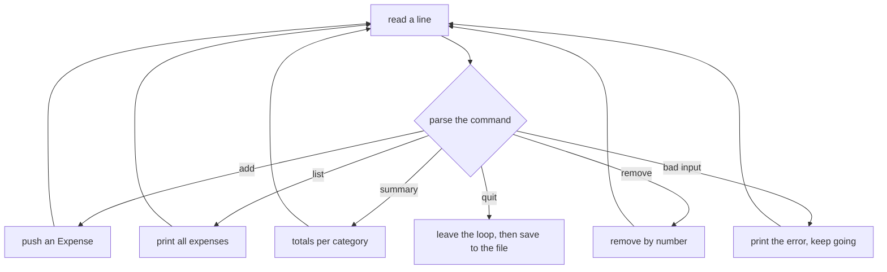

# Project: an expense tracker

Let's build a complete command-line program that uses everything from this course: structs, enums, `match`, `Option`, `Result` and `?`, `Vec`, maps, iterators, traits and files.

## What it does

You type commands; it keeps a list of expenses and saves them to a file:

<!-- diagram -->


```text
add 45.5 food lunch with Sara
add 120 transport monthly card
list
summary
remove 1
quit
```

## The code

Create the project with `cargo new expenses` and put this in `src/main.rs`:

<!-- stdin: add 45.5 food lunch with Sara\nadd 120 transport monthly card\nadd 30 food coffee beans\nadd abc food oops\nadd 15 fun\nlist\nremove 1\nremove 9\nsummary\nquit\n -->
```rust
use std::collections::BTreeMap;
use std::fmt;
use std::fs;
use std::io::{self, BufRead};

#[derive(Debug, Clone, PartialEq)]
struct Expense {
    amount: f64,
    category: String,
    note: String,
}

impl fmt::Display for Expense {
    fn fmt(&self, f: &mut fmt::Formatter) -> fmt::Result {
        write!(f, "{:>8.2}  {:<10} {}", self.amount, self.category, self.note)
    }
}

enum Command {
    Add(Expense),
    List,
    Remove(usize),
    Summary,
    Quit,
}

#[derive(Debug)]
enum ParseError {
    Unknown(String),
    Missing(&'static str),
    BadNumber(String),
}

impl fmt::Display for ParseError {
    fn fmt(&self, f: &mut fmt::Formatter) -> fmt::Result {
        match self {
            ParseError::Unknown(c) => write!(f, "unknown command '{c}'"),
            ParseError::Missing(what) => write!(f, "missing {what}"),
            ParseError::BadNumber(s) => write!(f, "'{s}' is not a number"),
        }
    }
}

fn parse_command(line: &str) -> Result<Command, ParseError> {
    let mut parts = line.split_whitespace();
    let word = parts.next().ok_or(ParseError::Missing("a command"))?;
    match word {
        "add" => {
            let amount_text = parts.next().ok_or(ParseError::Missing("an amount"))?;
            let amount: f64 = amount_text
                .parse()
                .map_err(|_| ParseError::BadNumber(amount_text.to_string()))?;
            let category = parts.next().ok_or(ParseError::Missing("a category"))?.to_string();
            let note = parts.collect::<Vec<_>>().join(" ");
            Ok(Command::Add(Expense { amount, category, note }))
        }
        "list" => Ok(Command::List),
        "summary" => Ok(Command::Summary),
        "quit" => Ok(Command::Quit),
        "remove" => {
            let n = parts.next().ok_or(ParseError::Missing("a number"))?;
            let index = n.parse().map_err(|_| ParseError::BadNumber(n.to_string()))?;
            Ok(Command::Remove(index))
        }
        other => Err(ParseError::Unknown(other.to_string())),
    }
}

struct Tracker {
    items: Vec<Expense>,
}

impl Tracker {
    fn load(path: &str) -> Tracker {
        let items = fs::read_to_string(path)
            .unwrap_or_default()                    // no file yet: start empty
            .lines()
            .filter_map(|line| {
                let mut f = line.splitn(3, '|');
                Some(Expense {
                    amount: f.next()?.parse().ok()?,
                    category: f.next()?.to_string(),
                    note: f.next().unwrap_or("").to_string(),
                })
            })
            .collect();
        Tracker { items }
    }

    fn save(&self, path: &str) -> io::Result<()> {
        let text: String = self
            .items
            .iter()
            .map(|e| format!("{}|{}|{}\n", e.amount, e.category, e.note))
            .collect();
        fs::write(path, text)
    }

    fn remove(&mut self, number: usize) -> Option<Expense> {
        if number == 0 || number > self.items.len() {
            return None;
        }
        Some(self.items.remove(number - 1))
    }

    fn by_category(&self) -> BTreeMap<&str, f64> {
        let mut totals = BTreeMap::new();
        for e in &self.items {
            *totals.entry(e.category.as_str()).or_insert(0.0) += e.amount;
        }
        totals
    }
}

fn main() -> Result<(), Box<dyn std::error::Error>> {
    let path = "expenses.txt";
    let _ = fs::remove_file(path);                 // start fresh for this demo
    let mut tracker = Tracker::load(path);

    for line in io::stdin().lock().lines() {
        let line = line?;
        match parse_command(&line) {
            Ok(Command::Add(e)) => {
                println!("added: {}", e.note);
                tracker.items.push(e);
            }
            Ok(Command::List) => {
                for (i, e) in tracker.items.iter().enumerate() {
                    println!("{:>2}. {e}", i + 1);
                }
            }
            Ok(Command::Remove(n)) => match tracker.remove(n) {
                Some(e) => println!("removed: {}", e.note),
                None => println!("there is no expense number {n}"),
            },
            Ok(Command::Summary) => {
                for (cat, total) in tracker.by_category() {
                    println!("{cat:<10} {total:>8.2}");
                }
                let all: f64 = tracker.items.iter().map(|e| e.amount).sum();
                println!("{:<10} {:>8.2}", "TOTAL", all);
            }
            Ok(Command::Quit) => break,
            Err(e) => println!("error: {e}"),
        }
    }

    tracker.save(path)?;
    let again = Tracker::load(path);
    println!("saved {} expenses; loaded {} back", tracker.items.len(), again.items.len());
    Ok(())
}
```

```output
added: lunch with Sara
added: monthly card
added: coffee beans
error: 'abc' is not a number
added: 
 1.    45.50  food       lunch with Sara
 2.   120.00  transport  monthly card
 3.    30.00  food       coffee beans
 4.    15.00  fun        
removed: lunch with Sara
there is no expense number 9
food          30.00
fun           15.00
transport    120.00
TOTAL        165.00
saved 3 expenses; loaded 3 back
```

(Remove the `fs::remove_file` line when you use it for real, so your expenses are kept between runs.)

## Things to notice

- **Parsing is separate from doing.** `parse_command` turns text into a `Command` enum or a `ParseError`; `main` only matches on clean values. Easy to test and easy to extend.
- `ok_or(...)?` turns a missing word (`None`) into an error and returns it. One line per check.
- `impl Display` for both `Expense` and `ParseError` gives neat `{}` printing. `{:>8.2}` right-aligns in 8 spaces with 2 decimals; `{:<10}` left-aligns.
- `BTreeMap` keeps categories sorted, so the summary has a stable order.
- `load` uses `filter_map` with `?` inside a closure returning `Option`: broken lines are skipped instead of crashing.
- No `unwrap()` anywhere: every failure is handled or passed up with `?`.

## Your turn

1. Add tests in a `#[cfg(test)] mod tests` for `parse_command` (good lines, missing amount, bad number, unknown command) and for `Tracker::remove`.
2. Add a `month` command: give each expense a date (`2026-11-21`) and show totals for one month.
3. Add `budget food 500` and warn when a category goes over its budget.
4. Move `Expense` and `Tracker` into `src/tracker.rs` with `mod tracker;` and `pub` where needed.
5. Use the `serde` and `serde_json` crates to save as JSON instead of `|`-separated text.

## Where to go next

The **advanced Rust** course continues with lifetimes, iterators and closures in depth, smart pointers (`Box`, `Rc`, `RefCell`, `Arc`), threads and channels, async with tokio, error crates, macros and unsafe code. Also excellent and free: *The Rust Programming Language* ("the book") at doc.rust-lang.org/book, and Rustlings for small exercises.

## Summary

- Turn input into enums first, then act on clean values.
- `Result`, `?`, `ok_or` and `map_err` keep error handling short with no unwraps.
- `Display`, `BTreeMap` and iterators make output tidy and predictable.

## Optional videos

The lesson above is complete on its own. These videos go deeper, if you like learning by watching.

**Error handling in Rust (Let's Get Rusty)**

https://www.youtube.com/watch?v=wM6o70NAWUI

**Learn Rust Programming, complete course (freeCodeCamp.org)**

https://www.youtube.com/watch?v=BpPEoZW5IiY
