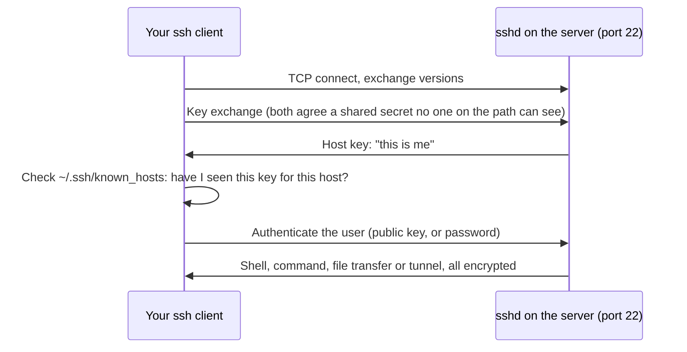

# Start here: how SSH works

SSH (Secure Shell) gives you an encrypted, authenticated connection to another machine. It's how almost every Linux server, cloud VM and Git push is managed.



## Two different keys, two different questions

| Key | Proves | Where it lives |
|---|---|---|
| **Host key** | "You're talking to the real server" | `/etc/ssh/ssh_host_*` on the server; remembered in your `~/.ssh/known_hosts` |
| **User key** | "I am sara" | Private key on your laptop; public key in the server's `~/.ssh/authorized_keys` |

## The first-connection question

```text
The authenticity of host 'web01 (203.0.113.10)' can't be established.
ED25519 key fingerprint is SHA256:Ab3...
Are you sure you want to continue connecting (yes/no)?
```

Typing `yes` stores the key. **Later** this warning is the serious one:

```text
WARNING: REMOTE HOST IDENTIFICATION HAS CHANGED!
```

It means the server's key changed: a rebuilt server (fine; remove the old entry with `ssh-keygen -R web01`), or someone in the middle (not fine). Find out which before you continue.

## The pieces on your machine

```bash
ssh -V                        # client version
ls -l ~/.ssh                  # keys, known_hosts, config
ssh -v sara@web01             # verbose: watch every step of the handshake (-vvv for more)
```

This course goes from everyday use (keys, config, copying files) to tunnels, bastions, SSH certificates and long-running sessions. You'll need two Linux machines or VMs; three for the bastion lab.

## Optional videos

The lesson above is complete on its own. These go deeper, if you like learning by watching.

**Jay LaCroix (LearnLinuxTV): how to use SSH from any OS**

https://www.youtube.com/watch?v=ZVMckBHd7WA
