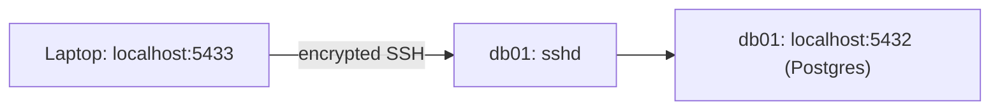

# Tunnels: local and remote port forwarding

SSH can carry other TCP connections inside its encrypted connection.

## Local forwarding (-L): reach something only the server can reach

The database listens on `127.0.0.1:5432` on db01 (good security). You want to use it from your laptop:

```bash
ssh -L 5433:localhost:5432 db01
# now, on your laptop:
psql -h localhost -p 5433 -U app
```



The middle part (`localhost:5432`) is resolved **on the server**. So you can reach a third machine the server can see:

```bash
ssh -L 6380:redis.internal:6379 bastion     # reach a private Redis through the bastion
```

## Remote forwarding (-R): expose something from your side to the server

```bash
ssh -R 9000:localhost:3000 web01
# on web01, localhost:9000 now reaches the dev server running on your laptop's port 3000
```

Useful for showing a local app to a remote machine, or reaching a machine behind NAT that can only dial out. By default the remote port listens only on the server's localhost (`GatewayPorts no`): keep it that way unless you mean to publish it.

## Handy flags

```bash
ssh -fN -L 5433:localhost:5432 db01      # -f background, -N no shell: just the tunnel
```

Keep a tunnel alive with `autossh` or a small systemd service. And remember: anything that can use your tunnel's local port uses **your** access, so bind local ports to `127.0.0.1` (the default).
