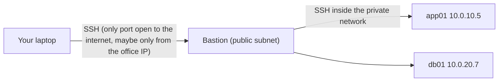

# Bastions and ProxyJump

Private servers shouldn't accept SSH from the internet at all. A **bastion** (jump host) is the single, hardened, well-logged door.



## ProxyJump: one command, end-to-end encryption

```bash
ssh -J sara@bastion.example.com sara@10.0.10.5
```

```text
# ~/.ssh/config
Host bastion
    HostName bastion.example.com
    User sara

Host app01
    HostName 10.0.10.5
    User sara
    ProxyJump bastion

Host 10.0.*
    ProxyJump bastion
```

Now `ssh app01`, `scp file app01:`, `rsync` and Ansible all go through the bastion automatically.

**Important:** with ProxyJump, your SSH session to app01 is encrypted **from your laptop**; the bastion only passes bytes along. Your private key never touches the bastion.

## Make the bastion boring and strong

- Nothing else runs on it. No other services, no files, no tools.
- Keys only, `AllowGroups`, MFA or hardware keys, fail2ban.
- Its SSH open only from known IPs (office, VPN).
- Log every login, ship logs elsewhere.
- Private servers' security groups / firewalls accept SSH **only from the bastion**.

## Optional videos

The lesson above is complete on its own. These go deeper, if you like learning by watching.

**MIT 6.858, Lecture 4: Privilege separation (how OpenSSH limits damage)**

https://www.youtube.com/watch?v=dNl22h1kW1k
