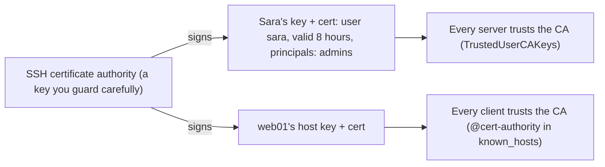

# SSH certificates: access that expires

With plain keys, every server keeps a list of allowed public keys, and every client trusts host keys one by one. With dozens of servers and people, that becomes hard to manage and to revoke. **SSH certificates** fix both directions.



## User certificates

```bash
ssh-keygen -t ed25519 -f user_ca                         # once: the CA key (keep it offline or in a vault)
ssh-keygen -s user_ca -I sara@2026-11-17 -n sara,admins -V +8h ~/.ssh/id_ed25519.pub
# -> ~/.ssh/id_ed25519-cert.pub, valid for 8 hours, for principals "sara" and "admins"
ssh-keygen -L -f ~/.ssh/id_ed25519-cert.pub             # inspect it
```

On every server:

```text
# /etc/ssh/sshd_config.d/30-ca.conf
TrustedUserCAKeys /etc/ssh/user_ca.pub
AuthorizedPrincipalsFile /etc/ssh/principals/%u     # e.g. /etc/ssh/principals/deploy contains "admins"
```

No `authorized_keys` to edit. Access ends when the certificate expires.

## Host certificates

```bash
ssh-keygen -s host_ca -I web01 -h -n web01,web01.example.com -V +52w /etc/ssh/ssh_host_ed25519_key.pub
```

Server: `HostCertificate /etc/ssh/ssh_host_ed25519_key-cert.pub`. Clients add one line to `known_hosts`:

```text
@cert-authority *.example.com ssh-ed25519 AAAA...host_ca...
```

No more "authenticity can't be established" prompts for new servers, and a real warning if one isn't signed.

Tools like HashiCorp Vault, Smallstep and Teleport run the CA for you and issue short certificates after single sign-on.
