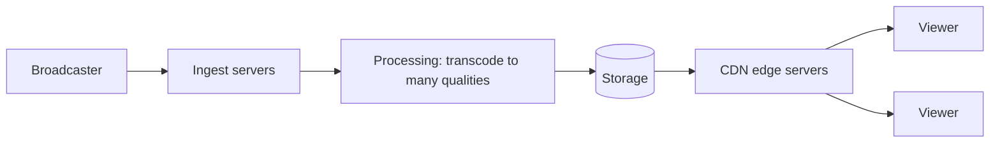

# Diagramming the approaches

When you draw, keep it simple and consistent:

- Draw the request path left to right.
- Label every arrow with *what* travels on it (raw video, segments, metadata).
- When there are two possible approaches, draw both and compare them on your requirements. The video does exactly this.
