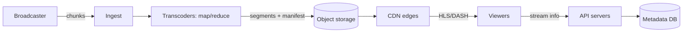

# High-level summary

Put the whole high-level design together and walk through one request, start to finish:

Practise saying it aloud in two minutes. Interviewers want a clear story more than a perfect diagram.
