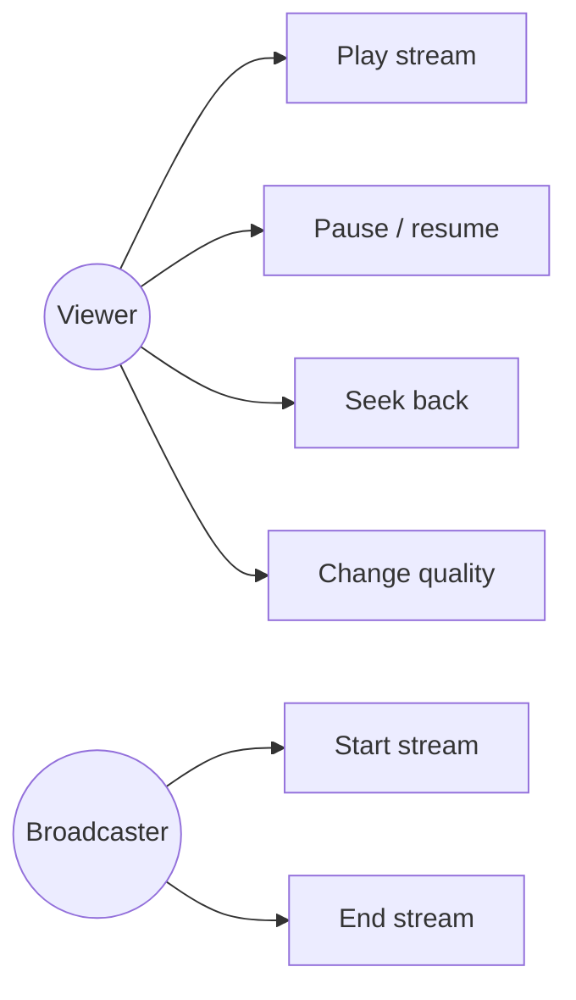

# Use case UML diagram

A **use case diagram** shows **who** (actors) can do **what** (use cases) with the system.

It's a planning tool: if an action isn't on the diagram, it's out of scope for now.
