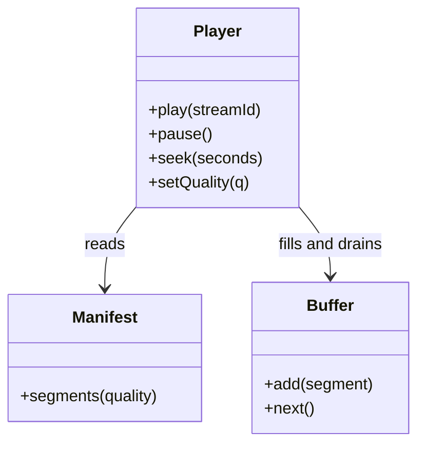

# Class UML diagram

A **class diagram** shows classes, their fields and methods, and how they relate.

Arrows mean "uses" or "has". Keep diagrams small: show the classes that matter for the question.
