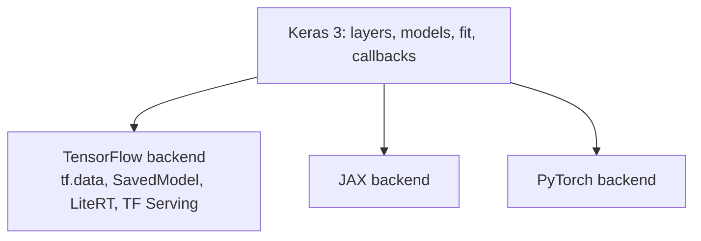
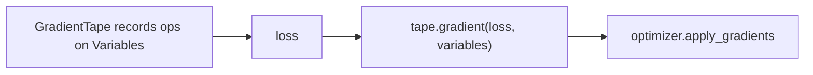

# TensorFlow and Keras today: tensors, variables and gradients

**TensorFlow** is Google's deep learning platform, strong in production and on mobile and edge devices (LiteRT, formerly TensorFlow Lite), in the browser (TensorFlow.js) and on TPUs. **Keras** is its high-level API. Since Keras 3 (2023), Keras is **multi-backend**: the same Keras code can run on TensorFlow, JAX or PyTorch. In TensorFlow 2.16 and later, `tf.keras` is Keras 3.



This course uses Keras with the TensorFlow backend (the default), plus TensorFlow's own tools where they matter.

## Install

```bash
pip install tensorflow          # includes Keras 3; GPU support on Linux with: pip install "tensorflow[and-cuda]"
```

## Tensors and variables

```python
import os
os.environ["TF_CPP_MIN_LOG_LEVEL"] = "2"           # hide TensorFlow's startup info messages
import numpy as np
import tensorflow as tf

a = tf.constant([[1.0, 2.0], [3.0, 4.0]])
print(a.shape, a.dtype)                            # (2, 2) <dtype: 'float32'>
print(tf.reduce_sum(a, axis=0).numpy())            # [4. 6.]: "axis", like NumPy
print((a @ tf.transpose(a)).numpy())
print(tf.reshape(tf.range(6), (2, 3)).numpy())
print(tf.convert_to_tensor(np.ones(3)).dtype)      # float64 from NumPy, as given

v = tf.Variable([1.0, 2.0])                        # a mutable tensor: weights are Variables
v.assign_add([0.5, 0.5])
print(v.numpy())
```

Tensors are **immutable**; `tf.Variable` holds state that changes (model weights). TensorFlow runs **eagerly** by default, like NumPy and PyTorch: each line executes immediately.

## Gradients with GradientTape

TensorFlow records operations inside a `GradientTape` block, then computes gradients from the tape:

```python
w = tf.Variable(2.0)
b = tf.Variable(0.5)
x, target = 3.0, 10.0
with tf.GradientTape() as tape:
    y = w * x + b
    loss = (y - target) ** 2
dw, db = tape.gradient(loss, [w, b])
print(float(loss), float(dw), float(db))           # 12.25 -21.0 -7.0: same as the PyTorch lesson
```



Compared with PyTorch: no `.backward()` and no gradient accumulation surprises; the tape returns gradients directly, and is used once (pass `persistent=True` to reuse it).

## Linear regression, TensorFlow style

```python
rng = np.random.default_rng(0)
X = rng.normal(size=(200, 3)).astype("float32")
y = (X @ np.array([2.0, -1.0, 0.5]) + 3.0 + rng.normal(scale=0.1, size=200)).astype("float32")

W = tf.Variable(tf.zeros(3)); B = tf.Variable(0.0)
opt = tf.keras.optimizers.SGD(learning_rate=0.1)
for step in range(200):
    with tf.GradientTape() as tape:
        loss = tf.reduce_mean((tf.linalg.matvec(X, W) + B - y) ** 2)
    grads = tape.gradient(loss, [W, B])
    opt.apply_gradients(zip(grads, [W, B]))
print(W.numpy().round(2), round(float(B), 2))
```

You'll rarely write this loop: Keras's `fit` does it for you (next lesson). Knowing it exists matters for custom training in part 2.

## Optional videos

The lesson above is complete on its own. These go deeper, if you like learning by watching.

**Learn TensorFlow and Deep Learning fundamentals, part 1 (Daniel Bourke)**

https://www.youtube.com/watch?v=tpCFfeUEGs8
