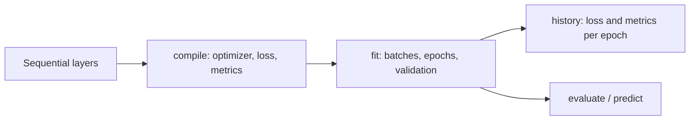

# Your first Keras model: compile, fit, evaluate

Keras turns the training loop into three calls: **compile** (choose optimizer, loss, metrics), **fit** (train), **evaluate** / **predict**.

```python
import numpy as np
import keras
from sklearn.datasets import load_digits
from sklearn.model_selection import train_test_split

keras.utils.set_random_seed(0)                     # seeds Python, NumPy and the backend together
d = load_digits()
X = (d.images / 16.0).astype("float32")[..., None]   # (1797, 8, 8, 1): Keras images are channels-last
y = d.target
X_tr, X_te, y_tr, y_te = train_test_split(X, y, test_size=0.2, random_state=0, stratify=y)

model = keras.Sequential([
    keras.Input(shape=(8, 8, 1)),
    keras.layers.Flatten(),
    keras.layers.Dense(128, activation="relu"),
    keras.layers.Dropout(0.2),
    keras.layers.Dense(10),                                   # logits
])
model.summary()

model.compile(
    optimizer=keras.optimizers.AdamW(learning_rate=1e-3),
    loss=keras.losses.SparseCategoricalCrossentropy(from_logits=True),   # integer labels, raw logits
    metrics=["accuracy"],
)
history = model.fit(X_tr, y_tr, validation_split=0.2, epochs=20, batch_size=64, verbose=0)
print({k: round(v[-1], 3) for k, v in history.history.items()})
test_loss, test_acc = model.evaluate(X_te, y_te, verbose=0)
print(f"test accuracy {test_acc:.3f}")
probs = keras.ops.softmax(model.predict(X_te[:3], verbose=0)).numpy()
print(probs.argmax(1), y_te[:3])
```



## Matching the loss to the labels

| Labels | Last layer | Loss |
|---|---|---|
| integers 0..C-1 | `Dense(C)` logits | `SparseCategoricalCrossentropy(from_logits=True)` |
| one-hot vectors | `Dense(C)` logits | `CategoricalCrossentropy(from_logits=True)` |
| 0/1 | `Dense(1)` logit | `BinaryCrossentropy(from_logits=True)` |
| numbers | `Dense(1)` | `MeanSquaredError()` or `Huber()` |

`from_logits=True` with a plain last layer is the numerically safer choice; if you put `activation="softmax"` on the last layer, use `from_logits=False` instead. Mismatching the two is the Keras version of the classic softmax bug.

## Reading the history

`fit` returns a `History` whose `.history` dict holds a list per metric: `loss`, `accuracy`, `val_loss`, `val_accuracy`. Plot `loss` and `val_loss` together to spot underfitting and overfitting, exactly as in the PyTorch course.

## Validation data

`validation_split=0.2` takes the **last** 20% of the arrays you pass (before shuffling), so shuffle your data first if it's ordered, or pass `validation_data=(X_val, y_val)` explicitly, which is clearer.
