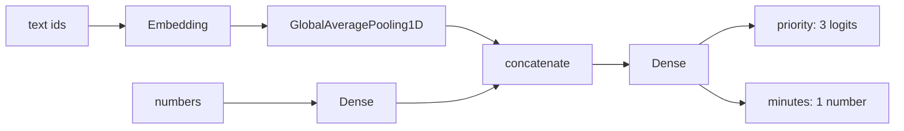

# The Functional API and subclassed models

`Sequential` is a straight stack. Real models branch: two inputs, two outputs, skip connections. Keras offers two more ways to build them.

## Functional API: layers as functions on tensors

```python
import numpy as np
import keras
from keras import layers

keras.utils.set_random_seed(0)
# a model with two inputs: a short text (as token ids) and a few numbers
text_in = keras.Input(shape=(20,), dtype="int32", name="text")
num_in = keras.Input(shape=(3,), name="numbers")

t = layers.Embedding(input_dim=1000, output_dim=16)(text_in)
t = layers.GlobalAveragePooling1D()(t)
n = layers.Dense(16, activation="relu")(num_in)
h = layers.concatenate([t, n])
h = layers.Dense(32, activation="relu")(h)
priority = layers.Dense(3, name="priority")(h)                       # 3 classes
minutes = layers.Dense(1, name="minutes")(h)                         # a number

model = keras.Model(inputs=[text_in, num_in], outputs=[priority, minutes])
model.compile(
    optimizer="adam",
    loss={"priority": keras.losses.SparseCategoricalCrossentropy(from_logits=True), "minutes": "mse"},
    loss_weights={"priority": 1.0, "minutes": 0.01},
)
N = 256
inputs = {"text": np.random.randint(0, 1000, (N, 20)), "numbers": np.random.rand(N, 3).astype("float32")}
targets = {"priority": np.random.randint(0, 3, N), "minutes": np.random.rand(N, 1).astype("float32") * 60}
model.fit(inputs, targets, epochs=2, verbose=0)
out = model.predict({k: v[:2] for k, v in inputs.items()}, verbose=0)
print({k: v.shape for k, v in out.items()} if isinstance(out, dict) else [o.shape for o in out])
```



Named inputs and outputs let you pass dicts, which avoids silent mix-ups in the order of arrays. `keras.utils.plot_model(model)` draws the graph (it needs the graphviz program installed).

## Residual connections

```python
inp = keras.Input((32,))
x = layers.Dense(32, activation="relu")(inp)
x = layers.Dense(32)(x)
out = layers.Activation("relu")(layers.add([inp, x]))     # skip connection: output = relu(input + F(input))
res_block = keras.Model(inp, out)
print(res_block.output.shape)
```

## Subclassing: full Python control

```python
class Classifier(keras.Model):
    def __init__(self, n_classes, **kwargs):
        super().__init__(**kwargs)
        self.hidden = layers.Dense(64, activation="relu")
        self.drop = layers.Dropout(0.2)
        self.out = layers.Dense(n_classes)

    def call(self, x, training=False):             # training flag controls dropout and batch norm
        return self.out(self.drop(self.hidden(x), training=training))

clf = Classifier(4)
print(clf(np.zeros((2, 10), "float32")).shape)
```

| Style | Use when |
|---|---|
| Sequential | a plain stack |
| **Functional** | most real models: branches, several inputs/outputs, shared layers; easy to inspect, save and export |
| Subclassing | research code with unusual control flow; most flexible, harder to inspect |

Functional models are the best default: Keras knows the whole graph, so `summary()`, saving and export work without surprises.
