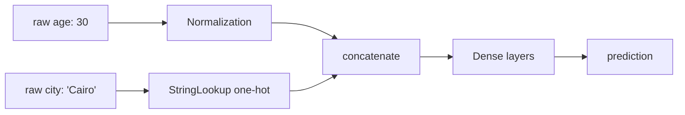

# Layers, including preprocessing layers

## The core layers

| Layer | Purpose |
|---|---|
| `Dense(units, activation)` | fully connected |
| `Conv2D(filters, kernel_size, padding="same")` | image convolution (channels-last by default) |
| `MaxPooling2D`, `GlobalAveragePooling2D` | downsample, then collapse to one vector |
| `BatchNormalization`, `LayerNormalization` | stabilise training |
| `Dropout(rate)` | regularisation, only active during training |
| `Embedding(vocab, dim)` | token ids to vectors |
| `LSTM`, `GRU`, `MultiHeadAttention` | sequences |

Layers create their weights the first time they see an input shape (**lazy building**), which is why Keras models often start with `keras.Input(shape=...)`.

## Preprocessing layers: put the preprocessing inside the model

A big Keras strength: normalisation, text tokenisation and category lookup can be **layers**. They're saved with the model, so the deployed model accepts raw inputs and can't be fed differently-scaled data by mistake.

```python
import numpy as np
import tensorflow as tf
import keras
from keras import layers

keras.utils.set_random_seed(0)

# numbers: learn mean and variance from training data with adapt()
ages = np.array([[18.0], [25.0], [40.0], [65.0]], dtype="float32")
norm = layers.Normalization()
norm.adapt(ages)
print(norm(ages).numpy().ravel().round(2))                 # standardised

# categories: strings to integer ids, then one-hot
cities = np.array(["Cairo", "Giza", "Cairo", "Alexandria"])
lookup = layers.StringLookup(output_mode="one_hot")
lookup.adapt(cities)
print([str(v) for v in lookup.get_vocabulary()])           # ['[UNK]', 'Cairo', ...]: unknown values get their own slot
print(lookup(np.array(["Giza", "Luxor"])).numpy())

# text: raw strings to padded token ids
texts = np.array(["the order arrived late", "great service", "late again, very late"])
vec = layers.TextVectorization(max_tokens=50, output_sequence_length=6)
vec.adapt(texts)
print(vec(texts).numpy())
```

`adapt()` computes statistics from training data only, just like fitting a scaler in scikit-learn.

## A model that takes raw inputs

```python
age_in = keras.Input(shape=(1,), name="age")
city_in = keras.Input(shape=(1,), dtype="string", name="city")
x = layers.concatenate([norm(age_in), lookup(city_in)])
x = layers.Dense(16, activation="relu")(x)
out = layers.Dense(1, activation="sigmoid")(x)
model = keras.Model([age_in, city_in], out)
print(model.predict({"age": np.array([[30.0]]), "city": tf.constant([["Cairo"]])}, verbose=0).shape)   # strings as a tf tensor
```



For heavy preprocessing during training (image decoding, augmentation), it can be faster to run these layers inside a `tf.data` pipeline (next module) and keep a lighter version in the exported model.
