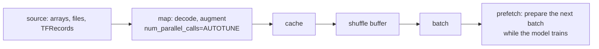

# Input pipelines with tf.data

`tf.data` builds input pipelines that read, transform, shuffle and batch data in parallel, so the accelerator never waits. Keras's `fit` accepts a `tf.data.Dataset` directly.



```python
import os
os.environ["TF_CPP_MIN_LOG_LEVEL"] = "2"
import numpy as np
import tensorflow as tf
import keras
from sklearn.datasets import load_digits

keras.utils.set_random_seed(0)
d = load_digits()
X = (d.images / 16.0).astype("float32")[..., None]
y = d.target.astype("int64")
n_val = 300
AUTOTUNE = tf.data.AUTOTUNE

def augment(image, label):
    image = image + tf.random.normal(tf.shape(image), stddev=0.05)        # a little noise
    image = tf.roll(image, shift=tf.random.uniform([], -1, 2, dtype=tf.int32), axis=1)   # shift sideways by up to 1 px
    return tf.clip_by_value(image, 0.0, 1.0), label

train_ds = (tf.data.Dataset.from_tensor_slices((X[n_val:], y[n_val:]))
            .cache()                                  # keep decoded data in memory after the first epoch
            .shuffle(2000)                            # buffer at least as big as the dataset for a full shuffle
            .map(augment, num_parallel_calls=AUTOTUNE)
            .batch(64)
            .prefetch(AUTOTUNE))
val_ds = tf.data.Dataset.from_tensor_slices((X[:n_val], y[:n_val])).batch(256).prefetch(AUTOTUNE)

images, labels = next(iter(train_ds))
print(images.shape, labels.shape)                     # (64, 8, 8, 1) (64,)

model = keras.Sequential([keras.Input((8, 8, 1)), keras.layers.Flatten(),
                          keras.layers.Dense(128, activation="relu"), keras.layers.Dense(10)])
model.compile("adam", keras.losses.SparseCategoricalCrossentropy(from_logits=True), metrics=["accuracy"])
model.fit(train_ds, validation_data=val_ds, epochs=10, verbose=0)
print("val accuracy:", round(model.evaluate(val_ds, verbose=0)[1], 3))
```

## The order matters

- `cache()` **before** random augmentation, so you cache clean data and still get new augmentations each epoch.
- `shuffle()` before `batch()`, so batches mix examples (shuffling batches only moves whole batches).
- `prefetch()` last.
- Don't augment validation data.

## Reading files

For data on disk, start from file paths and decode in `map`:

```python
paths = tf.data.Dataset.from_tensor_slices(["a.png", "b.png"])
# images = paths.map(lambda p: tf.image.resize(tf.io.decode_png(tf.io.read_file(p), channels=3), (224, 224)))
print(paths.cardinality().numpy(), "files listed")
```

`keras.utils.image_dataset_from_directory("data/train", image_size=(224, 224))` does this for a folder with one sub-folder per class. Very large datasets are often stored as **TFRecord** files (sequences of serialised examples) and read in parallel with `tf.data.TFRecordDataset`.
