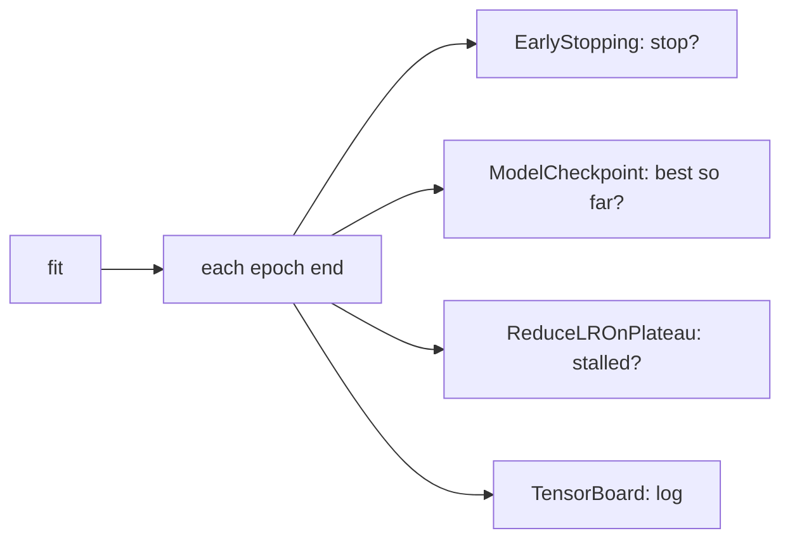

# Callbacks, schedules and TensorBoard

**Callbacks** run at points in `fit` (start or end of each epoch or batch). They give you early stopping, checkpoints, learning-rate control and logging without writing a custom loop.

```python
import numpy as np
import keras
from sklearn.datasets import load_digits
from sklearn.model_selection import train_test_split

keras.utils.set_random_seed(0)                     # seeds Python, NumPy and the backend together
d = load_digits()
X = (d.images / 16.0).astype("float32")[..., None]   # (1797, 8, 8, 1): Keras images are channels-last
y = d.target
X_tr, X_te, y_tr, y_te = train_test_split(X, y, test_size=0.2, random_state=0, stratify=y)

def make_model():
    m = keras.Sequential([keras.Input((8, 8, 1)), keras.layers.Flatten(),
                          keras.layers.Dense(128, activation="relu"), keras.layers.Dropout(0.3), keras.layers.Dense(10)])
    m.compile(keras.optimizers.Adam(1e-3), keras.losses.SparseCategoricalCrossentropy(from_logits=True), metrics=["accuracy"])
    return m

class PrintEvery(keras.callbacks.Callback):            # your own callback
    def __init__(self, every=10):
        super().__init__(); self.every = every
    def on_epoch_end(self, epoch, logs=None):
        if (epoch + 1) % self.every == 0:
            print(f"epoch {epoch + 1}: val_accuracy {logs['val_accuracy']:.3f}, lr {float(self.model.optimizer.learning_rate):.1e}")

callbacks = [
    keras.callbacks.EarlyStopping(monitor="val_loss", patience=8, restore_best_weights=True),
    keras.callbacks.ModelCheckpoint("best.keras", monitor="val_accuracy", save_best_only=True),
    keras.callbacks.ReduceLROnPlateau(monitor="val_loss", factor=0.5, patience=3),
    keras.callbacks.TensorBoard(log_dir="logs/run1"),
    PrintEvery(10),
]
model = make_model()
hist = model.fit(X_tr, y_tr, validation_split=0.2, epochs=100, batch_size=64, callbacks=callbacks, verbose=0)
print("stopped after", len(hist.history["loss"]), "epochs; test accuracy",
      round(model.evaluate(X_te, y_te, verbose=0)[1], 3))
```

| Callback | Does |
|---|---|
| `EarlyStopping(restore_best_weights=True)` | stops when the monitored value stops improving, and rolls back to the best epoch |
| `ModelCheckpoint(save_best_only=True)` | saves the best model to disk as training runs |
| `ReduceLROnPlateau` | lowers the learning rate when progress stalls |
| `TensorBoard(log_dir)` | logs curves for `tensorboard --logdir logs` |
| `CSVLogger`, `BackupAndRestore` | a CSV of metrics; resume after an interruption |

## Learning-rate schedules

Instead of reacting to plateaus, set a schedule up front by passing it as the learning rate:

```python
steps_per_epoch = int(len(X_tr) * 0.8) // 64
schedule = keras.optimizers.schedules.CosineDecay(
    initial_learning_rate=0.0, decay_steps=30 * steps_per_epoch,
    warmup_target=2e-3, warmup_steps=2 * steps_per_epoch)        # linear warmup, then cosine
print([round(float(schedule(s)), 5) for s in (0, steps_per_epoch, 2 * steps_per_epoch, 30 * steps_per_epoch)])
model = make_model()
model.compile(keras.optimizers.AdamW(learning_rate=schedule, weight_decay=0.01),
              keras.losses.SparseCategoricalCrossentropy(from_logits=True), metrics=["accuracy"])
model.fit(X_tr, y_tr, validation_split=0.2, epochs=30, batch_size=64, verbose=0)
print("with warmup + cosine:", round(model.evaluate(X_te, y_te, verbose=0)[1], 3))
```


