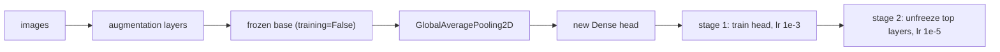

# CNNs and transfer learning in Keras

## A CNN on the digits

```python
import numpy as np
import keras
from sklearn.datasets import load_digits
from sklearn.model_selection import train_test_split

keras.utils.set_random_seed(0)                     # seeds Python, NumPy and the backend together
d = load_digits()
X = (d.images / 16.0).astype("float32")[..., None]   # (1797, 8, 8, 1): Keras images are channels-last
y = d.target
X_tr, X_te, y_tr, y_te = train_test_split(X, y, test_size=0.2, random_state=0, stratify=y)
from keras import layers

cnn = keras.Sequential([
    keras.Input((8, 8, 1)),
    layers.RandomTranslation(0.1, 0.1),                          # augmentation layers: active only in training
    layers.Conv2D(32, 3, padding="same", use_bias=False), layers.BatchNormalization(momentum=0.9), layers.ReLU(),
    layers.Conv2D(32, 3, padding="same", use_bias=False), layers.BatchNormalization(momentum=0.9), layers.ReLU(),
    layers.MaxPooling2D(),
    layers.Conv2D(64, 3, padding="same", activation="relu"),
    layers.GlobalAveragePooling2D(),
    layers.Dropout(0.2),
    layers.Dense(10),
])
cnn.compile(keras.optimizers.AdamW(2e-3), keras.losses.SparseCategoricalCrossentropy(from_logits=True), metrics=["accuracy"])
cnn.fit(X_tr, y_tr, validation_split=0.2, epochs=30, batch_size=64, verbose=0,
        callbacks=[keras.callbacks.EarlyStopping(patience=6, restore_best_weights=True)])
print("CNN test accuracy:", round(cnn.evaluate(X_te, y_te, verbose=0)[1], 3))
```

**About `momentum=0.9`:** BatchNorm keeps running averages of each channel's mean and variance for use at inference. Keras's default momentum (0.99) updates them very slowly; on a small dataset with few steps per epoch they never catch up, and the model scores near chance at evaluation even though training looks fine. A lower momentum (0.9) fixes it. PyTorch's default is the equivalent of 0.9, which is why the same model worked there without changes.

Keras images are **channels-last**: `(batch, height, width, channels)`, the opposite of PyTorch. Augmentation layers such as `RandomFlip`, `RandomRotation`, `RandomZoom` and `RandomTranslation` only act during training and pass images through unchanged at inference.

## Transfer learning with keras.applications

```python
base = keras.applications.MobileNetV3Small(
    input_shape=(224, 224, 3), include_top=False,
    weights=None,                 # use weights="imagenet" with internet: downloaded once, then cached
    include_preprocessing=True)   # this model expects raw pixels 0..255 and preprocesses itself
base.trainable = False            # freeze

inputs = keras.Input((224, 224, 3))
x = layers.RandomFlip("horizontal")(inputs)
x = base(x, training=False)       # keep BatchNorm in inference mode, even when fine-tuning later
x = layers.GlobalAveragePooling2D()(x)
x = layers.Dropout(0.2)(x)
outputs = layers.Dense(3)(x)
model = keras.Model(inputs, outputs)
model.compile(keras.optimizers.Adam(1e-3), keras.losses.SparseCategoricalCrossentropy(from_logits=True), metrics=["accuracy"])
print(len(model.trainable_weights), "trainable weight tensors (just the new head)")
print(model.predict(np.random.uniform(0, 255, (2, 224, 224, 3)).astype("float32"), verbose=0).shape)

# stage 2: unfreeze the top of the base and fine-tune with a small learning rate
base.trainable = True
for layer in base.layers[:-20]:
    layer.trainable = False
model.compile(keras.optimizers.Adam(1e-5), keras.losses.SparseCategoricalCrossentropy(from_logits=True), metrics=["accuracy"])
print(len(model.trainable_weights), "trainable weight tensors after unfreezing the top")
```



Two Keras-specific rules: **recompile after changing `trainable`** (otherwise the change is ignored), and call the base with `training=False` so its BatchNorm statistics aren't destroyed by your small dataset. Check each model's documentation for the input range it expects; some include preprocessing, others need `keras.applications.<family>.preprocess_input`.

## Optional videos

The lesson above is complete on its own. These go deeper, if you like learning by watching.

**CNN: Convolutional Neural Networks Explained (Computerphile)**

https://www.youtube.com/watch?v=py5byOOHZM8
