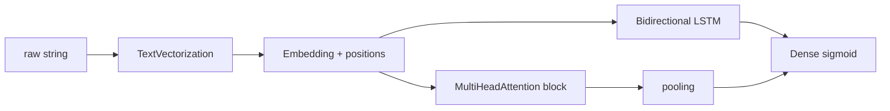

# Text and sequences in Keras

From raw strings to predictions inside one model: `TextVectorization`, then `Embedding`, then a sequence layer.

```python
import numpy as np
import tensorflow as tf
import keras
from keras import layers

keras.utils.set_random_seed(0)
pos_words = ["great", "fast", "friendly", "perfect", "helpful", "love"]
neg_words = ["late", "broken", "rude", "slow", "wrong", "refund"]
filler = ["the", "order", "was", "and", "service", "delivery", "very", "my", "it", "again"]
rng = np.random.default_rng(0)

def make_review(label):
    words = list(rng.choice(filler, 6)) + list(rng.choice(pos_words if label else neg_words, 2))
    rng.shuffle(words)
    return " ".join(words)

labels = rng.integers(0, 2, 1200)
texts = tf.constant([make_review(l) for l in labels])     # string data: pass it to Keras as a tf tensor
print(texts[:2].numpy(), labels[:2])

vectorize = layers.TextVectorization(max_tokens=1000, output_sequence_length=12)
vectorize.adapt(texts[:1000])                      # vocabulary from training texts only
```

## Model 1: embeddings + bidirectional LSTM

```python
def text_model(sequence_block):
    inp = keras.Input(shape=(1,), dtype="string")
    x = vectorize(inp)
    x = layers.Embedding(1000, 32, mask_zero=True)(x)       # mask_zero: ignore padding
    x = sequence_block(x)
    out = layers.Dense(1, activation="sigmoid")(x)
    m = keras.Model(inp, out)
    m.compile("adam", "binary_crossentropy", metrics=["accuracy"])
    return m

lstm = text_model(layers.Bidirectional(layers.LSTM(32)))
lstm.fit(texts[:1000], labels[:1000], epochs=5, batch_size=32, verbose=0)
print("LSTM val accuracy:", round(lstm.evaluate(texts[1000:], labels[1000:], verbose=0)[1], 3))
print(lstm.predict(tf.constant([["the delivery was late and broken"], ["friendly and fast service"]]), verbose=0).round(2))
```

## Model 2: a small transformer encoder

```python
class TransformerBlock(layers.Layer):
    def __init__(self, dim, heads, **kwargs):
        super().__init__(**kwargs)
        self.att = layers.MultiHeadAttention(num_heads=heads, key_dim=dim // heads)
        self.ffn = keras.Sequential([layers.Dense(2 * dim, activation="gelu"), layers.Dense(dim)])
        self.ln1, self.ln2 = layers.LayerNormalization(), layers.LayerNormalization()

    def call(self, x):
        x = self.ln1(x + self.att(x, x))                  # self-attention + residual
        return self.ln2(x + self.ffn(x))

def transformer_block(x):
    positions = keras.ops.arange(12)
    x = x + layers.Embedding(12, 32)(positions)           # learned positions
    x = TransformerBlock(32, 4)(x)
    return layers.GlobalAveragePooling1D()(x)

trf = text_model(transformer_block)
trf.fit(texts[:1000], labels[:1000], epochs=5, batch_size=32, verbose=0)
print("Transformer val accuracy:", round(trf.evaluate(texts[1000:], labels[1000:], verbose=0)[1], 3))
```



Both models accept raw strings because `TextVectorization` is inside them. For serious NLP, start from pretrained models instead: **KerasHub** (formerly KerasNLP) provides pretrained BERT, Gemma and other models as Keras layers, and the Hugging Face course covers the PyTorch side.

## Optional videos

The lesson above is complete on its own. These go deeper, if you like learning by watching.

**Transformers, the tech behind LLMs (3Blue1Brown, Deep Learning chapter 5)**

https://www.youtube.com/watch?v=wjZofJX0v4M
