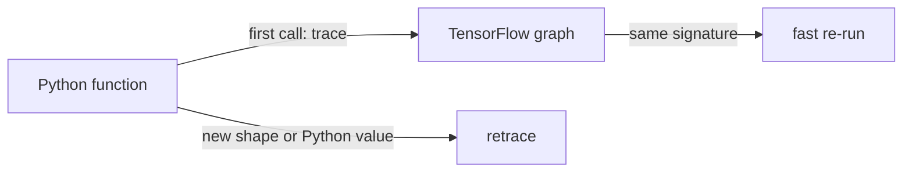

# Saving, loading and tf.function

## Three ways to save

| Format | Call | Use |
|---|---|---|
| `.keras` file | `model.save("m.keras")`, `keras.models.load_model` | to continue training or reuse in Python; architecture + weights + optimizer |
| weights only | `model.save_weights("m.weights.h5")` | when you rebuild the architecture in code |
| **SavedModel** (export) | `model.export("dir")` | for deployment: TF Serving, LiteRT conversion, TensorFlow.js; no Python model code needed |

```python
import os
os.environ["TF_CPP_MIN_LOG_LEVEL"] = "2"
import numpy as np
import tensorflow as tf
import keras

keras.utils.set_random_seed(0)
model = keras.Sequential([keras.Input((4,)), keras.layers.Dense(8, activation="relu"), keras.layers.Dense(3)])
model.compile("adam", keras.losses.SparseCategoricalCrossentropy(from_logits=True))
model.fit(np.random.rand(64, 4).astype("float32"), np.random.randint(0, 3, 64), epochs=2, verbose=0)
x = np.random.rand(5, 4).astype("float32")

model.save("model.keras")
again = keras.models.load_model("model.keras")
print(np.allclose(model.predict(x, verbose=0), again.predict(x, verbose=0)))

model.export("exported_model", verbose=False)             # a TensorFlow SavedModel directory
served = tf.saved_model.load("exported_model")
print(np.allclose(served.serve(x).numpy(), model.predict(x, verbose=0), atol=1e-6))
```

Custom layers and models need `@keras.saving.register_keras_serializable()` and a `get_config()` method to be saved in the `.keras` format; exporting to SavedModel doesn't need them.

## tf.function: graphs for speed and export

Eager execution is easy to debug; graphs are faster and portable. `@tf.function` **traces** a Python function into a TensorFlow graph the first time it's called with a given input signature.

```python
@tf.function
def scaled_sum(a, b):
    print("tracing!")                       # Python side effects run only while tracing
    return tf.reduce_sum(a * 2 + b)

print(scaled_sum(tf.ones(3), tf.ones(3)).numpy())   # traces, then runs
print(scaled_sum(tf.ones(3), tf.zeros(3)).numpy())  # same shapes and types: reuses the graph, no print
print(scaled_sum(tf.ones(4), tf.ones(4)).numpy())   # new shape: traces again

@tf.function(input_signature=[tf.TensorSpec([None], tf.float32)])
def any_length(a):
    return tf.reduce_mean(a)
print(any_length(tf.range(10, dtype=tf.float32)).numpy())
```



Keras compiles `fit`, `evaluate` and `predict` into graphs for you. Write `tf.function` yourself for custom training loops and exported serving functions, and watch for **retracing**: passing Python numbers or changing shapes every call silently retraces and makes code slow (part 2 covers how to avoid it).
