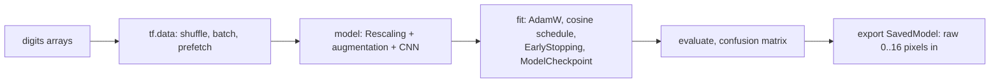

# Project: a complete Keras pipeline

Everything from this course in one project: data in `tf.data`, preprocessing and augmentation layers, a CNN, callbacks with a schedule, evaluation, error analysis and an exported model that accepts raw input.



```python
import os
os.environ["TF_CPP_MIN_LOG_LEVEL"] = "2"
import numpy as np
import tensorflow as tf
import keras
from keras import layers
from sklearn.datasets import load_digits
from sklearn.metrics import confusion_matrix
from sklearn.model_selection import train_test_split

keras.utils.set_random_seed(0)
d = load_digits()
X = d.images.astype("float32")[..., None]                   # raw pixel values 0..16: scaling happens inside the model
y = d.target
X_tmp, X_te, y_tmp, y_te = train_test_split(X, y, test_size=0.2, random_state=0, stratify=y)
X_tr, X_va, y_tr, y_va = train_test_split(X_tmp, y_tmp, test_size=0.2, random_state=0, stratify=y_tmp)

AUTOTUNE = tf.data.AUTOTUNE
train_ds = tf.data.Dataset.from_tensor_slices((X_tr, y_tr)).shuffle(2000).batch(64).prefetch(AUTOTUNE)
val_ds = tf.data.Dataset.from_tensor_slices((X_va, y_va)).batch(256).prefetch(AUTOTUNE)

inputs = keras.Input((8, 8, 1), name="pixels")
x = layers.Rescaling(1 / 16.0)(inputs)
x = layers.RandomTranslation(0.1, 0.1)(x)
for filters in (32, 32):
    x = layers.Conv2D(filters, 3, padding="same", use_bias=False)(x)
    x = layers.BatchNormalization(momentum=0.9)(x)
    x = layers.ReLU()(x)
x = layers.MaxPooling2D()(x)
x = layers.Conv2D(64, 3, padding="same", activation="relu")(x)
x = layers.GlobalAveragePooling2D()(x)
x = layers.Dropout(0.2)(x)
outputs = layers.Dense(10, name="logits")(x)
model = keras.Model(inputs, outputs)

epochs = 60
schedule = keras.optimizers.schedules.CosineDecay(3e-3, decay_steps=epochs * len(train_ds))
model.compile(keras.optimizers.AdamW(schedule, weight_decay=0.01),
              keras.losses.SparseCategoricalCrossentropy(from_logits=True), metrics=["accuracy"])
model.fit(train_ds, validation_data=val_ds, epochs=epochs, verbose=0, callbacks=[
    keras.callbacks.EarlyStopping(monitor="val_accuracy", patience=8, restore_best_weights=True),
    keras.callbacks.ModelCheckpoint("digits_best.keras", monitor="val_accuracy", save_best_only=True)])

test_acc = model.evaluate(X_te, y_te, verbose=0)[1]
pred = model.predict(X_te, verbose=0).argmax(1)
print(f"test accuracy {test_acc:.3f}")
print(confusion_matrix(y_te, pred))

model.export("digits_savedmodel", verbose=False)
served = tf.saved_model.load("digits_savedmodel")
print("served prediction:", served.serve(X_te[:5]).numpy().argmax(1), "true:", y_te[:5])
```

Because `Rescaling` lives inside the model, the exported model takes raw pixel values, exactly as they come from the data source.

## Your turn

1. Replace the digits with a small dataset of your own images using `keras.utils.image_dataset_from_directory`, and transfer learning from `keras.applications`.
2. Add a `ReduceLROnPlateau` run and compare with the cosine schedule.
3. Write down your best validation and final test accuracy, the confusion matrix, and three misclassified examples with your guess at why.

Part 2 goes under the hood: custom training loops, custom layers and losses, performance, distribution and deployment to servers and phones.

## Optional videos

The lesson above is complete on its own. These go deeper, if you like learning by watching.

**Learn TensorFlow and Deep Learning fundamentals, part 1 (Daniel Bourke)**

https://www.youtube.com/watch?v=tpCFfeUEGs8
