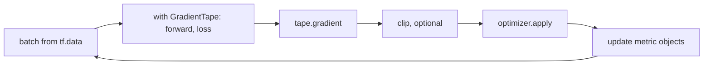

# Custom training loops with GradientTape

`fit` covers most needs. Write your own loop when training doesn't fit the mould: GANs (two models, two optimizers), reinforcement learning, unusual losses that need several forward passes, or research where you want every step visible.



```python
import os
os.environ["TF_CPP_MIN_LOG_LEVEL"] = "2"
import numpy as np
import tensorflow as tf
import keras
from keras import layers
from sklearn.datasets import load_digits

keras.utils.set_random_seed(0)
d = load_digits()
X = (d.images / 16.0).astype("float32")[..., None]
y = d.target.astype("int32")
X_tr, y_tr, X_va, y_va = X[300:], y[300:], X[:300], y[:300]

model = keras.Sequential([keras.Input((8, 8, 1)), layers.Flatten(),
                          layers.Dense(128, activation="relu"), layers.Dropout(0.2), layers.Dense(10)])
loss_fn = keras.losses.SparseCategoricalCrossentropy(from_logits=True)
opt = keras.optimizers.AdamW(1e-3)
train_acc = keras.metrics.SparseCategoricalAccuracy()
val_acc = keras.metrics.SparseCategoricalAccuracy()
train_ds = tf.data.Dataset.from_tensor_slices((X_tr, y_tr)).shuffle(2000).batch(64).prefetch(tf.data.AUTOTUNE)
val_ds = tf.data.Dataset.from_tensor_slices((X_va, y_va)).batch(256)

@tf.function                                  # compile the step into a graph: much faster than eager
def train_step(xb, yb):
    with tf.GradientTape() as tape:
        logits = model(xb, training=True)     # training=True: dropout on
        loss = loss_fn(yb, logits)
    grads = tape.gradient(loss, model.trainable_variables)
    grads, _ = tf.clip_by_global_norm(grads, 1.0)
    opt.apply(grads, model.trainable_variables)
    train_acc.update_state(yb, logits)
    return loss

@tf.function
def val_step(xb, yb):
    val_acc.update_state(yb, model(xb, training=False))

for epoch in range(10):
    for xb, yb in train_ds:
        loss = train_step(xb, yb)
    for xb, yb in val_ds:
        val_step(xb, yb)
    if epoch % 3 == 2:
        print(f"epoch {epoch + 1}: loss {float(loss):.3f}, train acc {float(train_acc.result()):.3f}, val acc {float(val_acc.result()):.3f}")
    train_acc.reset_state(); val_acc.reset_state()
```

## The pieces

- **`@tf.function`** turns the step into a graph once; later calls are fast. Keep Python-side logging outside it.
- **Metric objects** (`keras.metrics.*`) accumulate correctly over batches; `reset_state()` each epoch.
- **`training=True/False`** controls dropout and batch norm; in a custom loop you pass it yourself.
- **`optimizer.apply(grads, variables)`** is Keras 3's update call (older code uses `apply_gradients(zip(grads, vars))`, which still works).

## Two models, two optimizers

The reason custom loops exist, in miniature: a tiny GAN step where a generator and a discriminator are trained against each other.

```python
gen = keras.Sequential([keras.Input((4,)), layers.Dense(16, activation="relu"), layers.Dense(2)])
disc = keras.Sequential([keras.Input((2,)), layers.Dense(16, activation="relu"), layers.Dense(1)])
g_opt, d_opt = keras.optimizers.Adam(1e-3), keras.optimizers.Adam(1e-3)
bce = keras.losses.BinaryCrossentropy(from_logits=True)
real = tf.random.normal((64, 2), mean=3.0)

@tf.function
def gan_step(real):
    noise = tf.random.normal((64, 4))
    with tf.GradientTape() as g_tape, tf.GradientTape() as d_tape:
        fake = gen(noise, training=True)
        d_real, d_fake = disc(real, training=True), disc(fake, training=True)
        d_loss = bce(tf.ones_like(d_real), d_real) + bce(tf.zeros_like(d_fake), d_fake)
        g_loss = bce(tf.ones_like(d_fake), d_fake)                 # the generator wants fakes called real
    d_opt.apply(d_tape.gradient(d_loss, disc.trainable_variables), disc.trainable_variables)
    g_opt.apply(g_tape.gradient(g_loss, gen.trainable_variables), gen.trainable_variables)
    return d_loss, g_loss

for step in range(300):
    d_loss, g_loss = gan_step(real)
print("mean of generated points:", gen(tf.random.normal((500, 4))).numpy().mean(0).round(2), "(moving toward the real data around 3, 3)")
```
