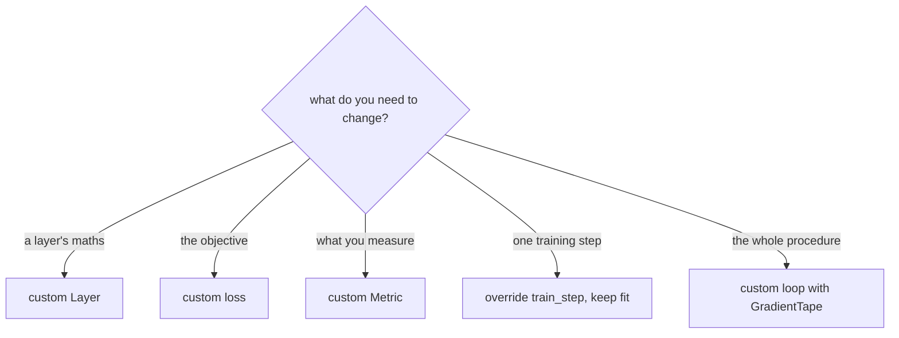

# Custom layers, losses, metrics and train_step

Often you don't need a whole custom loop: customise one piece and keep `fit`, callbacks and distribution for free.

## A custom layer

```python
import os
os.environ["TF_CPP_MIN_LOG_LEVEL"] = "2"
import numpy as np
import tensorflow as tf
import keras
from keras import layers
from sklearn.datasets import load_digits

keras.utils.set_random_seed(0)
d = load_digits()
X = (d.images / 16.0).astype("float32")[..., None]
y = d.target.astype("int32")
X_tr, y_tr, X_va, y_va = X[300:], y[300:], X[:300], y[:300]

@keras.saving.register_keras_serializable()
class RMSNorm(layers.Layer):
    def __init__(self, eps=1e-6, **kwargs):
        super().__init__(**kwargs)
        self.eps = eps

    def build(self, input_shape):                       # weights created once the input size is known
        self.scale = self.add_weight(shape=(input_shape[-1],), initializer="ones", name="scale")

    def call(self, x):
        ms = keras.ops.mean(keras.ops.square(x), axis=-1, keepdims=True)
        return x * keras.ops.rsqrt(ms + self.eps) * self.scale

    def get_config(self):                               # needed to save and reload the layer
        return {**super().get_config(), "eps": self.eps}

print(RMSNorm()(tf.random.normal((2, 5)) * 10).numpy().round(2))
```

Using `keras.ops` (instead of `tf.*`) keeps the layer working on every Keras backend.

## A custom loss and metric

```python
def focal_loss(gamma=2.0):
    """Down-weights easy examples; useful when one class dominates."""
    def loss(y_true, logits):
        y_true = keras.ops.cast(keras.ops.reshape(y_true, (-1,)), "int32")
        probs = keras.ops.softmax(logits)
        p_t = keras.ops.take_along_axis(probs, keras.ops.expand_dims(y_true, -1), axis=-1)[:, 0]
        return keras.ops.mean(-((1 - p_t) ** gamma) * keras.ops.log(p_t + 1e-7))
    return loss

class TopTwoAccuracy(keras.metrics.Metric):
    def __init__(self, name="top2", **kwargs):
        super().__init__(name=name, **kwargs)
        self.hits = self.add_variable(shape=(), initializer="zeros", name="hits")
        self.total = self.add_variable(shape=(), initializer="zeros", name="total")

    def update_state(self, y_true, y_pred, sample_weight=None):
        top2 = keras.ops.top_k(y_pred, k=2)[1]
        y = keras.ops.cast(keras.ops.reshape(y_true, (-1, 1)), top2.dtype)
        self.hits.assign_add(keras.ops.sum(keras.ops.cast(keras.ops.any(top2 == y, axis=1), "float32")))
        self.total.assign_add(keras.ops.cast(keras.ops.shape(y)[0], "float32"))

    def result(self):
        return self.hits / self.total

model = keras.Sequential([keras.Input((8, 8, 1)), layers.Flatten(), layers.Dense(64, activation="relu"), RMSNorm(), layers.Dense(10)])
model.compile("adam", loss=focal_loss(), metrics=["accuracy", TopTwoAccuracy()])
h = model.fit(X_tr, y_tr, validation_data=(X_va, y_va), epochs=8, verbose=0)
print({k: round(v[-1], 3) for k, v in h.history.items() if k.startswith("val")})
```

## Overriding train_step

The middle path: your own step logic, Keras's `fit` around it. Here, a step that adds a small penalty for confident predictions (an alternative to label smoothing):

```python
class ConfidencePenaltyModel(keras.Model):
    def train_step(self, data):
        x, y = data
        with tf.GradientTape() as tape:
            logits = self(x, training=True)
            loss = self.compute_loss(x=x, y=y, y_pred=logits)
            probs = tf.nn.softmax(logits)
            entropy = -tf.reduce_mean(tf.reduce_sum(probs * tf.math.log(probs + 1e-7), axis=1))
            total = loss - 0.1 * entropy                 # reward a little uncertainty
        grads = tape.gradient(total, self.trainable_variables)
        self.optimizer.apply(grads, self.trainable_variables)
        for m in self.metrics:
            m.update_state(loss) if m.name == "loss" else m.update_state(y, logits)
        return {m.name: m.result() for m in self.metrics}

inp = keras.Input((8, 8, 1))
out = layers.Dense(10)(layers.Dense(64, activation="relu")(layers.Flatten()(inp)))
cp = ConfidencePenaltyModel(inp, out)
cp.compile("adam", keras.losses.SparseCategoricalCrossentropy(from_logits=True), metrics=["accuracy"])
h = cp.fit(X_tr, y_tr, validation_data=(X_va, y_va), epochs=8, verbose=0)
print("val accuracy:", round(h.history["val_accuracy"][-1], 3))
```


