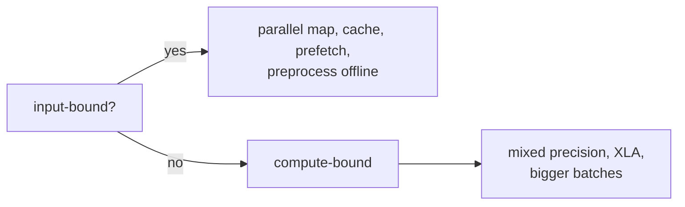

# Performance: graphs, XLA, mixed precision and input speed

## Avoid retracing

A `tf.function` retraces for every new input shape, dtype, or **Python value**. Passing Python numbers that change (a step counter, a learning rate) retraces every call:

```python
import os
os.environ["TF_CPP_MIN_LOG_LEVEL"] = "2"
import tensorflow as tf

traces = []

@tf.function
def scaled(x, factor):
    traces.append(1)                      # runs only while tracing
    return x * factor

for f in [1.0, 2.0, 3.0]:
    scaled(tf.ones(3), f)                 # a Python float: a new trace each time
print("traces with Python floats:", len(traces))

traces.clear()
for f in [1.0, 2.0, 3.0]:
    scaled(tf.ones(3), tf.constant(f))    # a tensor: one trace, reused
print("traces with tensors:", len(traces))

@tf.function(reduce_retracing=True)       # or give an input_signature with None for variable sizes
def total(x):
    return tf.reduce_sum(x)
for n in [3, 4, 5, 6]:
    total(tf.ones(n))
print("traces for 4 different lengths:", total.experimental_get_tracing_count())   # 1 or 2, not 4
```

## XLA

**XLA** compiles a graph further, fusing operations into fewer, faster kernels (the same idea as `torch.compile`). In Keras: `model.compile(..., jit_compile=True)` (often on by default where supported); for your own functions: `@tf.function(jit_compile=True)`.

```python
@tf.function(jit_compile=True)
def gelu_mlp(x, w1, w2):
    return tf.nn.gelu(x @ w1) @ w2

x, w1, w2 = tf.random.normal((64, 128)), tf.random.normal((128, 512)), tf.random.normal((512, 128))
print(gelu_mlp(x, w1, w2).shape)
```

## Mixed precision

One line switches Keras layers to compute in 16-bit while keeping weights in 32-bit:

```python
import keras
from keras import layers

keras.mixed_precision.set_global_policy("mixed_bfloat16")     # "mixed_float16" on older NVIDIA GPUs (adds loss scaling)
model = keras.Sequential([keras.Input((32,)), layers.Dense(64, activation="relu"),
                          layers.Dense(10, dtype="float32")])   # keep the output layer in float32 for a stable softmax/loss
print(model.layers[0].compute_dtype, model.layers[0].variable_dtype, model.layers[-1].compute_dtype)
keras.mixed_precision.set_global_policy("float32")            # back to the default for the rest of this lesson
```

With `mixed_float16`, Keras wraps the optimizer with **loss scaling** automatically when you use `fit`; in a custom loop, use `keras.optimizers.LossScaleOptimizer` yourself.

## Input speed

The [tf.data performance guide](https://www.tensorflow.org/guide/data_performance) boils down to: `map(..., num_parallel_calls=AUTOTUNE)`, `cache()` small datasets, `prefetch(AUTOTUNE)`, read many files in parallel with `interleave`, and do expensive one-off preprocessing offline (store resized images or tokenised text). The TensorBoard **Profiler** tab shows whether steps wait on input.


