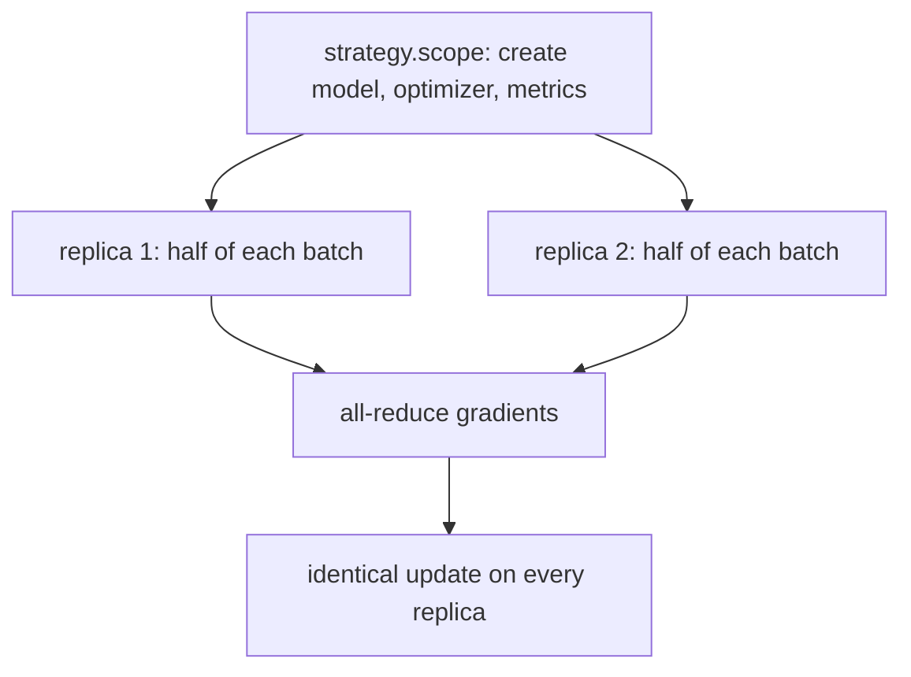

# Distributed training with tf.distribute

TensorFlow's distribution strategies wrap model creation and `fit` so the same code runs on one GPU, several GPUs, several machines or TPUs.

| Strategy | Where |
|---|---|
| `MirroredStrategy` | several GPUs in one machine (data parallel, like PyTorch DDP) |
| `MultiWorkerMirroredStrategy` | several machines, configured with the `TF_CONFIG` environment variable |
| `TPUStrategy` | Google Cloud TPUs and Colab/Kaggle TPUs |
| `ParameterServerStrategy` | large asynchronous training with parameter servers |



```python
import os
os.environ["TF_CPP_MIN_LOG_LEVEL"] = "2"
import numpy as np
import tensorflow as tf
import keras
from keras import layers

# On a machine without GPUs, split the CPU into 2 logical devices to try the strategy
# (this must run before TensorFlow uses any device, so restart Python if it fails)
cpus = tf.config.list_physical_devices("CPU")
try:
    tf.config.set_logical_device_configuration(cpus[0], [tf.config.LogicalDeviceConfiguration()] * 2)
except RuntimeError as err:
    print("devices already initialised; using what exists:", str(err)[:40])
devices = [d.name for d in tf.config.list_logical_devices("CPU")][:2]
strategy = tf.distribute.MirroredStrategy(devices=devices)     # on a GPU machine: tf.distribute.MirroredStrategy()
print("replicas:", strategy.num_replicas_in_sync)

per_replica_batch = 32
global_batch = per_replica_batch * strategy.num_replicas_in_sync
X = np.random.rand(2048, 16).astype("float32"); y = (X[:, :4].sum(1) > 2).astype("int32")
ds = tf.data.Dataset.from_tensor_slices((X, y)).shuffle(2048).batch(global_batch).prefetch(tf.data.AUTOTUNE)

with strategy.scope():                                         # variables created here are mirrored on every replica
    model = keras.Sequential([keras.Input((16,)), layers.Dense(64, activation="relu"), layers.Dense(2)])
    model.compile(keras.optimizers.Adam(1e-3 * strategy.num_replicas_in_sync ** 0.5),   # a common lr adjustment
                  keras.losses.SparseCategoricalCrossentropy(from_logits=True), metrics=["accuracy"])
model.fit(ds, epochs=3, verbose=0)                             # fit splits each global batch across replicas
print("accuracy:", round(model.evaluate(ds, verbose=0)[1], 3))
```

## The rules

- Create the model, optimizer and metrics **inside `strategy.scope()`**; `fit` and `evaluate` can be called outside.
- **Batch with the global batch size** (per-replica × replicas); the strategy splits it.
- Larger global batches usually need a larger (or warmed-up) learning rate.
- In custom loops, use `strategy.distribute_datasets_from_function` and `strategy.run(step, args=...)`, and scale the loss by the global batch size (`tf.nn.compute_average_loss`).
- On multiple machines, every worker runs the same script with its own `TF_CONFIG` (its index and the cluster's addresses); only the chief worker should save checkpoints and write logs.

## Keras 3's own distribution

Keras 3 also offers `keras.distribution` (data and model parallelism through a device mesh), currently most complete on the JAX backend. If you plan very large-scale training today, JAX with Keras or plain JAX, or PyTorch with FSDP, are the common choices; `tf.distribute` remains the straightforward option for TensorFlow-based teams and TPUs.
