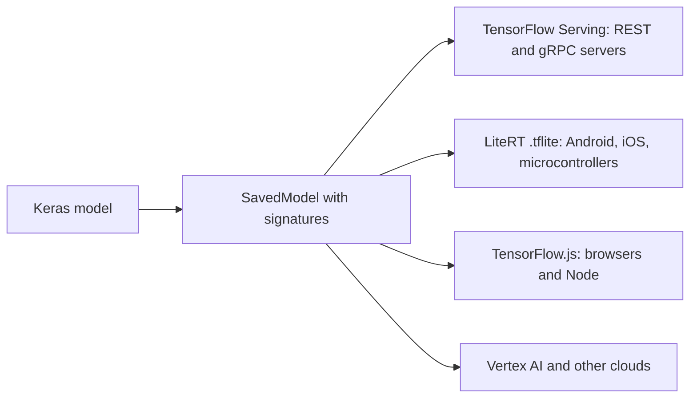

# Deploying: SavedModel signatures, serving and LiteRT

Deployment is where TensorFlow is strongest. One exported **SavedModel** feeds several targets.



## Export with a clear signature

```python
import os, json
os.environ["TF_CPP_MIN_LOG_LEVEL"] = "2"
import numpy as np
import tensorflow as tf
import keras
from keras import layers

keras.utils.set_random_seed(0)
inputs = keras.Input((8,), name="features")
x = layers.Normalization(mean=0.5, variance=1 / 12)(inputs)
outputs = layers.Dense(3, name="logits")(layers.Dense(16, activation="relu")(x))
model = keras.Model(inputs, outputs)

export = keras.export.ExportArchive()
export.track(model)
export.add_endpoint(
    name="predict",
    fn=lambda features: {"probabilities": tf.nn.softmax(model(features, training=False))},
    input_signature=[tf.TensorSpec(shape=(None, 8), dtype=tf.float32, name="features")],
)
export.write_out("classifier/1", verbose=False)                # TF Serving expects numbered version folders

loaded = tf.saved_model.load("classifier/1")
print(list(loaded.signatures.keys()) or "callable endpoint", loaded.predict(tf.zeros((2, 8)))["probabilities"].shape)
```

Putting softmax (and any preprocessing) in the endpoint means clients get exactly what they need.

## TensorFlow Serving

TF Serving is a C++ server for SavedModels, usually run as a Docker container:

```bash
docker run -p 8501:8501 -v "$PWD/classifier:/models/classifier" -e MODEL_NAME=classifier tensorflow/serving
```

It serves every numbered version in the folder (and switches to new versions without restarting). A REST request looks like:

```python
request_body = {"signature_name": "serving_default", "instances": [[0.1] * 8, [0.9] * 8]}
print(json.dumps(request_body)[:80], "... POST to http://localhost:8501/v1/models/classifier:predict")
```

For the REST API, export with `model.export(...)` or name your endpoint `serving_default`; Serving also offers gRPC, which is faster for large inputs.

## LiteRT (formerly TensorFlow Lite) for phones and edge devices

```python
converter = tf.lite.TFLiteConverter.from_saved_model("classifier/1", signature_keys=["predict"])
converter.optimizations = [tf.lite.Optimize.DEFAULT]           # dynamic-range quantization: int8 weights
tflite_bytes = converter.convert()
open("classifier.tflite", "wb").write(tflite_bytes)
print(f"tflite size: {len(tflite_bytes) / 1024:.1f} KB")

from ai_edge_litert.interpreter import Interpreter               # pip install ai-edge-litert
interpreter = Interpreter(model_content=tflite_bytes)
runner = interpreter.get_signature_runner("predict")
sample = np.random.rand(1, 8).astype("float32")
lite = runner(features=sample)["probabilities"]
full = loaded.predict(tf.constant(sample))["probabilities"].numpy()
print(np.abs(lite - full).max() < 1e-2, lite.round(3))
```

Google renamed TensorFlow Lite to **LiteRT** in 2024. The converter still lives in TensorFlow (`tf.lite.TFLiteConverter`), but `tf.lite.Interpreter` is deprecated: run models with the `ai-edge-litert` package, as above, which also works without installing TensorFlow (on a Raspberry Pi, for example). For full int8 quantization (faster on many phone chips), give the converter a `representative_dataset` of real inputs for calibration, and always re-check accuracy afterwards.

**TensorFlow.js:** `pip install tensorflowjs`, then `tensorflowjs_converter` turns a SavedModel into files a web page loads, so the model runs in the user's browser with no server.
