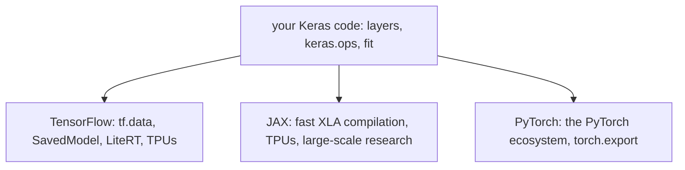

# Keras 3 across backends: TensorFlow, JAX and PyTorch

Keras 3 code written with `keras.layers` and `keras.ops` runs unchanged on three backends. You choose with an environment variable **before importing Keras**:

```bash
KERAS_BACKEND=jax python train.py        # or tensorflow (default), or torch
```



## Same code, three backends

```python
import os, subprocess, sys

script = r"""
import numpy as np, keras
from keras import layers, ops
keras.utils.set_random_seed(0)
x = np.random.rand(256, 8).astype("float32"); y = (x.sum(1) > 4).astype("int32")
model = keras.Sequential([keras.Input((8,)), layers.Dense(32, activation="relu"), layers.Dense(2)])
model.compile("adam", keras.losses.SparseCategoricalCrossentropy(from_logits=True), metrics=["accuracy"])
model.fit(x, y, epochs=20, verbose=0)
print(keras.backend.backend(), round(model.evaluate(x, y, verbose=0)[1], 2), type(ops.convert_to_tensor(x)).__module__)
"""
for backend in ["tensorflow", "jax", "torch"]:
    env = {**os.environ, "KERAS_BACKEND": backend, "TF_CPP_MIN_LOG_LEVEL": "3"}
    out = subprocess.run([sys.executable, "-c", script], env=env, capture_output=True, text=True)
    print(out.stdout.strip() or out.stderr[-200:])
```

Each run prints its backend, a similar accuracy, and the backend's own tensor type.

## Writing backend-agnostic code

- Use `keras.ops` (a NumPy-like API: `ops.matmul`, `ops.softmax`, `ops.where`...) instead of `tf.*`, `jnp.*` or `torch.*` inside layers and losses.
- Use `keras.random` with a `SeedGenerator` for randomness.
- Data can come from NumPy arrays, `tf.data`, PyTorch `DataLoader`s or Python generators, on any backend.
- Saved `.keras` files load on any backend, so a model trained with JAX can be served from a TensorFlow SavedModel.

```python
import numpy as np
import keras
from keras import ops

logits = np.array([[2.0, 1.0, 0.1]], dtype="float32")
print(ops.convert_to_numpy(ops.softmax(logits)).round(3), ops.convert_to_numpy(ops.argmax(logits, axis=-1)))
```

## Mixing with native code

On the PyTorch backend, a Keras model **is** a `torch.nn.Module`, so it can join a PyTorch training loop; on JAX, Keras offers a stateless API (`model.stateless_call`) for use inside `jax.jit` and `jax.grad`. That makes Keras a reasonable shared layer for teams whose members prefer different frameworks.

## Choosing a backend

| Prefer | When |
|---|---|
| TensorFlow | you deploy with TF Serving, LiteRT or TensorFlow.js, or your team's pipelines use tf.data |
| JAX | speed matters most, you use TPUs, or you train very large models |
| PyTorch | you need PyTorch libraries or want to combine with PyTorch code |
