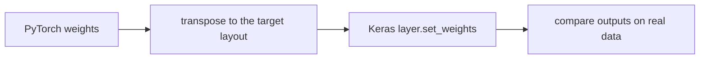

# PyTorch or TensorFlow? Porting between them

## How they compare today

| | PyTorch | TensorFlow / Keras |
|---|---|---|
| Research and new papers | the large majority | a minority |
| Pretrained models (Hugging Face) | almost all | some; many via Keras or conversion |
| Large-scale LLM training | dominant (FSDP, torchtitan), with JAX at some labs | mostly JAX instead |
| Mobile and edge | ExecuTorch | LiteRT, very mature |
| Browser | ONNX Runtime Web | TensorFlow.js |
| Serving | TorchServe successors, Triton, vLLM, ONNX Runtime | TF Serving, very mature |
| High-level training | Lightning, Hugging Face Trainer | Keras `fit` built in |

A practical answer for a job seeker: learn PyTorch first for depth, and know Keras well enough to work in a TensorFlow team. The concepts (tensors, autograd, layers, loops, data pipelines, export) are the same.

## Translating the vocabulary

| PyTorch | Keras / TensorFlow |
|---|---|
| `nn.Module`, `forward` | `keras.Model` or `Layer`, `call` |
| `nn.Linear(in, out)` | `layers.Dense(out)` (input size inferred) |
| `loss.backward(); opt.step()` | `tape.gradient(...)`; `opt.apply(...)`, or just `fit` |
| `model.train()` / `model.eval()` | `training=True/False` argument |
| `Dataset`, `DataLoader` | `tf.data.Dataset` |
| `state_dict` | `get_weights()` / `.keras` file |
| images (N, C, H, W) | images (N, H, W, C) |

## Moving weights from PyTorch to Keras

Layers store weights in different layouts. A PyTorch `Linear` weight is (out, in); a Keras `Dense` kernel is (in, out): transpose it.

```python
import os
os.environ["TF_CPP_MIN_LOG_LEVEL"] = "2"
import numpy as np
import torch
import keras

torch.manual_seed(0)
pt = torch.nn.Sequential(torch.nn.Linear(4, 8), torch.nn.ReLU(), torch.nn.Linear(8, 3)).eval()

ks = keras.Sequential([keras.Input((4,)), keras.layers.Dense(8, activation="relu"), keras.layers.Dense(3)])
for pt_layer, k_layer in zip([pt[0], pt[2]], [ks.layers[0], ks.layers[1]]):
    k_layer.set_weights([pt_layer.weight.detach().numpy().T, pt_layer.bias.detach().numpy()])

x = np.random.rand(5, 4).astype("float32")
with torch.no_grad():
    a = pt(torch.from_numpy(x)).numpy()
b = ks.predict(x, verbose=0)
print(np.abs(a - b).max() < 1e-5)
```

Convolutions need more care: a PyTorch `Conv2d` weight is (out, in, kh, kw); a Keras `Conv2D` kernel is (kh, kw, in, out), so `w.transpose(2, 3, 1, 0)`, and inputs move from channels-first to channels-last. After any port, **compare outputs on real inputs**, layer by layer if they differ.



The **ONNX** route (export from PyTorch, run in ONNX Runtime) avoids porting entirely when you only need inference.
