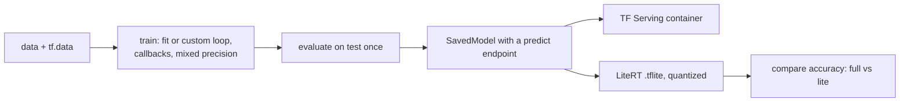

# Capstone: train, export and ship a TensorFlow model

Bring both parts together in a project you could show an employer: a model trained with a proper pipeline, exported once, and shipped to a server and a phone format, with measured accuracy at every step.



## A checklist that runs

```python
import os
os.environ["TF_CPP_MIN_LOG_LEVEL"] = "2"
import numpy as np
import tensorflow as tf
import keras
from keras import layers
from sklearn.datasets import load_digits
from sklearn.model_selection import train_test_split

keras.utils.set_random_seed(0)
d = load_digits()
X = d.images.astype("float32")[..., None]
y = d.target.astype("int32")
X_tr, X_te, y_tr, y_te = train_test_split(X, y, test_size=0.2, random_state=0, stratify=y)

inp = keras.Input((8, 8, 1), name="pixels")
x = layers.Rescaling(1 / 16.0)(inp)
x = layers.Conv2D(32, 3, padding="same", activation="relu")(x)
x = layers.MaxPooling2D()(x)
x = layers.Conv2D(64, 3, padding="same", activation="relu")(x)
x = layers.GlobalAveragePooling2D()(x)
model = keras.Model(inp, layers.Dense(10)(x))
model.compile(keras.optimizers.Adam(2e-3), keras.losses.SparseCategoricalCrossentropy(from_logits=True), metrics=["accuracy"])
model.fit(X_tr, y_tr, validation_split=0.15, epochs=40, batch_size=64, verbose=0,
          callbacks=[keras.callbacks.EarlyStopping(patience=6, restore_best_weights=True)])
keras_acc = model.evaluate(X_te, y_te, verbose=0)[1]

archive = keras.export.ExportArchive()
archive.track(model)
archive.add_endpoint("predict", lambda pixels: {"probs": tf.nn.softmax(model(pixels, training=False))},
                     input_signature=[tf.TensorSpec((None, 8, 8, 1), tf.float32, name="pixels")])
archive.write_out("digits_service/1", verbose=False)

conv = tf.lite.TFLiteConverter.from_saved_model("digits_service/1", signature_keys=["predict"])
conv.optimizations = [tf.lite.Optimize.DEFAULT]
from ai_edge_litert.interpreter import Interpreter
lite = Interpreter(model_content=conv.convert()).get_signature_runner("predict")
lite_pred = np.array([lite(pixels=X_te[i:i + 1])["probs"][0].argmax() for i in range(len(X_te))])
lite_acc = (lite_pred == y_te).mean()

print(f"Keras test accuracy {keras_acc:.3f} | LiteRT int8-weight accuracy {lite_acc:.3f}")
print(f"SavedModel size {sum(os.path.getsize(os.path.join(r, f)) for r, _, fs in os.walk('digits_service') for f in fs) / 1024:.0f} KB")
```

## What to hand in

1. A repository with `train.py`, `export.py`, a small `client.py` that calls TF Serving's REST API, and a `README.md`.
2. A results table: accuracy of the Keras model, the SavedModel through Serving, and the LiteRT model; model sizes; latency on your machine.
3. One paragraph on a decision you made and why (an augmentation, the quantization mode, the input signature).

## Going further

- **KerasHub** for pretrained LLMs and vision models as Keras layers, with LoRA fine-tuning built in.
- **TFX** for full production ML pipelines (data validation, training, model analysis, pushing to serving).
- The **Hugging Face and ecosystem** course in this series for the PyTorch-centred world of pretrained models.

## Optional videos

The lesson above is complete on its own. These go deeper, if you like learning by watching.

**Learn TensorFlow and Deep Learning fundamentals, part 1 (Daniel Bourke)**

https://www.youtube.com/watch?v=tpCFfeUEGs8
